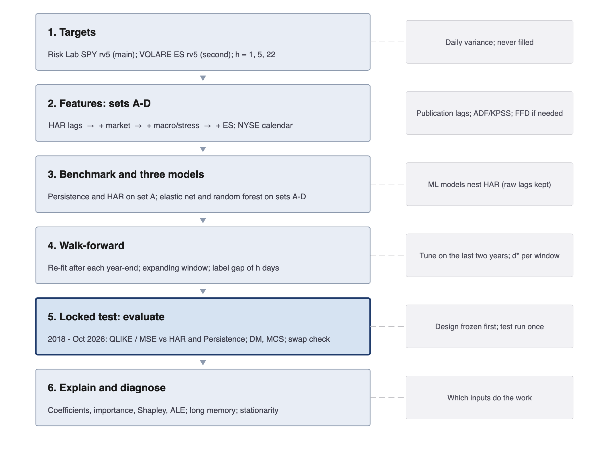
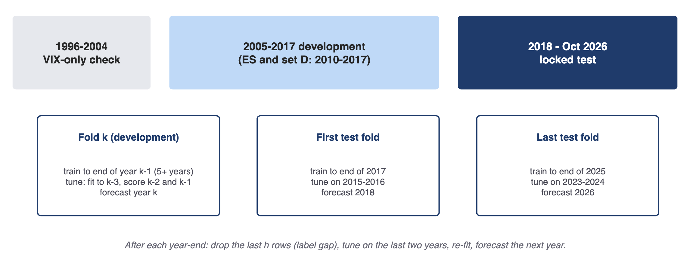
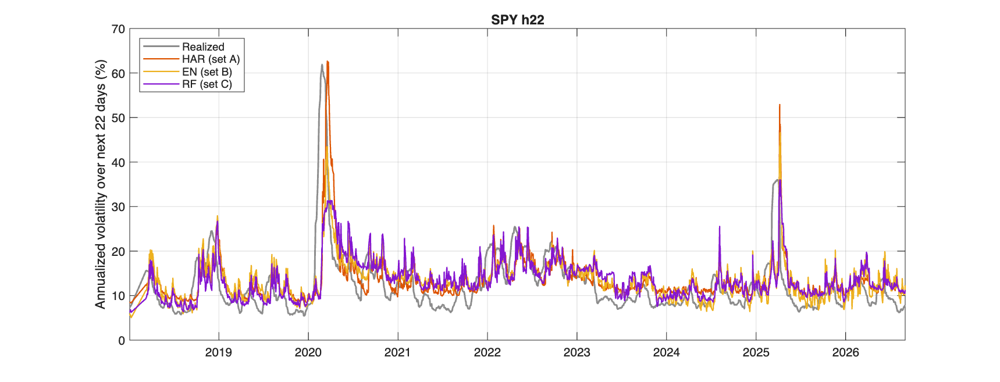
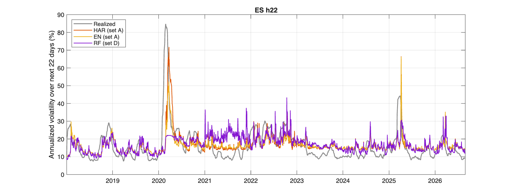
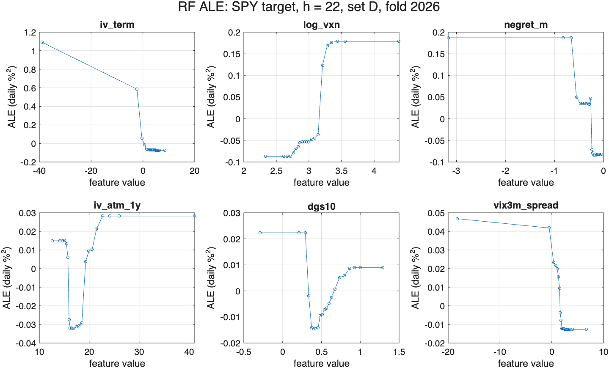

::: {custom-style="Block Text"}
**Status (21 October 2026; implements proposal v5.4).** Everything in the proposal is implemented in one MATLAB pipeline and runs end to end. That covers data alignment and publication lags, the stationarity and long-memory diagnostics, fractional differencing chosen inside each training window, the Persistence benchmark, all three models on all four feature sets at every horizon for both targets, the walk-forward engine, the full evaluation suite and every robustness check. As proposal Section 5 prescribes, every setting was frozen on the development results (git tag `design-freeze`) before the 2018 – October 2026 test was run, once. Section 7 summarizes the development period that fixed the design. Section 8 reports the locked test, which is the basis for every conclusion.
:::

# 1. Introduction and Motivation

Volatility sets the price of every option, the size of risk limits and how much a fund can safely invest. It is not observed directly. It can be measured after the fact by summing squared intraday returns, which gives **realized variance (RV)** (Andersen, Bollerslev, Diebold & Labys, 2003). For day $t$, with $M$ intraday returns $r_{t,i}$:

$$\mathrm{RV}_t=\sum_{i=1}^{M} r_{t,i}^{2}$$

EQNUM(1)

Five-minute sampling is the standard compromise between information and microstructure noise, and it is the frequency used by all three reference papers.

Forecasting S&P 500 realized volatility is **crucial for volatility trading with S&P 500 options, including variance swaps**. A one-month variance-swap strike is approximately $\mathrm{VIX}^2$. Anyone who forecasts realized variance better than that price knows when volatility looks cheap or expensive. The same forecasts drive volatility-targeting funds, value-at-risk limits and margin models.

Two structural facts motivate a machine-learning comparison:

- **HAR is a strong but linear baseline.** Corsi's (2009) model predicts future RV from its daily, weekly and monthly averages. Three regressors are enough to approximate the long memory of volatility (Section 4.3). The reference papers disagree on whether ML beats it:
  - Kılıç (2026) finds that ML sometimes improves on HAR but does not systematically beat a broader econometric set.
  - Christensen, Siggaard & Veliyev (2023) find that ML does beat the HAR family, especially at longer horizons.
  - Rahimikia & Poon (2026) find that ML wins on most days, but HAR does better on extreme-volatility days.
- **Richer information is available, but only some of it is RV history.** Option-implied volatility, rates, macro and financial-stress indices can all enter as features. So can VOLARE E-mini futures decompositions (jumps, semivariances, quarticity), available from late 2009. Linear models struggle with many correlated inputs; trees can capture interactions and regimes. Many of these inputs are close to unit-root processes, which is why the design tests them and, where needed, fractionally differentiates them.

Our contribution is deliberately narrow:

- **Three models:** HAR, the elastic net and the random forest, all on the same horizons and walk-forward design.
- **A naive Persistence benchmark** ("tomorrow looks like today") that every forecast must beat.
- **HAR as the fixed benchmark** on its own lags (set A).
- **Four nested feature sets for the two ML models.** This lets us ask whether they beat HAR, and also whether the non-linear model extracts more than the linear one from the implied-vol, macro/stress and ES features.

**How to read this report.**

- Sections 2–6 follow the proposal's structure and give every definition and formula needed to reproduce the work.
- Section 7 summarizes the development-period results on which the design was frozen.
- Section 8 reports the locked 2018–2026 test.
- Section 9 relates the results to the reference papers.
- Sections 10–12 cover applications, risks and limitations, and the implementation.
- The appendices give a feature dictionary, a line-by-line compliance check against proposal v5.4, the output files and a glossary.

# 2. Research Questions and Hypotheses

| Research question | Hypothesis | How it is tested |
|--------------------------------|--------------------------------|--------------------------------|
| **RQ1.** With volatility history alone (set A), do the elastic net or random forest beat HAR (and the naive Persistence benchmark) out of sample? | At $h=1$ gains are small; they grow at $h=5$ and $h=22$, consistent with Christensen et al. (2023). | Pairwise DM tests and the MCS on set A (Persistence, HAR, EN, RF), by horizon. |
| **RQ2.** Does the random forest get more improvement from implied-vol, macro/stress and ES features than the elastic net? | The forest's non-linearity and interactions let it extract more from sets B–D, so its loss reduction from set A exceeds the elastic net's. | Per horizon and target, the change in QLIKE/MSE from A→B, A→C and A→D for RF vs EN. A DM test on the difference-in-differences of losses (eq. 15), plus the MCS. |
| **RQ3.** Does the full-session ES target change the economic conclusion relative to SPY intraday RV? | ES captures about 95% of close-to-close variance (SPY RV about 56%), so ES-target forecasts should align better with a variance-swap payoff. | The pipeline is repeated on VOLARE ES (2010–2026), and the variance-swap comparison is run on both targets. |

The three questions are separable: a null finding on any one of them is still useful. In particular, we do not assume that implied volatility helps:

- the set A → B comparison tests whether implied-vol features add forecasting power;
- the set-B coefficients and importances (Section 8.7) show which part of the block does the work.

**Success criterion** (proposal Section 6). On the locked test, the design counts as successful if both of the following hold:

1. the elastic net or random forest has statistically lower QLIKE than HAR at one horizon or more, and the MCS includes the winner;
2. the variance-swap check is directionally consistent.

For RQ2 the question is answered either way, by the sign and significance of the RF-minus-EN gain. A well-documented failure to beat HAR is also a legitimate outcome (Kılıç, 2026). **Persistence is the floor:** a forecast that does not beat it is reported as uninformative at that horizon. The pipeline computes all of this automatically (Section 8.10).

# 3. Data

The team's cleaned inputs are read unchanged from the project's data folder; every column is described in the companion *Data Description*. No file is simply "five-minute data". Each delivers daily measures built from a stated intraday sampling frequency, or daily and weekly macro series.

| File (source) | Sampling and measure | Coverage | Role in the project |
|--------------------------|----------------------------------|------------------|----------------------|
| Risk Lab SPY (Dacheng Xiu) | Daily annualized SPY volatility from intraday trades, regular session: rv5 (5-min subsampled), rv15, QMLE | 2 Jan 1996 – 5 Oct 2026; 7,707 days | **Main target** (rv5); set-A lags; rv15 and QMLE as robustness |
| VOLARE ES | Daily variances from 1-second ES mid-quotes over the Globex session (18:00–17:00 ET): RV, bipower, ± semivariances, quarticity at 1-min and 5-min; realized kernel | 30 Sep 2009 – 30 Sep 2026; 4,397 rows | **Second target** (rv5); set D; rv1 and kernel as robustness |
| Oxford-Man Realized Library (archived) | Daily S&P 500 index rv5, bipower, negative semivariance, cash session | 3 Jan 2000 – 25 Feb 2022 | Cross-check of the SPY target (correlation 0.968 over 4,293 common days, reproduced by `data_audit.m`); pre-2010 jump robustness |
| Bloomberg IV surface | Daily SPX implied vol, 7 moneyness levels × 6 tenors (1–24 months) | 3 Jan 2005 – 1 Oct 2026; 5,471 days | Set B: ATM level, skew, term slope; fixes the 2005 sample start |
| Cboe indices | Daily VIX, VIX9D, VIX3M, VIX6M, VIX1Y, SKEW | VIX from 1990; VIX3M from Sep 2009; VIX9D from Jan 2011 | Set B (log VIX, VRP, term structure); VIX² is the variance-swap strike |
| `features_daily.csv`: market | Daily S&P 500 OHLC and returns; Hang Seng; VVIX, VXN, VXD, RVX | 1990 – 6 Oct 2026; VVIX from Mar 2006 | Set B; Hang Seng in set C |
| `features_daily.csv`: rates | Daily 10Y−3M spread and 10Y yield (FRED) | 1990 – Oct 2026 | Set B |
| `features_daily.csv`: macro and stress | EPU, CISS, real-time ADS, news sentiment, GPR (daily); NFCI, STLFSI4 (weekly) | 1990 – Oct 2026; real-time ADS from Dec 2008 | Set C |
| `features_daily.csv`: Fama–French | Daily factor returns, published about a month late | to Aug 2026 | Not used (not available in real time) |
| NYSE calendar | NYSE sessions and early closes | 1990 – 6 Oct 2026 (9,258 sessions) | Master calendar for alignment and FFD; early-close flag in set C |

**About the calendar.** We take the NYSE calendar from the dates of `features_daily.csv`; the data team verified these sessions are identical to the NYSE calendar (special closures excluded). Proposal v5.4 names a separate calendar file (`nyse_trading_calendar_1990_2026.csv`, 9,318 sessions to end-2026) that is not in the data folder. It would only add sessions after 6 October 2026, which no forecast uses.

## 3.1 Sample design

| Sample | Dates | Size |
|---|---|---|
| Main sample | January 2005 – 5 October 2026 (starts when the implied-vol surface begins) | 5,440 Risk Lab days |
| **Development** | **2005–2017** | 3,272 days |
| **Locked test** | **2 January 2018 – 5 October 2026** | 2,201 sessions; 2,168 with a Risk Lab value |
| ES models and set D: development | 2010–2017 | 2,013 NYSE days |
| ES models and set D: locked test | Same test, through 30 September 2026 | — |

Pre-2005 Risk Lab data enter only a VIX-only robustness check.

## 3.2 Missing data, holidays and staggered starts

- **Calendar.** Every series is aligned to the NYSE trading-day calendar, and FFD (Section 4.3) is computed over NYSE sessions. Weekends and exchange holidays are therefore not missing observations. Weekly NFCI and STLFSI4 are placed on their release date and held until the next release.
- **Late starts.** A series that begins after the sample start has its features, and its FFD transform, only from its first date plus the FFD window $\ell_\tau$. Earlier rows are unavailable for that feature. This applies to:
  - VVIX (Mar 2006);
  - real-time ADS (Dec 2008);
  - VIX3M (Sep 2009);
  - the ES/set-D measures (Sep 2009);
  - VIX9D (Jan 2011).

  Comparisons across sets use common days only.
- **Missing trading days.** We reproduced the proposal's counts exactly from the raw files (`data_audit.m`):
  - Risk Lab SPY lacks 33 of the 5,473 NYSE sessions from 3 Jan 2005 to 5 Oct 2026, all in the test period (5–9 Feb 2018 and 28 isolated days). Development has none, and ES has no missing NYSE session.
  - Within their coverage, some inputs also lack values on NYSE days: Hang Seng 251 (Hong Kong holidays), T10Y3M and DGS10 39 (bond-market holidays), VVIX 61 (59 in 2006), RVX 7, VXD 3.
  - Targets are never filled, and ES is never a stand-in for a missing SPY target.

| Horizon | Test origins | Target window has a missing day | More than 20% of target window missing | 22-day lag window has a missing day |
|----------|----------|----------|----------|----------|
| $h=1$ | 2,200 | 33 | 33 | 531 |
| $h=5$ | 2,196 | 143 | 12 | 527 |
| $h=22$ | 2,179 | 532 | 19 | 510 |

*Affected Risk Lab SPY test origins (reproduced from the raw files; matches proposal v5.4, Section 3.2).*

- **Treatment, frozen before the test.** Proposal v5.4 left the treatment of missing days to be decided once the counts were measured. The team froze four rules, all switches in `rv_config.m` / `build_design.m`:
  1. a multi-day target is dropped if more than 20% of its window is missing;
  2. weekly and monthly RV lags are built from the observed days if at least 80% of the window is present;
  3. an origin whose own $\mathrm{RV}_t$ is missing is dropped, for every model alike;
  4. on a day when a daily input has no value (e.g. a bond holiday), its last published value is used for at most 5 sessions (10 for weekly series), which uses no future information.

  None of these affects the development results, because development has no missing Risk Lab days. A **strict** alternative is run as a robustness check (scenario `strict`): any origin whose target or 22-day lag window touches a missing day is dropped. On the test this removes about a quarter of the SPY 22-day origins (2,160 → 1,647).
- **ES holiday sessions.** VOLARE has 121 rows on non-NYSE dates (abbreviated Globex holiday sessions). Their variance is rolled into the next NYSE day, so each target spans one close-to-close interval; dropping them is a robustness check (scenario `holdrop`).

## 3.3 Limitations

- **VOLARE coverage.** VOLARE has no SPY or index series; ES is its only S&P 500 instrument. It is refreshed monthly, and ES ends 30 September 2026.
- **ES session timing.** The ES day is inferred as 18:00–17:00 ET, and roll dates are not flagged.
- **Missing feature types.** We lack limit-order-book and news-text features (central to Rahimikia & Poon) and the firm-level implied vol used by Christensen et al.
- **Overnight move.** SPY intraday RV omits the overnight move, so it covers only about 56% of close-to-close variance. ES captures about 95%, which is why it is the preferred target for the variance-swap check.

# 4. Methodology

Forecasts are produced at the close of each NYSE day $t$ for horizons $h\in\{1,5,22\}$ trading days. Figure 1 summarizes the pipeline.

{width=74%}

## 4.1 Targets

For SPY, Risk Lab reports an annualized volatility $\sigma^{\mathrm{rv5}}_t$. We convert it to a daily variance, held in %² (i.e. decimal × $10^4$), and form horizon averages:

$$\mathrm{RV}^{\mathrm{SPY}}_t=\frac{(\sigma^{\mathrm{rv5}}_t)^2}{252},\qquad \mathrm{RV}_{t+1:t+h}=\frac{1}{h}\sum_{k=1}^{h}\mathrm{RV}_{t+k}$$

EQNUM(2)

For ES, VOLARE rv5 is already a daily variance of 5-minute mid-quote returns over the Globex session. Any linear forecast below the training-window minimum of daily RV is floored at that minimum (Christensen et al., 2023).

## 4.2 Nested feature sets

| Set | Contents (exact features: Appendix A) | First date |
|--------------|-----------------------------------------------------------|------------------|
| **A: HAR lags** | Daily, weekly (5-day) and monthly (22-day) averages of the target's own RV | Jan 2005 (SPY), Jan 2010 (ES) |
| **B: + market** | A + negative-return averages (d/w/m), Parkinson range (d/w), log VIX, VRP $=\mathrm{VIX}^2/252-\mathrm{RV}^{(m)}$, IV surface (ATM 1M/3M/1Y, 1M skew, 1Y−1M term slope), 10Y yield and 10Y−3M spread, VVIX, SKEW, VIX9D−VIX, VIX3M−VIX, log VXN, log RVX | Jan 2005; VVIX, VIX3M, VIX9D from their start + $\ell_\tau$ |
| **C: + macro/stress** | B + real-time ADS, log EPU, news sentiment, log GPR, CISS, NFCI, STLFSI4, squared Hang Seng return, calendar flags | Jan 2005; real-time ADS from Dec 2008 |
| **D: + ES measures** | C + ES continuous/jump averages (d/w/m), ± semivariances (d/w), $\sqrt{\mathrm{RQ}}\times\mathrm{RV}$, realized kernel, overnight variance $\max(\mathrm{ES}-\mathrm{SPY},0)$ (d/w) | Jan 2010 |

How the sets are used:

- **HAR** is estimated on set A only.
- **The elastic net on set A** is a regularized HAR.
- **On sets B–D,** both ML models receive the HAR lags plus the extras, so they nest HAR.
- **Jump, semivariance and quarticity measures** enter **as features**, not as separate HAR-J / SHAR / HARQ models.

From the VOLARE bipower variation $\mathrm{BV}_t$ and signed semivariances, the set-D inputs are:

$$J_t=\max(\mathrm{RV}_t-\mathrm{BV}_t,\,0),\quad C_t=\mathrm{RV}_t-J_t,\quad \mathrm{RS}^{+}_t=\sum_{i} r^{2}_{t,i}\mathbf{1}\{r_{t,i}>0\},\quad \mathrm{RS}^{-}_t=\sum_{i} r^{2}_{t,i}\mathbf{1}\{r_{t,i}<0\}$$

EQNUM(3)

## 4.3 Stationarity and long memory

**Why it matters.** Both ML models learn a mapping on the training window and apply it to later years, so their inputs must behave similarly in both. Two kinds of input cause trouble:

- VIX, rate and stress levels are close to unit-root processes;
- RV is highly persistent, with slowly decaying autocorrelations (long memory).

When an input drifts, its test values can fall outside the training range. A random forest cannot extrapolate beyond the leaf values it has seen. Elastic-net coefficients fitted to trending, correlated levels change from one re-estimation to the next.

**The fix.** Integer differencing restores stationarity but removes the memory that HAR exploits. **Fractional differencing** (López de Prado, 2018, ch. 5) is the middle ground. With the lag operator $L$ ($L^kX_t=X_{t-k}$) and order $d\ge0$:

$$(1-L)^dX_t=\sum_{k=0}^{\infty}w_kX_{t-k},\qquad w_0=1,\quad w_k=-w_{k-1}\frac{d-k+1}{k}\ (k\ge1)$$

EQNUM(4)

For $d=1$ the weights are $\{1,-1,0,\dots\}$ (ordinary differences). For $0<d<1$ they decay slowly, so part of the memory survives. The fixed-width-window version (FFD) truncates the weights once they fall below a threshold $\tau$, so every observation is built from the same window. The order $d$ is set to the smallest grid value that passes the ADF test at 95%:

$$\widetilde X_t(d)=\sum_{k=0}^{\ell_\tau}w_kX_{t-k},\qquad \ell_\tau=\max\{k:|w_k|\ge\tau\},\qquad d^*=\min\{d\in\mathcal G:\mathrm{ADF}(\widetilde X(d))<c_{0.95}\}$$

EQNUM(5)

**Implementation.**

- **Grid and threshold.** $\mathcal G=\{0,0.05,\dots,1\}$ and $\tau=10^{-3}$, fixed in advance. This gives windows of at most about 70 sessions.
- **The tests.** ADF uses a constant, the Schwert lag length and the MacKinnon 5% critical value. KPSS tests level stationarity with a Bartlett long-run variance and the 5% critical value 0.463. Both are coded directly, because MATLAB's `adftest` and `kpsstest` belong to the Econometrics Toolbox, which is not installed.
- **Which inputs.** Every input except the raw HAR lags and the two calendar flags is a candidate. Each candidate's $d^*$ is chosen on the training window's data only, and re-chosen at every walk-forward re-fit.
- **What stays raw.** The target is never transformed, and the same raw HAR lags enter both ML models, so they still nest HAR.
- **Robustness.** An FFD variant in which the ML lag block is replaced by FFD log RV is a robustness check.

**Diagnosis on the development sample** (2005–2017; 2010–2017 for ES and set D; `stationarity.m`). ADF and KPSS were run on both targets and every input, in levels and, for positive series, in logs: 74 tests in all.

| Verdict | Count | Series |
|----------------------|------|------------------------------------------------------------|
| ADF rejects a unit root **and** KPSS rejects stationarity ("persistent / long memory") | 65 | Both targets and the HAR lags; returns, ranges, VIX, VRP, skew, term slope, VVIX, SKEW, VIX9D and VIX3M spreads, cross-market IV; ADS, EPU, news, GPR, NFCI, STLFSI4; every ES measure |
| ADF cannot reject a unit root | 8 | ATM 3M and 1Y implied vol, 10Y−3M spread, 10Y yield, CISS (level) |
| Stationary on both tests | 1 | $\sqrt{\mathrm{RQ}}\times\mathrm{RV}$ |

The dominant pattern, where ADF rejects but KPSS still rejects, is exactly what Bhatti (2026) describes for long-memory series. ADF declares stationarity while KPSS keeps rejecting under strong persistence, and neither identifies the minimal $d$.

Under eq. 5, only the unit-root inputs are transformed. Their $d^*$ and retained correlation $\rho=\mathrm{corr}(\widetilde X(d^*),X)$ are:

| Input | $d^*$ (full development sample) | $\rho$ (memory retained) | Inside the walk-forward (set-D folds): $d^*$ range, share of folds differenced |
|------------------|------|------|------------------------------------------|
| ATM 3M implied vol | 0.10 | 0.992 | 0–0.10, 66% |
| ATM 1Y implied vol | 0.20 | 0.969 | 0.10–0.15, 100% |
| 10Y−3M spread | 0.25 | 0.968 | 0.15–0.25, 100% |
| 10Y yield | 0.30 | 0.960 | 0.15–0.25, 100% |
| CISS | 0.10 | 0.995 | 0–0.15, 33% |
| ATM 1M IV, log RVX, STLFSI4 | 0 | 1 | 0–0.10 in some folds, 33% |

Fractional differencing therefore changes very little here. The orders are small, and the transformed inputs keep 96–99.5% correlation with the originals. What it removes is the slow drift in rates and long-dated implied vol.

**Memory of RV.** We estimate $d$ in two ways:

- **Local Whittle** (Robinson, 1995), which minimizes over the first $m$ Fourier frequencies $\lambda_j$, with periodogram $I(\lambda_j)$:

$$\hat d=\arg\min_{d}\Bigl[\ln\Bigl(\tfrac{1}{m}\sum_{j=1}^{m}\lambda_j^{2d}I(\lambda_j)\Bigr)-\tfrac{2d}{m}\sum_{j=1}^{m}\ln\lambda_j\Bigr],\qquad \mathrm{se}(\hat d)=\tfrac{1}{2\sqrt m}$$

EQNUM(6)

- **Bhatti's detectability-boundary estimator $d_{\mathrm{LTM}}$,** as a cross-check. For each $d$ on a grid the series is fractionally differenced, and $\ln|\hat\rho(k)|$ is regressed on $\ln k$ over lags 20 to $K_2\le200$. $d_{\mathrm{LTM}}$ is the $d$ with the largest regression RMSE. In his Monte Carlo the boundary sits below the true order by about $d_0(T)=5.81\,T^{-0.367}$, and short windows bias it downward.

| Series (development data) | $T$ | Local Whittle $\hat d$, $m=T^{0.5}$ | Local Whittle $\hat d$, $m=T^{0.65}$ | $d_{\mathrm{LTM}}$ | $d_0(T)$ |
|--------------------|------|----------|----------|------|------|
| SPY RV 1996–2017, level | 5,539 | 0.37 (0.06) | 0.53 (0.03) | 0.50 | 0.25 |
| SPY RV 1996–2017, log | 5,539 | 0.61 (0.06) | 0.60 (0.03) | 0.92 | 0.25 |
| SPY RV 2005–2017, level | 3,272 | 0.52 (0.07) | 0.63 (0.04) | 0.44 | 0.30 |
| SPY RV 2005–2017, log | 3,272 | 0.61 (0.07) | 0.56 (0.04) | 0.40 | 0.30 |
| ES RV 2010–2017, level | 2,013 | 0.47 (0.08) | 0.40 (0.04) | 0.08 | 0.36 |
| ES RV 2010–2017, log | 2,013 | 0.56 (0.08) | 0.57 (0.04) | 0.42 | 0.36 |

What the estimates say:

- **Local Whittle:** $d$ is between 0.37 and 0.63 for every series. That is classic long memory, many standard errors from zero.
- **$d_{\mathrm{LTM}}$ is erratic:**
  - 0.40–0.44 on the 2005–2017 SPY window (about 0.7 after adding Bhatti's offset);
  - 0.92 for log RV over 1996–2017;
  - 0.08 for ES levels on 2,013 observations, close to his 2,000-observation minimum.

  As the proposal anticipates, it is reported as a cross-check and not used to choose $d$.
- **Implication:** volatility memory decays over months. That is why HAR works, and why every ML set keeps the raw HAR lags.

{width=100%}

## 4.4 Benchmarks and comparison grid

Two simple benchmarks sit beside the three models; neither is estimated.

- **Persistence** is the naive benchmark: the coming $h$-day average equals the latest $h$-day average of realized variance. For $h=1$, tomorrow's forecast is today's variance:

$$\widehat{\mathrm{RV}}^{\mathrm P}_{t+1:t+h}=\frac{1}{h}\sum_{j=0}^{h-1}\mathrm{RV}_{t-j},\qquad \widehat{\mathrm{RV}}^{\mathrm P}_{t+1}=\mathrm{RV}_t$$

EQNUM(7)

  It is the floor every forecast must clear, including HAR.
- **The VIX-implied strike $\mathrm{VIX}^2$** is the market benchmark, used only in the variance-swap check.

| Forecast | Type | Inputs | Estimation | Owner | Code |
|----------|----------|----------|------------------|------|----------|
| Persistence | Naive benchmark | Latest RV only | None | James | `fit_persistence.m` |
| HAR | Model 1 | Set A | OLS per horizon | James | `fit_har.m` |
| Elastic net | Model 2 | Sets A–D | Penalized regression, tuned | Aryan | `fit_en.m` |
| Random forest | Model 3 | Sets A–D | Bagged trees, tuned | Aryan | `fit_rf.m` |
| VIX² strike | Market benchmark | VIX | None; variance-swap check only | All | `evaluate_phase.m` |

## 4.5 Model 1: HAR

There is one ordinary-least-squares specification per horizon, on the variance scale (Corsi, 2009):

$$\begin{aligned}\mathrm{RV}_{t+1:t+h}&=\beta_0+\beta_d\,\mathrm{RV}_t+\beta_w\,\mathrm{RV}^{(w)}_t+\beta_m\,\mathrm{RV}^{(m)}_t+\varepsilon_{t+h},\\ \mathrm{RV}^{(w)}_t&=\frac{1}{5}\sum_{j=0}^{4}\mathrm{RV}_{t-j},\qquad \mathrm{RV}^{(m)}_t=\frac{1}{22}\sum_{j=0}^{21}\mathrm{RV}_{t-j}\end{aligned}$$

EQNUM(8)

It has four parameters, estimates in milliseconds, and is the literature's standard benchmark.

## 4.6 Model 2: Elastic net

The elastic net is a penalized linear regression on the active feature set $\mathbf{x}_t$, with target $y_{t+h}=\mathrm{RV}_{t+1:t+h}$:

$$\min_{\beta_0,\boldsymbol\beta}\;\frac{1}{2N}\sum_{t=1}^{N}\bigl(y_{t+h}-\beta_0-\mathbf{x}_t^{\top}\boldsymbol\beta\bigr)^2+\lambda\Bigl[\alpha\lVert\boldsymbol\beta\rVert_1+\frac{1-\alpha}{2}\lVert\boldsymbol\beta\rVert_2^2\Bigr]$$

EQNUM(9)

- **The mixing parameter $\alpha$** blends ridge ($\alpha=0$) and lasso ($\alpha=1$).
- **Tuning.** Both $\alpha\in\{0,0.1,0.25,0.5,0.75,0.9,1\}$ and a 50-point $\lambda$ path are tuned on validation QLIKE, so ridge and lasso are special cases rather than separate models.
- **Implementation.** MATLAB's `lasso` handles $\alpha>0$; the ridge case is solved in closed form in the same scaling. Predictors are standardized with training-window statistics only.
- **Reporting.** Following Kılıç (2026), the selected coefficients are reported as a result (Section 8.7).

## 4.7 Model 3: Random forest

The random forest averages many regression trees. Each tree is grown on a bootstrap sample, with a random subset of predictors tried at every split (MATLAB `TreeBagger`). Trees capture interactions and regimes, need little tuning and supply impurity-based importance. With $B$ trees $T_b$:

$$\widehat{\mathrm{RV}}_{t+1:t+h}=\frac{1}{B}\sum_{b=1}^{B}T_b(\mathbf{x}_t)$$

EQNUM(10)

- **Tuning.** Bayesian optimization (`bayesopt`, 12 evaluations of 100-tree forests on validation QLIKE) chooses the minimum leaf size (1–200) and the number of predictors per split (1 to $p$).
- **Final forest:** 300 trees.
- **A key limitation.** A forest predicts averages of training targets, so its forecasts are always positive. It also cannot forecast outside the range of volatility it has seen.

## 4.8 What we do not estimate

The following are out of scope:

- LogHAR, LevHAR, HAR-X, HAR-J/CJ, SHAR and HARQ;
- $\mathrm{VIX}^2/252$ as a forecasting model;
- gradient boosting, neural nets and LSTMs;
- forecast combinations.

$\mathrm{VIX}^2$ remains the **market strike** in the variance-swap test, not a competing forecast. The optional exploratory boosting run on the winning feature set was not carried out.

# 5. Validation Design

Days are never shuffled, and every date below is an NYSE session.

- **Boundaries.**
  - SPY: development origins 3 Jan 2005 – 29 Dec 2017. Locked-test origins run from 2 Jan 2018 to the last session whose $h$-day target ends by 5 Oct 2026.
  - ES and set D: development from 4 Jan 2010; test targets end by 30 Sep 2026.
- **Re-estimation dates.** After the close of the last session of year $Y$ (date $T_Y$), every model is re-fitted on all data through $T_Y$. The window expands from 2005 for SPY and from 2010 for ES and set D. The re-fitted model is used unchanged for every origin in year $Y+1$, so the locked test has nine re-fits, at the last sessions of 2017 through 2025. **Development pseudo-out-of-sample years use the same rule once the window holds five years: SPY 2010–2017, ES and set D 2015–2017.**
- **Tuning.** Hyperparameters are chosen by fitting on the window minus its last two years and validating on those two years. The model is then re-fitted on the whole window. $d^*$ and standardization use the training window only.
- **Label gap.** A row with origin $s$ is used in the re-fit at $T_Y$ only if its target has been observed. The last $h$ origins of each window are therefore dropped, and the same gap separates the inner fit from the two tuning years:

$$\mathcal D_Y(h)=\bigl\{(\mathbf x_s,\ \mathrm{RV}_{s+1:s+h}):\ s+h\le T_Y\bigr\}$$

EQNUM(11)

- **Rolling window.** A rolling 10-year window (8-year for ES) is a robustness check.
- **Availability timing.** The forecast origin is the end of NYSE day $t$. An input dated $t$ enters only if it is published by then; later releases are shifted:

| Input | Value for day $t$ is known | Shift (sessions) |
|----------------------------------------|------------------------------|----------------|
| Risk Lab SPY RV; S&P 500 OHLC; Cboe VIX family, VVIX, VXN, VXD, RVX; Bloomberg IV surface | End of day $t$ | 0 |
| VOLARE ES measures | 17:00 ET on $t$ (Globex close) | 0 |
| Hang Seng | 04:00 ET on $t$, before the NYSE open | 0 |
| Treasury T10Y3M, DGS10 | Late afternoon of $t$ | 0 |
| EPU | Morning of $t+1$ | 1 |
| ECB CISS | About one business day later | 2 |
| SF Fed news sentiment; classic daily GPR | Weekly updates | 5 |
| ADS | Real-time vintage released before $t$ (current vintage lagged 5 days before Dec 2008, training rows only) | Built in |
| NFCI, STLFSI4 | Weekly; placed on release date | Built in |
| Fama–French factors | About one month later | Not used |

{width=100%}

The test period is examined once; anything changed afterwards is labelled exploratory.

# 6. Evaluation

All scores are strictly out of sample and computed on the same origins for every forecast. They are reported for the development pseudo-out-of-sample period (Section 7) and for the locked test (Section 8).

| Area | Metrics |
|--------------------|------------------------------------------------------------------|
| Statistical accuracy | MSE and QLIKE on the variance scale (QLIKE primary; Patton, 2011); MAE; out-of-sample $R^2$ against the HAR training-window mean |
| Significance | Diebold–Mariano tests with Newey–West variance and HLN correction, against HAR and against Persistence; Model Confidence Set at 10% over Persistence, HAR, EN and RF (Hansen, Lunde & Nason, 2011) |
| Attribution | Loss ratios vs HAR and vs Persistence by feature set and horizon; RF-minus-EN change in loss from set A to B, C and D (RQ2); calm vs high-RV regimes; normal vs extreme days; stress episodes |
| Economic value | Realized utility of a volatility-targeting rule (Bollerslev et al., 2018); stylized variance-swap P&L vs VIX² |
| Robustness | Rolling window; Risk Lab 15-min and QMLE; ES rv1 / kernel / holiday-drop; Oxford-Man pre-2010 jump features; 1996 VIX-only start; FFD-lag variant; untuned forest |

**Losses.** With forecast $\hat y_t$ of realized variance $y_t$ over $T$ days, the two losses are (Patton, 2011):

$$\mathrm{MSE}=\frac{1}{T}\sum_{t=1}^{T}(y_t-\hat y_t)^2,\qquad \mathrm{QLIKE}=\frac{1}{T}\sum_{t=1}^{T}\Bigl(\frac{y_t}{\hat y_t}-\ln\frac{y_t}{\hat y_t}-1\Bigr)$$

EQNUM(12)

QLIKE is robust to noise in the volatility proxy, and it penalizes under-prediction more than over-prediction.

**Diebold–Mariano.** For a loss differential $d_t$ (benchmark loss minus model loss):

$$\mathrm{DM}=\sqrt{\frac{T+1-2h+h(h-1)/T}{T}}\;\frac{\bar d}{\sqrt{\widehat{\mathrm{LRV}}(d)/T}}$$

EQNUM(13)

- The long-run variance is Bartlett, with bandwidth $\max(\lceil1.5h\rceil,4(T/100)^{2/9})$ to cover the overlap of multi-day targets.
- The square-root factor in front is the Harvey–Leybourne–Newbold small-sample correction.
- p-values come from Student $t_{T-1}$.

**MCS.** The $T_{\max}$ statistic at 10%, with a moving-block bootstrap (block length $\max(h,\lfloor\sqrt T\rfloor)$, 5,000 draws).

**Regimes.**

- *High-RV:* the monthly RV lag exceeds its 2005–2017 80th percentile.
- *Extreme days:* the realized target exceeds Q3 + 1.5·IQR (Rahimikia & Poon, 2026).
- *Stress episodes:* August 2015; the euro crisis (Kılıç, 2026); and the proposal's test episodes (Feb 2018, 2020, 2022, Apr 2025).

**Economic value: vol-targeting utility.**

$$U=\frac{\mathrm{SR}^2}{\gamma}\Bigl(\sqrt{\frac{\mathrm{RV}}{F}}-\frac{\mathrm{RV}}{2F}\Bigr)$$

EQNUM(14)

with $\mathrm{SR}=0.4$ and $\gamma=2$, so the maximum is 4% per year, reached at $F=\mathrm{RV}$.

**RQ2.** With $L^{m}_{s,t}$ the daily loss of model $m$ on set $s\in\{B,C,D\}$, the DM test is applied to

$$d_{s,t}=\bigl(L^{\mathrm{RF}}_{A,t}-L^{\mathrm{RF}}_{s,t}\bigr)-\bigl(L^{\mathrm{EN}}_{A,t}-L^{\mathrm{EN}}_{s,t}\bigr),\qquad \bar d_s>0\ \Rightarrow\ \text{the forest gains more}$$

EQNUM(15)

**Variance swap.** A one-month forecast is compared with the strike $K_t\approx(\mathrm{VIX}_t/100)^2$, which we report in vol-points² as $\mathrm{VIX}_t^2$. Selling one unit of variance pays

$$\Pi_t=K_t-252\cdot\mathrm{RV}_{t+1:t+22}$$

EQNUM(16)

- **Timing rule:** sell variance when the annualized forecast is below $K_t$; buy otherwise.
- **SPY adjustment:** SPY RV omits the overnight move, so SPY forecasts are rescaled by the training ratio of mean squared close-to-close return to mean RV.
- **Payoffs:** the actual close-to-close payoff is reported alongside.

# 7. Results: Development Period (2005–2017)

The development period is where the design was tuned and frozen; its numbers are pseudo-out-of-sample. All ten forecasts (Persistence, HAR, and EN/RF on sets A–D) share **2 January 2015 – 29 December 2017 ($n=755$)** for both targets; SPY sets A–C also share a longer sample, **2010–2017 ($n=2{,}013$)**.

Ratios are model QLIKE ÷ HAR QLIKE, so values below 1 beat HAR. Table notation, used throughout Sections 7 and 8:

- **bold** = significantly lower QLIKE than HAR (one-sided DM, $p<0.05$);
- ✓ = in the 10% MCS;
- † = significantly lower QLIKE than Persistence.

## 7.1 Forecast accuracy

| Target | $h$ | HAR QLIKE | Persist. | EN A | RF A | EN B | RF B | EN C | RF C | EN D | RF D |
|------|----|------|------|------|------|------|------|------|------|------|------|
| SPY | 1 | 0.254 | 0.952 | 1.000 | **0.815**† | 1.675 | **0.745**† | 1.596 | **0.705** ✓† | 0.978 | **0.714** ✓† |
| SPY | 5 | 0.263 ✓ | 1.078 ✓ | 1.000 ✓ | 1.036 ✓ | 1.335 ✓ | 0.995 ✓ | 1.625 | 0.967 ✓ | 0.935 ✓ | **0.914** ✓ |
| SPY | 22 | 0.317 ✓ | 0.884 ✓ | 1.000 ✓ | 0.922 ✓ | **0.838** ✓ | 0.933 ✓ | 0.955 ✓ | 1.197 ✓ | 1.061 ✓ | 1.058 ✓ |
| ES | 1 | 0.217 | 0.943 | 1.021 | **0.874**† | **0.777** | **0.615** ✓† | **0.802** | **0.625** ✓† | **0.753** | **0.614** ✓† |
| ES | 5 | 0.292 | 0.895 ✓ | 1.018 | **0.887** ✓ | **0.646** ✓† | **0.844** ✓ | **0.740** ✓ | **0.754** ✓ | **0.709** ✓ | **0.819** ✓ |
| ES | 22 | 0.325 ✓ | 0.942 ✓ | 1.185 ✓ | 0.967 ✓ | 0.944 ✓ | 1.035 ✓ | 1.114 ✓ | 1.028 ✓ | 1.152 ✓ | 0.976 ✓ |

**Longer SPY sample, sets A–C (2010–2017, $n=2{,}013$):**

| $h$ | Persistence | EN A | RF A | EN B | RF B | EN C | RF C |
|----|------|------|------|------|------|------|------|
| 1 | 1.060 | 1.000 | **0.887**† | 2.925 | **0.797**† | 2.626 | **0.777** ✓† |
| 5 | 1.092 ✓ | 1.002 ✓ | 0.988 ✓ | 2.656 | 0.947 ✓† | 3.157 | **0.916** ✓† |
| 22 | 1.104 ✓ | 1.010 ✓ | 0.971 ✓ | 1.943 | 0.971 ✓ | 3.981 | 1.144 ✓ |

## 7.2 What the development period showed

- **1 day.** The random forest on any set beats HAR, by 18–30% for SPY and 13–39% for ES, and it is the only forecast that also significantly beats Persistence.
- **5 and 22 days.** Several models beat HAR, but apart from the ES elastic net on set B at 5 days, none significantly beats Persistence. HAR does not significantly beat Persistence on 2015–2017 either, a calm window in which "tomorrow looks like today" is hard to beat.
- **RQ1 (set A).** The elastic net on set A reproduces HAR (validation picks almost no shrinkage). The set-A forest beats HAR at 1 day for both targets (ratios 0.89 and 0.87) and at 5 days for ES.
- **RQ2.** The significant positive differences-in-differences come from the elastic net breaking down on SPY sets B and C, where it hits the forecast floor on 8–12% of days. Where neither model breaks down (set D for SPY, every ES set), the forest never gains significantly more.
- **RQ3.** At 22 days, ES-target forecasts line up better with the variance-swap payoff than SPY-target ones: every estimated ES model has a signal–payoff correlation of 0.23–0.41, against −0.11 to 0.38 for SPY.
- **Robustness.** Every robustness scenario reproduces the 1-day result (best forest 0.61–0.84 against HAR, significant against both benchmarks). The strict missing-day rule gives results identical to the main design, because development has no missing Risk Lab day.

## 7.3 What was frozen

The design entering the test was the proposal's specification, unchanged, with the following choices fixed on the development data:

- the four missing-day rules of Section 3.2 and the rolled-forward ES holiday rows;
- the elastic net as specified in the proposal, **without** a guard against its breakdown on sets B and C (the team decided to report the breakdown as a finding rather than change the specification);
- the forest's tuning budget (12 `bayesopt` evaluations, one seed) and every other setting in `rv_config.m`;
- the feature sets of Section 4.2, including the VIX3M − VIX term-structure spread that proposal Section 4.2 lists for set B.

The frozen code is git tag `design-freeze`. The test was then run once for the main design and every robustness scenario.

# 8. Results: Locked Test (2018 – October 2026)

Every number in this section comes from the single run of the frozen design. Re-fits happen at the last session of 2017 through 2025, so the test has nine re-fits. All ten forecasts share their sample from the first test day: $n=2{,}109$–$2{,}135$ for SPY (origins with a missing Risk Lab day or a target more than 20% missing drop out) and $n=2{,}176$–$2{,}197$ for ES.

## 8.1 Forecast accuracy

| Target | $h$ | HAR QLIKE | Persist. | EN A | RF A | EN B | RF B | EN C | RF C | EN D | RF D |
|------|----|------|------|------|------|------|------|------|------|------|------|
| SPY | 1 | 0.235 ✓ | 1.308 | 1.001 ✓† | 0.982 ✓† | 1.346 ✓ | **0.857** ✓† | 1.332 ✓ | **0.846** ✓† | 2.109 | 0.922 ✓† |
| SPY | 5 | 0.215 ✓ | 1.366 | 0.999 ✓† | 1.051 ✓† | 0.959 ✓† | **0.883** ✓† | 1.973 ✓ | 0.930 ✓† | 2.878 | 1.149 ✓ |
| SPY | 22 | 0.333 ✓ | 1.508 ✓ | 1.023 ✓† | 1.085 ✓† | 0.971 ✓ | 1.055 ✓† | 0.987 ✓ | 1.043 ✓ | 1.291 ✓ | 1.270 ✓ |
| ES | 1 | 0.193 ✓ | 1.211 ✓ | 1.001 ✓† | 1.133 ✓ | 1.557 | 1.051 ✓ | 1.489 ✓ | 1.006 ✓† | 1.071 ✓† | 0.968 ✓† |
| ES | 5 | 0.216 ✓ | 1.304 ✓ | 1.001 ✓† | 1.344 ✓ | 2.061 ✓ | 1.321 ✓ | 2.368 | 1.432 ✓ | 0.984 ✓† | 1.057 ✓† |
| ES | 22 | 0.387 ✓ | 1.559 ✓ | 1.000 ✓† | 1.229 ✓† | 1.206 ✓ | 1.348 ✓ | 1.270 ✓ | 1.399 ✓ | 1.255 ✓ | 1.213 ✓ |

- **SPY, 1 and 5 days: the forest on market features wins.** RF C (0.846) and RF B (0.857) at 1 day, and RF B (0.883) at 5 days, have significantly lower QLIKE than HAR ($p<0.01$), stay in the MCS and beat Persistence. That is a 12–15% loss reduction over nine years that include four stress episodes.
- **SPY, 22 days: nothing beats HAR.** The best forecast is EN B (0.971, $p=0.33$).
- **ES: nothing beats HAR at any horizon.** The best ratios are 0.968 (RF D, 1 day) and 0.984 (EN D, 5 days), neither significant. The ES forests on sets A–C are 23–43% *worse* than HAR at 5 and 22 days.
- **HAR beats Persistence everywhere.** Persistence is 21–56% worse than HAR, and HAR's advantage is significant at every horizon for both targets ($p\le0.04$; Section 8.2). This reverses the development window, where calm 2015–2017 flattered Persistence.
- **The MCS rarely discriminates.** HAR is in the 10% MCS in every case. The MCS removes the worst forecasts (Persistence at short SPY horizons, the elastic net on SPY set D) but cannot separate HAR from the winning forests.
- **MSE.** Under MSE, no improvement over HAR is significant anywhere, and every forecast is in the MSE MCS. The best SPY 1-day ratio is RF C at 0.69 ($p=0.08$).
- **The elastic net still breaks down on some sets.** On SPY set D it is 2.1–2.9 times worse than HAR at 1 and 5 days, and on ES sets B and C 1.5–2.4 times worse; floors bind on up to 3% of days.
- **Out-of-sample $R^2$** (MSE-based, against the HAR training mean):

| | $h=1$ | $h=5$ | $h=22$ |
|---|---|---|---|
| SPY: HAR | 0.53 | 0.48 | 0.09 |
| SPY: best model | 0.67 (RF C) | 0.52 (RF B) | 0.25 (RF A) |
| ES: HAR | 0.63 | 0.52 | 0.17 |
| ES: best model | 0.63 (EN A) | 0.52 (EN A) | 0.17 (HAR) |

{width=100%}

{width=100%}

## 8.2 RQ1: volatility history only (set A)

The table gives QLIKE ratios between the set-A forecasts, with the one-sided DM p-value for "first beats second" in parentheses.

| Comparison | SPY $h=1$ | SPY $h=5$ | SPY $h=22$ | ES $h=1$ | ES $h=5$ | ES $h=22$ |
|------------------|----------|----------|----------|----------|----------|----------|
| HAR vs Persistence | **0.765** (<0.001) | **0.732** (<0.001) | **0.663** (0.038) | **0.826** (<0.001) | **0.767** (<0.001) | **0.641** (0.021) |
| EN A vs HAR | 1.000 (0.95) | 0.999 (0.22) | 1.023 (0.90) | 1.000 (0.61) | 1.000 (0.62) | 1.000 (0.50) |
| RF A vs HAR | 0.982 (0.20) | 1.051 (0.93) | 1.085 (0.96) | 1.133 (0.94) | 1.344 (0.95) | 1.229 (0.96) |
| RF A vs Persistence | **0.751** (<0.001) | **0.769** (<0.001) | **0.720** (0.048) | 0.936 (0.20) | 1.031 (0.57) | **0.788** (0.045) |

**Answer.** With volatility history alone, **neither machine-learning model beats HAR** at any horizon, for either target.

- The elastic net on set A is HAR: validation chooses almost no shrinkage.
- The set-A forest's 1-day advantage on the development period (0.87–0.89) does not survive the test. It is roughly level with HAR for SPY at 1 day and worse elsewhere.
- **The horizon hypothesis is rejected.** Gains do not grow at 5 and 22 days; if anything, the forest falls further behind HAR as the horizon lengthens.
- HAR, in turn, is informative: it beats the Persistence floor at every horizon.

## 8.3 RQ2: does the random forest gain more from richer features?

The table gives the QLIKE gain from set A to set $s$, as a % of each model's set-A loss, the difference-in-differences (eq. 15) and its one-sided p-value for "RF gains more".

| Target | $h$ | Step | EN gain | RF gain | DiD | $p_1$ |
|------|----|----------|----------|----------|----------|----------|
| SPY | 1 | A→B / A→C / A→D | −35% / −33% / −111% | +13% / +14% / +6% | +0.11 / +0.11 / +0.28 | 0.001 / 0.001 / < 0.001 |
| SPY | 5 | A→B / A→C / A→D | +4% / −98% / −188% | +16% / +12% / −9% | +0.03 / +0.24 / +0.38 | 0.003 / < 0.001 / < 0.001 |
| SPY | 22 | A→B / A→C / A→D | +5% / +4% / −26% | +3% / +4% / −17% | −0.01 / +0.00 / +0.03 | 0.64 / 0.46 / 0.33 |
| ES | 1 | A→B / A→C / A→D | −56% / −49% / −7% | +7% / +11% / +15% | +0.12 / +0.12 / +0.05 | < 0.001 / < 0.001 / < 0.001 |
| ES | 5 | A→B / A→C / A→D | −106% / −137% / +2% | +2% / −7% / +21% | +0.23 / +0.28 / +0.06 | < 0.001 / < 0.001 / 0.098 |
| ES | 22 | A→B / A→C / A→D | −21% / −27% / −26% | −10% / −14% / +1% | +0.03 / +0.04 / +0.11 | 0.29 / 0.29 / 0.064 |

**Answer.** On the test, **the forest gains significantly more than the elastic net from richer features at 1 and 5 days, for both targets.** The hypothesis is supported at short horizons and not at 22 days.

- **Two different mechanisms.** In most significant cases the forest improves while the elastic net gets worse, so part of the DiD is elastic-net fragility rather than extra information extracted by the forest.
- **Clean cases.** Two comparisons do not rely on an elastic-net breakdown. For SPY at 5 days, A→B, both models gain, the forest +16% and the elastic net +4% ($p=0.003$). For ES at 1 day, A→D, the forest gains +15% while the elastic net loses 7% ($p<0.001$), so the forest uses the ES jump and semivariance block better.
- **22 days.** Richer features help neither model, and the DiD is not significant.

## 8.4 RQ3: ES target and the variance-swap check ($h=22$)

The table gives the mean P&L per 22-day variance-swap trade (vol-points², actual close-to-close payoff) with its $t$-statistic, and $\rho$, the correlation between the forecast signal $K-F$ and the realized payoff $K-\text{realized}$.

| Strategy | SPY-target forecasts | ES-target forecasts |
|--------------------|------------------------------------|------------------------------------|
| Always sell variance | +70.7 ($t=1.1$) | +68.1 ($t=1.0$) |
| Persistence | +37.5 ($t=0.6$), $\rho=-0.11$ | +24.8 ($t=0.4$), $\rho=-0.13$ |
| HAR | +52.4 ($t=1.2$), $\rho=0.10$ | +45.6 ($t=0.8$), $\rho=0.05$ |
| EN A | +46.1 ($t=1.1$), $\rho=0.10$ | +53.7 ($t=0.8$), $\rho=0.10$ |
| RF A | **+85.2 ($t=2.3$), $\rho=0.28$** | +44.6 ($t=0.7$), $\rho=0.08$ |
| EN B | +45.9 ($t=0.7$), $\rho=0.13$ | +51.6 ($t=0.8$), $\rho=0.10$ |
| RF B | +61.4 ($t=1.6$), $\rho=0.16$ | +21.1 ($t=0.3$), $\rho=0.08$ |
| EN C | +33.1 ($t=0.5$), $\rho=0.10$ | +57.3 ($t=0.9$), $\rho=0.09$ |
| EN D | +52.7 ($t=0.8$), $\rho=0.12$ | +44.5 ($t=0.7$), $\rho=0.08$ |
| RF D | +30.4 ($t=0.5$), $\rho=0.09$ | +17.9 ($t=0.3$), $\rho=0.08$ |

- **Short variance paid, but noisily.** Selling variance every day earned about +70 vol-points² per trade, but the 2018, 2020 and 2025 spikes make it insignificant ($t\approx1$).
- **Every estimated forecast times the swap in the right direction** (positive $\rho$), and Persistence does not ($\rho<0$). The success criterion's "directionally consistent" condition is therefore met for both targets.
- **Only one timing rule is significant:** the set-A forest on the SPY target (+85.2, $t=2.3$, $\rho=0.28$), the only timing rule that beats always selling variance.
- **RQ3 answer: not supported.** ES-target forecasts do **not** line up better with the swap payoff. Their signal–payoff correlations (0.05–0.10) are lower than the SPY-target ones (0.09–0.28). The development-period hint (Section 7.2) does not survive the test, mainly because the ES models, trained without a crisis in their history, under-forecast the 2020 spike (Figure 5).

## 8.5 Regimes, extreme days and stress episodes

QLIKE ratio vs HAR on the test; the best one or two forecasts per cell, plus Persistence.

| Sample | SPY $h=1$ | SPY $h=22$ | ES $h=1$ | ES $h=22$ |
|---------------------------------|------------------|------------------|------------------|------------------|
| Calm (monthly RV ≤ 80th pct) | RF C 0.87, RF B 0.89; Persist. 1.36 | EN C 0.98; Persist. 1.54 | RF D 0.94; Persist. 1.24 | EN A 0.96; Persist. 1.66 |
| High RV (510 SPY / 738 ES days) | RF B 0.76, RF C 0.77; Persist. 1.15 | EN B 0.93; Persist. 1.37 | EN D 0.88; RF A 1.38 | every ML ≥ 1.13; Persist. 1.24 |
| Extreme days (target > Q3 + 1.5·IQR) | RF C 0.51, EN B 0.53 | EN B 0.84; Persist. 1.57 | EN D 0.79, EN B 0.82; RF A 1.36 | EN B 0.97; Persist. 1.36 |
| Feb 2018 Volmageddon | EN B/C 0.71; RF A 1.64 | every ML ≥ 1.55; Persist. 0.87 | EN B 0.58, EN C 0.64 | EN B 0.76, RF D 0.85 |
| COVID 2020 (70 days) | RF C 0.72, EN B 0.74; **RF D 2.25** | EN B 0.81, RF A 0.85; Persist. 2.03 | **RF A–D 2.6–4.5**; Persist. 0.79 | every ML 1.19–1.72 |
| 2022 bear market | RF C 0.66, EN B/C 0.66 | EN B 0.72 | RF B 0.68, RF C 0.70 | RF C 0.83, RF D 0.86 |
| April 2025 tariffs | RF D 0.41, RF C 0.42 | EN D 0.52, RF D 0.58 | RF D 0.53, RF B 0.56 | EN B/C 0.82 |

- **At 1 day, ML beats HAR on extreme days and in stress episodes.** For SPY, the best forests halve HAR's loss on extreme days (0.51) and in April 2025 (0.41–0.42), and cut it by a third in 2022. This is the opposite of Rahimikia & Poon's single-stock finding.
- **The COVID failure is a training-history failure.** Every model whose training window starts in 2010 (all ES models and SPY set D) never saw a crisis of 2008's size. In March 2020 these forests were 2.3–4.5 times worse than HAR. The SPY forests on sets B and C, trained from 2005 and so through the 2008 crisis, beat HAR in the same episode (0.72–0.80). A forest cannot forecast outside the range of volatility it was trained on (Section 9).
- **Persistence is now poor everywhere except the first days of a spike,** where it reacts fastest (ES COVID 0.79, SPY Feb 2018 at 22 days 0.87).
- **At 22 days, extreme days remain hard for everyone.** Only the elastic net on set B does slightly better than HAR (0.84 SPY, 0.97 ES).

## 8.6 Economic value: volatility-targeting utility

Realized utility (eq. 14) in % per year; the maximum is 4.00.

| Target | $h$ | Persistence | HAR | Best model |
|-------|----|------|------|---------------------------|
| SPY | 1 | 3.31 | 3.54 | 3.62 (RF B, RF C) |
| SPY | 5 | 3.32 | 3.55 | 3.61 (RF B) |
| SPY | 22 | 2.70 | 3.21 | 3.25 (EN B) |
| ES | 1 | 3.48 | 3.61 | 3.62 (RF D) |
| ES | 5 | 3.35 | 3.53 | 3.54 (EN D) |
| ES | 22 | 2.40 | 3.04 | 3.05 (EN A) |

- **HAR is worth 0.1–0.6 percentage points a year more than Persistence,** most at 22 days, where Persistence's spike errors are costliest.
- **The best ML model adds about 0.06–0.08 points a year over HAR for SPY at 1 and 5 days,** and almost nothing elsewhere. Model choice matters less than having a model at all.

## 8.7 What drives the forecasts

Averaged over the nine test re-fits:

- **Random forest, 1 day (set D):** the VIX9D − VIX spread dominates for both targets (27%), followed by the weekly negative-return average (10–12%), ES continuous variation (8–9%) and the ES negative semivariance (8–9%).
- **Random forest, 22 days (set D):** the implied-vol term slope leads (9–10%), followed by cross-market implied vol (log VXN) and negative-return averages.
- **Elastic net, set D:**
  - 1 day: the Parkinson range, the weekly negative-return average (negative), the VIX9D spread, the ES negative semivariance and the VRP, all selected in every re-fit.
  - 22 days: the VIX3M − VIX spread has the largest coefficient (negative), followed by the 1-month IV skew and the weekly ES jump average.
- **Conclusion on implied volatility:** as on development data, implied volatility helps mainly through the **shape** of the term structure (short-dated spread, VIX3M spread, term slope) and the skew, not through its level. Macro, stress and calendar features again rank at the bottom.
- **HAR coefficients** are stable across re-fits (persistence $\beta_d+\beta_w+\beta_m$ = 0.88–0.92 at 1 day). After 2020 the weight moves from the monthly lag (0.19 → 0.05) to the weekly lag (0.47 → 0.56).
- **Fractional differencing in the test re-fits:** the 10Y yield and the 10Y − 3M spread are differenced in every re-fit ($d^*$ 0.10–0.40, retained correlation 0.96–0.97), and ATM 1Y implied vol in a third of them. Every other input passes ADF undifferenced.

- **Shapley values** for the last test re-fit (forest on set D, $h=22$, forecasting 2026) agree with the impurity ranking. The IV term slope leads for both targets, followed by log VXN and the monthly negative-return average. For ES, the VIX3M − VIX spread and ATM 1M implied vol are next.
- **ALE curves** (Figure 6) are steep at low values and flat beyond the training range: the forest cannot extrapolate.

{width=80%}

## 8.8 Memory in forecast errors

The table gives the local Whittle $\hat d$ of the 1-day forecast errors over the test at two bandwidths (s.e. 0.07 and 0.04) and the Ljung–Box $Q(10)$ test.

| Target | Forecast | $\hat d$, $m=T^{0.5}$ | $\hat d$, $m=T^{0.65}$ | Ljung–Box $p$ |
|------|----------------------|------------------|------------------|------------------|
| SPY | Persistence / HAR | −0.49 / −0.37 | −0.49 / −0.08 | < 0.001 |
| SPY | EN B–D / RF A–D | −0.13 to 0.12 | 0.06 to 0.43 | < 0.001 |
| ES | Persistence / HAR | −0.49 / −0.17 | −0.48 / 0.15 | < 0.001 |
| ES | EN B–D / RF A–D | 0.03 to 0.14 | 0.40 to 0.46 | < 0.001 |

- **On development data no forecast left long memory in its errors** (every $\hat d\le0.10$; Section 4.3).
- **On the test, the ML errors carry low-frequency persistence.** At the wider bandwidth their $\hat d$ is 0.06–0.46, against −0.08 (SPY) and 0.15 (ES) for HAR. The ML models' errors stay on one side for long stretches, most visibly the ES and set-D forests after the 2020 shift in the volatility level. Short-range dependence (Ljung–Box) is present for every forecast.
- **Interpretation.** A level shift such as 2020 creates spurious long memory in a short sample, so these estimates are a symptom of the regime problem in Section 8.5 rather than evidence of unmodelled fractional integration. HAR, whose weights adapt smoothly, absorbs the shift best on this measure. Bhatti's $d_{\mathrm{LTM}}$ was unstable on these error series and is not reported.

## 8.9 Robustness on the test

Each check reruns the frozen walk-forward on the test with one change. The table gives the best one or two QLIKE ratios against that scenario's own HAR, plus Persistence (same notation as Section 8.1).

| Check (scenario) | $h=1$ | $h=5$ | $h=22$ |
|-------------------------------|----------------------|----------------------|----------------------|
| Main design, SPY | RF C **0.85** ✓†, RF B **0.86** ✓† | RF B **0.88** ✓†; Persist. 1.37 | EN B 0.97 ✓; Persist. 1.51 |
| Main design, ES | RF D 0.97 ✓† | EN D 0.98 ✓† | EN A 1.00 ✓†; Persist. 1.56 |
| Rolling window, SPY (10 years) | RF C 0.93 ✓†, RF D 0.95 ✓† | EN D 0.90 ✓† | EN A 0.99 ✓ |
| Rolling window, ES (8 years) | RF D 0.95 ✓†, RF C 0.95 ✓† | EN A 1.00 ✓† | EN A 1.03 ✓† |
| SPY target = Risk Lab 15-min RV | RF C **0.84** ✓†, RF D **0.90** ✓† | RF C **0.89** ✓† | EN C 0.98 ✓ |
| SPY target = Risk Lab QMLE | RF C **0.85** ✓†, RF A **0.92** ✓† | RF C 0.99 ✓† | EN C 0.99 ✓ |
| Strict missing-day rule, SPY ($n$ = 1,650 / 1,580 / 1,318) | RF C **0.83** ✓†, EN D **0.91** ✓† | RF C **0.90** ✓† | EN C 0.97 ✓ |
| ES target = 1-min RV | RF D 1.00 ✓† | EN A 1.01 ✓† | EN A 0.99 ✓† |
| ES target = realized kernel | RF D 0.96 ✓†, RF C 0.97 ✓† | EN A 1.00 ✓† | EN A 1.00 ✓† |
| ES holiday rows dropped | RF D 0.96 ✓† | EN A 1.00 ✓† | EN A 1.00 ✓† |
| Random forest with untuned defaults | SPY RF C **0.87** ✓†; ES RF D **0.91** ✓† | SPY RF C 0.94 ✓†; ES ≥ 1.14 | SPY ≥ 1.08; ES ≥ 1.14 |
| FFD-lag variant (ML lag block = FFD log RV) | SPY RF CL **0.84** ✓†; ES RF CL 0.97 ✓† | SPY RF BL **0.88** ✓†, RF CL **0.89** ✓† | SPY EN BL 0.97 ✓; ES ≥ 1.13 |
| Oxford-Man jump features, SPY 2018–2021 ($n\approx970$) | RF C+OM **0.87** ✓† vs RF C **0.92** ✓† | RF C 0.97 ✓† | EN C 0.99 ✓ |
| 1996 start, HAR lags + log VIX | RF A+VIX **0.89** ✓†, RF A **0.93**† | RF A+VIX **0.90** ✓† | EN A+VIX 1.00 ✓ |

What the checks show:

- **The SPY short-horizon result is robust where the training history includes 2008.** The 1-day forest gain over HAR (0.83–0.89) survives the alternative SPY targets (15-min RV, QMLE), the strict missing-day rule, untuned forests, FFD lags and the 1996 start. At 5 days it survives 15-min RV, the strict rule, FFD lags and the 1996 start.
- **It weakens with a rolling window.** A 10-year rolling window drops 2008 from SPY training after the 2018 re-fit, and the 1-day forest gain shrinks to 0.93, no longer significant. This is the same training-history effect as the COVID failure (Section 8.5).
- **ES: no check produces a significant gain over HAR, with one exception.** The untuned forest on set D (0.91 at 1 day) does, which suggests that the tuned ES forests were over-fitted to calm validation years. The alternative ES targets, the holiday-row treatment and the rolling window change nothing material.
- **22 days: no check produces a forecast that beats HAR.** Persistence is 1.3–1.7 times worse than HAR in every scenario.
- **The strict missing-day rule** removes about a quarter of SPY origins but leaves the conclusions unchanged, so the frozen 80%/20% rules are not driving the results.
- **FFD lags:** the forest is again indifferent to raw or FFD lags, while the elastic net on FFD log RV alone is 1.1–2.0 times worse than HAR. Keeping the raw HAR lags matters for the linear model.

## 8.10 Success-criterion scorecard

| Target | $h$ | Best ML | Ratio vs HAR | $p$ vs HAR | In MCS | Beats HAR | Ratio vs Persist. | Beats Persist. | Swap timing (P&L, $\rho$) |
|----|----|------|------|------|----|----|------|----|----------------|
| SPY | 1 | RF C | 0.846 | < 0.001 | yes | **yes** | 0.646 | **yes** | — |
| SPY | 5 | RF B | 0.883 | 0.006 | yes | **yes** | 0.646 | **yes** | — |
| SPY | 22 | EN B | 0.971 | 0.33 | yes | no | 0.644 | no | +45.9, $\rho=0.13$ (consistent) |
| ES | 1 | RF D | 0.968 | 0.30 | yes | no | 0.800 | **yes** | — |
| ES | 5 | EN D | 0.984 | 0.41 | yes | no | 0.755 | **yes** | — |
| ES | 22 | EN A | 1.000 | 0.50 | yes | no | 0.641 | **yes** | +53.7, $\rho=0.10$ (consistent) |

- **The success criterion is met.** The random forest has statistically lower QLIKE than HAR at two horizons (SPY 1 and 5 days), the MCS includes it, and the variance-swap check is directionally consistent for both targets.
- **The success is narrow.** It holds for the main SPY target at short horizons and on market-feature sets only. It fails for ES and at 22 days, where HAR remains the forecast to beat, consistent with Kılıç (2026).
- **Informative forecasts.** Against the Persistence floor, HAR and the set-A elastic net are informative at every horizon for both targets. The forecasts that fail to beat Persistence are models on the richer sets B–D, above all at 22 days, and the ES set-A forest at 1 and 5 days.

## 8.11 Development versus test

| Finding | Development (2015–2017) | Locked test (2018–2026) |
|---|---|---|
| 1-day ML gain over HAR | Large for both targets (forest 0.61–0.81) | SPY only (forest 0.85); ES none |
| Set-A forest vs HAR | Beats HAR at 1 day | Does not beat HAR |
| HAR vs Persistence | Not significantly better | Significantly better at every horizon |
| RQ2 (forest gains more) | Only where the elastic net breaks | Yes at 1 and 5 days, partly through elastic-net fragility |
| RQ3 (ES aligns better with swaps) | Directionally yes | No |
| Gains grow with the horizon | No | No |

The pattern is consistent with a calm development window that flattered both the forests (which interpolate well inside a familiar range) and Persistence (which is excellent when nothing moves). Nine test years with four stress episodes reward HAR's smooth weighting of the past and punish models trained on too narrow a range of volatility.

# 9. Discussion and Relation to the Literature

The project folder holds the three reference papers and the long-memory working paper cited in Section 4.3.

| Study | Data and design | Headline finding | What this project takes from it |
|----------------|------------------------------|------------------------------|------------------------------|
| Christensen, Siggaard & Veliyev (2023), *JFEC* (arXiv:2601.13014) | 29 DJIA stocks, 5-min RV, 2001–2017; averaged targets at 1, 5, 22 days; HAR family vs EN, RF, boosting, neural nets; MSE, DM, MCS 90% | With HAR lags only ML ≈ HAR; with covariates RF MSE 0.90 / 0.80 / 0.60 of HAR; gains grow with the horizon | Floor rule; train-only standardization; trailing validation (no shuffling); RF-defaults check; ALE |
| Kılıç (2026), FEDS 2025-061r1 | S&P 500 RV 1996–2025 and 40 stocks; HAR, ARFIMA, regime-switching HAR vs XGBoost, MLP, LSTM; QLIKE, DM–HLN, MCS | ML improves on HAR by about 1% at most at 1 day and loses by 22 days; extended predictors do not help | Label-availability rule; HLN-corrected DM; MCS block length $\lfloor\sqrt T\rfloor$; euro-crisis window; utility check; EN coefficients as a result |
| Rahimikia & Poon (2026), SSRN 3707796 | 23 NASDAQ stocks with order-book and news data, 2007–2022, 1 day; HAR family (CHAR) vs LSTM | ML loses overall, wins on normal days, loses badly on extreme days (RV > Q3 + 1.5·IQR) | Extreme-day split; floor-frequency reporting |
| Bhatti (2026), Fordham working paper | Long memory in S&P 500 constituent log prices; finite-sample detectability boundary | $d_0(T)=5.81T^{-0.367}$; ADF passes after one difference while KPSS keeps rejecting under long memory | ADF and KPSS read together; $d_{\mathrm{LTM}}$ cross-check with its caveats (Section 4.3) |

**With Christensen et al. on set A.** As they find, with volatility history alone the machine-learning models do no better than HAR. Unlike them, we find no gains that grow with the horizon. Under MSE our 22-day SPY ratios with covariates (0.86–0.92) are in their range but not significant over nine years of a single index; they forecast 29 stocks and refit daily.

**Closest to Kılıç.** Our test results match his conclusion on the S&P 500: ML gains are concentrated at short horizons, they are modest, and extended macro predictors add nothing. Our 1-day SPY gain (12–15% QLIKE) is larger than his (about 1%), which we attribute to the implied-vol term-structure features he does not use. They are the forest's most important inputs.

**Against Rahimikia & Poon.** At 1 day our forests do much *better* than HAR on extreme days (0.51 for SPY). Index RV is smoother than single-stock RV, and our models see the implied-vol term structure, which moves before realized volatility. At 22 days extreme days stay hard for every model.

**Why the forests failed in 2020, and why that matters.** A tree forecasts the average of the training targets in a leaf, so its forecasts are bounded by the training range. The ES models and SPY set D can only be trained from 2010, when the ES data begin, so through 2019 they had never seen volatility like March 2020. Their 1-day QLIKE in COVID was 2.3–4.5 times HAR's. The SPY forests trained from 2005 had the 2008 crisis in their history and did well. A practical lesson for anyone deploying tree-based volatility models: the training window must contain at least one crisis, or the forecasts must be blended with a model that can extrapolate.

**Why the elastic net breaks down on some sets.**

1. Validation sometimes picks an almost-zero penalty.
2. The near-OLS fit then puts large, offsetting coefficients on the collinear implied-vol block (VIX, ATM 1M/3M/1Y IV, VRP).
3. These inputs mostly pass the ADF test, so FFD leaves them unchanged.
4. When they move one to two standard deviations outside their training range, the linear forecast falls below zero and is floored, or overshoots.

The team kept the proposal's specification rather than add a guard after seeing the development results. Possible remedies (a floor on $\lambda$, an unpenalized HAR block as in Kılıç, or trimming the implied-vol block) are left for exploratory work.

**Why Persistence looked strong in development and weak in the test.** In a persistently calm regime the latest realized variance is an excellent forecast. Over 2018–2026, with frequent spikes and fast mean reversion, its errors on the days after a spike dominate, and it loses to HAR by 21–56%.

# 10. Applications

- **Volatility and variance trading.** A forecast of realized variance against $\mathrm{VIX}^2$ indicates when implied volatility is rich or cheap. On the test, the timing signal is directionally right for every estimated model, but significantly profitable only for the SPY-target set-A forest; the evidence for systematic swap timing is weak.
- **Volatility targeting and risk budgeting.** A fund that scales exposure by $1/\hat\sigma$ gains 0.1–0.6 percentage points a year from using HAR instead of Persistence, and a further 0.06–0.08 points from the 1- and 5-day SPY forests.
- **Risk limits and margining.** One-day forecasts feed value-at-risk limits and initial-margin models. That is the horizon where the ML gains are largest, and the forests' advantage on extreme days is what such systems need. The COVID failure shows the forests should be trained on a window that includes a crisis, or combined with HAR.
- **A reusable evaluation harness.** Any new volatility model can be dropped into `models/walk_forward.m` and judged against HAR and Persistence under the same rules: label gap, train-only stationarity transforms, tuning protocol, DM and MCS tests, regimes and economic checks.

# 11. Risks, Limitations and Decisions

| Risk (proposal Section 7) | Mitigation in the implementation | Status |
|--------------------------|------------------------------------------|----------|
| Look-ahead bias | Publication-lag table; real-time ADS; label gap; train-only standardization, imputation, floors and $d^*$; locked test | In place |
| Overfitting a flexible model | Nested sets; DM and MCS; design frozen at tag `design-freeze` before the test; later ideas labelled exploratory | In place |
| ES session and sample | SPY remains the main target; Oxford-Man pre-2010 check; holiday-row robustness | In place; the short ES history proved the main weakness (Section 8.5) |
| Over-differencing or look-ahead in choosing $d$ | Smallest $d$ passing ADF, re-chosen inside each training window; retained correlation reported (0.96–0.999); raw HAR lags kept; FFD-lag variant as robustness | In place |
| Missing SPY days in test | Targets never imputed; rules frozen before the test; strict-rule robustness; ES models scored on those days | Done |
| Overnight mismatch | ES secondary target for the swap payoff; SPY forecasts rescaled in that check only | In place |
| Scope for one semester | Three models plus two unestimated benchmarks | In place |

**Decisions taken before the test** (Section 7.3): the four missing-day rules; ES holiday rows rolled into the next session; the elastic net left as specified; the forest's tuning budget unchanged; VIX3M added to set B as the proposal lists. No setting was changed after the test was run.

**Limitations.**

1. **One test, one index.** Nine years of one index give limited power: many ratios of 0.90–0.97 are not significant, and the MCS rarely excludes HAR.
2. **Levels-scale modelling** causes both the forest's extrapolation problem and the elastic net's floor and overshoot problems.
3. **A narrow benchmark set.** The benchmarks are plain HAR and Persistence. Richer econometric models (ARFIMA, CHAR, regime-switching HAR) might erase the remaining ML gains, so our conclusions are "relative to HAR and Persistence".
4. **Short ES history.** ES and set D start in 2010, so their training windows contain no crisis before 2020.
5. **Tuning noise.** Twelve Bayesian-optimization steps with one seed make the forest's hyperparameters noisy across years.
6. **Data gaps.** There are no limit-order-book or news-text data; ES session times are inferred; pre-December-2008 ADS is the revised vintage (training rows only).
7. **A stylized variance-swap check.** VIX² only approximates the strike; there are no costs; trades overlap.
8. **Many tests.** Read individual p-values together with the MCS.
9. **Hand-coded tests.** ADF and KPSS are coded directly rather than taken from the Econometrics Toolbox. They reproduce the textbook behaviour on simulated white noise and random walks.
10. **An earlier look at two benchmarks.** Before the team adopted a single pipeline, a standalone HAR script also scored HAR and Persistence on 2018–2026 (20 October 2026). Neither benchmark has tuning parameters, and no design choice used those numbers.

**Exploratory next steps** (outside the frozen design): an elastic net with an unpenalized HAR block or a $\lambda$ floor; forests on log RV, or forests combined with HAR; a training window that adds pre-2010 Oxford-Man jump measures to the ES models; the optional boosting run.

# 12. Implementation and Code

Work proceeded in thin slices, so that each phase left a runnable pipeline:

1. Persistence and HAR on set A, end to end;
2. the elastic net and random forest;
3. richer feature sets;
4. the development evaluation, the design freeze and the locked test.

All code is one MATLAB pipeline in `Code/` (MATLAB R2026a with the Statistics and Machine Learning Toolbox; neither the Parallel Computing nor the Econometrics Toolbox is needed). Its folders follow the stages of Figure 1, and every target, feature, model and table comes from the same code path.

| Stage (proposal Section 8 task) | Implementation |
|--------------------------|--------------------------------------------------------------|
| Data: targets, alignment and publication lags | `data/load_panel.m` (NYSE-calendar alignment), `data/build_design.m` (targets, feature sets, publication lags, sources), `data/export_design.m` (modelling dataset and feature dictionary), `data/data_audit.m` (missing-day counts, target cross-check) |
| Stationarity and FFD | `stationarity/adf_test.m`, `kpss_test.m`, `ffd.m`, `ffd_choose.m` (coded directly); `stationarity.m` (diagnostics); `long_memory.m`; $d^*$ per fold in `models/walk_forward.m` |
| Persistence and HAR | `models/fit_persistence.m`, `models/fit_har.m` |
| Elastic net | `models/fit_en.m` (`lasso` with Alpha, plus closed-form ridge) |
| Random forest | `models/fit_rf.m` (`TreeBagger`, `bayesopt`) |
| Walk-forward and scenarios | `models/walk_forward.m`, `run_job.m`, `data/make_spec.m` (main and robustness scenarios), `rv_config.m` (every setting and the test lock) |
| Evaluation and explanation | `evaluation/evaluate_phase.m`, `qlike.m`, `dm_test.m`, `mcs.m`; `evaluation/explain_rf.m` (Shapley, ALE) |
| Drivers and report | `run_parallel.sh`, `main.m`; `evaluation/report_figures.m`, `Report/build_report.py` |

**How to run.**

- `Code/run_parallel.sh dev all` regenerates every development result: the main design and the eleven robustness scenarios (about 35 minutes on a 14-core Mac).
- `Code/run_parallel.sh test all` runs the locked test with `cfg.runLockedTest = true` (about 45 minutes).
- `python3 Report/build_report.py` rebuilds this document as `.docx` and `.pdf`.

**Implementation choices the proposal leaves open** (all in `rv_config.m`, `data/build_design.m` or `models/walk_forward.m`):

| Choice | Setting |
|---|---|
| Units | Variances in daily %² |
| Tuning criterion | Validation QLIKE |
| FFD grid and threshold | $\{0,0.05,\dots,1\}$; $\tau=10^{-3}$ |
| ADF specification | Constant; Schwert lag length |
| Late-starting inputs | Enter a fold once they have three years of history; earlier rows get the training median |
| Calendar flags | Next-session early close; days to the next session |
| DM bandwidth | $\max(\lceil1.5h\rceil,4(T/100)^{2/9})$ |
| MCS bootstrap | Block length $\max(h,\lfloor\sqrt T\rfloor)$; 5,000 draws |
| High-RV threshold | 80th percentile of the monthly RV lag over 2005–2017 |
| SPY rescaling in the swap check | Training ratio of close-to-close variance to RV |

| Team member | Lead responsibility | Pipeline stage |
|------------|--------------------------------------------------------|----------|
| Robin | Risk Lab and VOLARE ES targets, feature alignment and publication lags, data dictionary, QC | `Code/data/` |
| James | Persistence and HAR; walk-forward engine; DM tests and Model Confidence Set | `Code/models/` (benchmarks, walk-forward), `Code/evaluation/` |
| Aryan | Elastic net and random forest, tuning, coefficients and feature importance | `Code/models/` (EN, RF), `Code/evaluation/explain_rf.m` |
| All | Stationarity, volatility-timing utility, variance-swap comparison, report and presentation | `Code/stationarity/`, `Report/` |

**Calendar.**

| Milestone | Status |
|---|---|
| Data lock (mid-October) | Done |
| Persistence, HAR and first ML baseline (end-October) | Done |
| Full sets A–D and ES runs (mid-November) | Done |
| Design freeze and locked test | Done (21 October 2026) |
| Economic checks, final report and slides (through early December) | Report done; slides to follow |

# References

::: {custom-style="Bibliography"}
Andersen, T. G., Bollerslev, T., Diebold, F. X., & Labys, P. (2003). Modeling and forecasting realized volatility. *Econometrica*, 71(2), 579–625.

Apley, D. W., & Zhu, J. (2020). Visualizing the effects of predictor variables in black box supervised learning models. *Journal of the Royal Statistical Society B*, 82(4), 1059–1086.

Aruoba, S. B., Diebold, F. X., & Scotti, C. (2009). Real-time measurement of business conditions. *Journal of Business & Economic Statistics*, 27(4), 417–427.

Baker, S. R., Bloom, N., & Davis, S. J. (2016). Measuring economic policy uncertainty. *Quarterly Journal of Economics*, 131(4), 1593–1636.

Bhatti, A. S. (2026). Finite-sample long-memory estimation via detectability boundaries. Working paper, Fordham University, February 2026.

Bollerslev, T., Hood, B., Huss, J., & Pedersen, L. H. (2018). Risk everywhere: Modeling and managing volatility. *Review of Financial Studies*, 31(7), 2730–2773.

Bollerslev, T., Patton, A. J., & Quaedvlieg, R. (2016). Exploiting the errors: A simple approach for improved volatility forecasting. *Journal of Econometrics*, 192(1), 1–18.

Breiman, L. (2001). Random forests. *Machine Learning*, 45(1), 5–32.

Carr, P., & Wu, L. (2009). Variance risk premiums. *Review of Financial Studies*, 22(3), 1311–1341.

Christensen, K., Siggaard, M., & Veliyev, B. (2023). A machine learning approach to volatility forecasting. *Journal of Financial Econometrics*, 21(5), 1680–1727. arXiv:2601.13014.

Cipollini, F., Cruciani, G., Gallo, G. M., Insana, A., Otranto, E., & Spagnolo, F. (2026). VOLatility Archive for Realized Estimates (VOLARE). arXiv:2602.19732.

Corsi, F. (2009). A simple approximate long-memory model of realized volatility. *Journal of Financial Econometrics*, 7(2), 174–196.

Dickey, D. A., & Fuller, W. A. (1979). Distribution of the estimators for autoregressive time series with a unit root. *Journal of the American Statistical Association*, 74(366), 427–431.

Diebold, F. X., & Mariano, R. S. (1995). Comparing predictive accuracy. *Journal of Business & Economic Statistics*, 13(3), 253–263.

Hansen, P. R., Lunde, A., & Nason, J. M. (2011). The model confidence set. *Econometrica*, 79(2), 453–497.

Harvey, D., Leybourne, S., & Newbold, P. (1997). Testing the equality of prediction mean squared errors. *International Journal of Forecasting*, 13(2), 281–291.

Kılıç, R. (2026). Linear and nonlinear econometric models against machine learning models: Realized volatility prediction. Finance and Economics Discussion Series 2025-061r1, Board of Governors of the Federal Reserve System.

Kwiatkowski, D., Phillips, P. C. B., Schmidt, P., & Shin, Y. (1992). Testing the null hypothesis of stationarity against the alternative of a unit root. *Journal of Econometrics*, 54(1–3), 159–178.

López de Prado, M. (2018). *Advances in Financial Machine Learning*. Hoboken, NJ: Wiley (Chapter 5: Fractionally Differentiated Features).

Lundberg, S. M., & Lee, S.-I. (2017). A unified approach to interpreting model predictions. *Advances in Neural Information Processing Systems*, 30.

MacKinnon, J. G. (2010). Critical values for cointegration tests. Queen's Economics Department Working Paper 1227.

Patton, A. J. (2011). Volatility forecast comparison using imperfect volatility proxies. *Journal of Econometrics*, 160(1), 246–256.

Patton, A. J., & Sheppard, K. (2015). Good volatility, bad volatility: Signed jumps and the persistence of volatility. *Review of Economics and Statistics*, 97(3), 683–697.

Rahimikia, E., & Poon, S.-H. (2026). Machine learning for realised volatility forecasting. SSRN Working Paper 3707796 (revised 22 January 2026).

Robinson, P. M. (1995). Gaussian semiparametric estimation of long range dependence. *Annals of Statistics*, 23(5), 1630–1661.

Zou, H., & Hastie, T. (2005). Regularization and variable selection via the elastic net. *Journal of the Royal Statistical Society B*, 67(2), 301–320.

Data sources: Dacheng Xiu, Risk Lab (research use); VOLARE (volare.unime.it), ES measures downloaded 4 October 2026 (research use); Oxford-Man Institute Realized Library (archived mirror); Cboe; FRED; Federal Reserve Bank of Philadelphia (ADS); ECB (CISS); SF Fed news sentiment; Caldara–Iacoviello GPR; Yahoo Finance; Bloomberg.
:::

# Appendix A. Feature Dictionary

All variances are in daily %². The full list with first dates and missing counts is written by `data/export_design.m` to `Output/data/feature_dictionary.csv`. "Lag" is the publication shift in trading days. "FFD" says whether the input is a fractional-differencing candidate; every input is one except the raw HAR lags and the calendar flags. On development data, only the unit-root inputs marked † are actually differenced in most folds.

| Feature | Set | Definition | Source | Lag | FFD |
|------------------|----|----------------------------------------|----------------|------|------|
| `rv_d`, `rv_w`, `rv_m` | A | Target RV today; 5-day and 22-day averages (≥80% observed) | Risk Lab `rv5_trade_vol`²/252 (SPY) or VOLARE `rv5` (ES) | 0 | never (raw) |
| `negret_d`, `negret_w`, `negret_m` | B | $\min(r_t,0)$ of the S&P 500 close-to-close % return; 5- and 22-day averages | `spx_logret_cc_pct` | 0 | candidate |
| `parkinson_d`, `parkinson_w` | B | Parkinson range variance; 5-day average | `spx_parkinson_var_daily` | 0 | candidate |
| `log_vix`, `vrp` | B | $\ln\mathrm{VIX}$; $\mathrm{VIX}^2/252-\mathrm{RV}^{(m)}$ | Cboe | 0 | candidate |
| `iv_atm_1m`, `iv_atm_3m`, `iv_atm_1y` | B | At-the-money implied vol, vol points | Bloomberg | 0 | 3M†, 1Y† |
| `iv_skew_1m`, `iv_term` | B | IV(90%) − IV(110%) at 1 month; ATM IV(1Y) − IV(1M) | Bloomberg | 0 | candidate |
| `t10y3m`, `dgs10` | B | 10Y − 3M Treasury spread; 10Y yield | FRED | 0 | both† |
| `vvix`, `skew`, `vix9d_spread`, `vix3m_spread` | B | VVIX; Cboe SKEW; VIX9D − VIX; VIX3M − VIX | Cboe | 0 | candidate |
| `log_vxn`, `log_rvx` | B | Log Nasdaq-100 and Russell 2000 implied vol | Cboe / FRED | 0 | candidate |
| `ads` | C | ADS business conditions, real-time vintage | Philadelphia Fed | built in | candidate |
| `log_epu` | C | Log daily Economic Policy Uncertainty | Baker–Bloom–Davis | 1 | candidate |
| `ciss` | C | ECB New CISS for the US | ECB | 2 | † (some folds) |
| `news_sent` | C | SF Fed daily news sentiment | SF Fed | 5 | candidate |
| `log_gpr` | C | Log classic daily geopolitical risk | Caldara–Iacoviello | 5 | candidate |
| `nfci`, `stlfsi4` | C | Chicago Fed NFCI; St. Louis Fed stress index | FRED | built in | candidate |
| `hsi_sq` | C | Squared Hang Seng return (0 when HKEX is closed) | Yahoo | 0 | candidate |
| `early_close_next`, `gap_days_next` | C | Next NYSE session is an early close; calendar days to the next session | NYSE calendar | 0 | never |
| `es_C_d/w/m`, `es_J_d/w/m` | D | ES continuous and jump components (eq. 3); 5- and 22-day averages | VOLARE `rv5`, `bv5` | 0 | candidate |
| `es_rsp_d/w`, `es_rsn_d/w` | D | ES positive and negative semivariance; 5-day averages | VOLARE `rsp5`, `rsn5` | 0 | candidate |
| `es_sqrtrq_rv` | D | $\sqrt{\mathrm{RQ}}\times\mathrm{RV}$ (Bollerslev, Patton & Quaedvlieg, 2016) | VOLARE `rq5`, `rv5` | 0 | candidate |
| `es_rk_d` | D | ES realized kernel | VOLARE `rk` | 0 | candidate |
| `overnight_d`, `overnight_w` | D | $\max(\mathrm{ES\ rv5}-\mathrm{SPY\ RV},0)$; 5-day average | VOLARE, Risk Lab | 0 | candidate |
| `log_rv` | L | Log RV of the target (FFD-lag robustness variant only) | as set A | 0 | candidate |

```{=openxml}
<w:p><w:r><w:br w:type="page"/></w:r></w:p>
```

# Appendix B. Compliance with Proposal v5.4

Status key:

- **Done:** implemented and run on the development period and the locked test.
- **Optional:** allowed by the proposal, not done.

| Proposal item (section) | Status | Where |
|----------------------------------------------|----------|------------------------------|
| Three models plus Persistence and VIX² benchmarks (Abstract, §1, §4.4) | Done | `fit_persistence.m`, `fit_har.m`, `fit_en.m`, `fit_rf.m`, `evaluate_phase.m` |
| Four nested sets; HAR and Persistence on A; ML on A–D (§4.2, §4.4) | Done (set B includes VIX3M) | `data/build_design.m`, `data/set_columns.m`, `run_job.m` |
| Horizons 1, 5, 22; target = average RV over $t{+}1{:}t{+}h$ (§4.1) | Done | `build_design.m` |
| Main target SPY rv5 from 2005; ES second target and set D from 2010 (§3.1) | Done; Risk Lab vs Oxford-Man correlation 0.968 reproduced | `data/sample_start.m`, `data/data_audit.m` |
| NYSE calendar alignment; weekly series held to next release (§3.2) | Done (calendar from `features_daily.csv`; the named calendar file is not in the data folder) | `data/load_panel.m` |
| Late starts from first date + $\ell_\tau$; common days only (§3.2) | Done | `ffd.m`, `walk_forward.m`, `evaluate_phase.m` |
| Missing-day counts measured (§3.2) | Done (reproduced exactly) | `data_audit.m` |
| Missing-day treatment (§3.2: "will be decided") | Done (rules frozen before the test; strict-rule robustness) | `rv_config.m`, `data/build_design.m`; scenario `strict` |
| ES holiday rows rolled forward; dropping as robustness (§3.2) | Done | `data/load_panel.m`; scenario `holdrop` |
| Linear forecasts floored at the training-window minimum RV (§4.1) | Done | `fit_har.m`, `fit_en.m` |
| ADF and KPSS on every target and input, levels and logs, development sample only (§4.3) | Done (coded directly; Econometrics Toolbox not installed) | `adf_test.m`, `kpss_test.m`, `stationarity.m` |
| Local Whittle and Bhatti's detectability-boundary estimator for RV memory (§4.3) | Done | `long_memory.m` |
| FFD with the smallest $d$ passing ADF, chosen inside each training window; $\tau$ and grid fixed in advance; $d^*$ and retained correlation reported (§4.3) | Done | `ffd.m`, `ffd_choose.m`, `walk_forward.m`, `ffd_*.csv` |
| Target never transformed; raw HAR lags kept in both ML models (§4.3) | Done | `walk_forward.m` |
| FFD variant replacing the ML lag block with FFD log RV (§4.3) | Done | scenario `ffdlags` |
| Elastic net: $\alpha$ and $\lambda$ tuned; ridge and lasso special cases; coefficients reported (§4.6) | Done | `fit_en.m`, `explain_*.csv` |
| Random forest; impurity importance (§4.7) | Done | `fit_rf.m` |
| Excluded models not estimated (§4.8) | Done | — |
| Optional exploratory boosting run (§4.8) | Optional | — |
| Boundaries; re-fit after each year-end; development years once the window holds five years (§5) | Done | `walk_forward.m`, `rv_config.m` |
| Tuning on the last two years; label gap (eq. 10) (§5) | Done | `walk_forward.m` |
| Availability timing and publication shifts (§5) | Done | `build_design.m` |
| Rolling 10-year (8-year ES) robustness (§5) | Done | scenario `rolling` |
| Locked 2018–2026 test examined once (§5) | Done, after the `design-freeze` tag (early benchmark look disclosed, Section 11) | `cfg.runLockedTest`; Section 8 |
| MSE, QLIKE, MAE, OOS $R^2$ on the same origins (§6) | Done | `loss_*.csv` |
| DM (Newey–West + HLN) against HAR and Persistence; MCS at 10% over Persistence, HAR, EN, RF (§6) | Done | `dm_test.m`, `mcs.m`, `loss_*.csv`, `rq1_*.csv` |
| Loss ratios vs HAR and vs Persistence; RQ2 difference-in-differences (§6) | Done | `loss_ratios_vs_HAR.csv`, `rq2_*.csv` |
| Calm vs high-RV regimes; stress episodes (§6) | Done (Feb 2018, 2020, 2022, Apr 2025) | `regimes_*.csv` |
| Vol-targeting utility; variance-swap P&L vs VIX² (§6) | Done | `utility_*.csv`, `varswap_*_h22.csv` |
| Robustness: rolling; Risk Lab 15-min and QMLE; ES rv1, kernel, holiday drop; Oxford-Man; 1996 VIX-only (§6) | Done | scenarios `rolling`, `rv15`, `qmle`, `rv1`, `rk`, `holdrop`, `oxford`, `vix1996` |
| Success criterion, with Persistence as the floor (§6) | Done (met; Section 8.10) | `success_criterion.csv` |
| Shapley and ALE (§8) | Done | `explain_rf.m` |
| Code regenerates every table from the cleaned inputs (§8) | Done | `run_parallel.sh` |
| Final report (§8) | Done | this report |
| Slides (§8) | Optional (after the test) | — |
| Additions from the research papers | Done | Extreme-day split (Rahimikia & Poon); RF-defaults robustness and floor reporting (Christensen et al.); MCS block length and euro-crisis window (Kılıç) |

# Appendix C. Output Files

`<phase>` is `dev` (development) or `test` (locked test); `<scenario>` is `main` or a robustness scenario.

| Location | Contents |
|--------------------------------|------------------------------------------------------------|
| `Output/panel.mat` | The aligned daily panel (all inputs on the NYSE calendar) |
| `Output/data/design_SPY.csv`, `design_ES.csv`, `feature_dictionary.csv` | The modelling dataset (targets and features A–D per origin) and the feature dictionary |
| `Output/forecasts/<phase>/<scenario>/<target>_h<h>.mat` | Every forecast, with per-fold hyperparameters, kept features, coefficients, importances and FFD orders |
| `Output/tables/<phase>/<scenario>/summary.md` | All tables for a scenario in one readable file |
| `.../loss_*.csv`, `loss_noD_*.csv` | Accuracy, DM against HAR and Persistence, MCS; sets A–C on the longer SPY development sample |
| `.../rq1_*.csv`, `rq2_*.csv` | RQ1 pairwise tests (Persistence, HAR, EN, RF); RQ2 difference-in-differences |
| `.../regimes_*.csv`, `utility_*.csv`, `varswap_*_h22.csv` | Regimes and episodes; vol-targeting utility; variance swap |
| `.../explain_*.csv`, `har_coefficients_*.csv`, `ffd_*.csv` | EN coefficients and RF importance; HAR coefficients per re-fit; FFD orders per input |
| `.../shap_*.csv`, `ale_*.png` | Shapley values and ALE plots for the last-fold forest |
| `.../stationarity.csv`, `long_memory_*.csv`, `long_memory_acf.png` | ADF/KPSS diagnostics with development $d^*$; long-memory estimates and memory in forecast errors |
| `.../success_criterion.csv`, `loss_ratios_vs_HAR.csv` | Success scorecard (with Persistence floor); every loss ratio in one table |
| `Output/tables/audit_*.csv` | Missing-data counts, the test-origin table of proposal 3.2 and the Risk Lab vs Oxford-Man cross-check |
| `Output/logs/` | One log per MATLAB job |

# Appendix D. Glossary

| Term | Meaning |
|----------------|----------------------------------------------------------------------|
| RV | Realized variance: the sum of squared intraday returns (eq. 1) |
| Persistence | Naive benchmark: the latest $h$-day average of RV is the forecast (eq. 7) |
| HAR | Heterogeneous autoregressive model: regression of future RV on daily, weekly and monthly RV averages (eq. 8) |
| ADF / KPSS | Unit-root test (null: unit root) / stationarity test (null: stationary) |
| FFD, $d^*$ | Fixed-width fractional differencing (eq. 5); $d^*$ is the smallest order that makes an input pass ADF |
| Long memory, $d$ | Very slow (hyperbolic) decay of autocorrelation; $d$ is the fractional-integration order |
| Local Whittle; $d_{\mathrm{LTM}}$ | Semiparametric estimator of $d$ (eq. 6); Bhatti's detectability-boundary estimator |
| QLIKE | Quasi-likelihood loss (eq. 12); robust to noise in the volatility proxy |
| DM test | Diebold–Mariano test of equal forecast accuracy, with the HLN correction (eq. 13) |
| MCS | Model Confidence Set: the models that cannot be distinguished from the best |
| DiD | Difference-in-differences of losses for RQ2 (eq. 15) |
| Uninformative | A forecast that does not significantly beat Persistence at that horizon |
| VRP | Variance risk premium: implied minus expected realized variance |
| Label gap | A training row is used only once its whole target window has been observed (eq. 11) |
| Walk-forward | Re-estimate after each year-end on past data only; forecast the next year |
| Floor | Linear forecasts below the training minimum of daily RV are set to that minimum |
| ALE / Shapley | Model-agnostic explanations of how features move forecasts |
