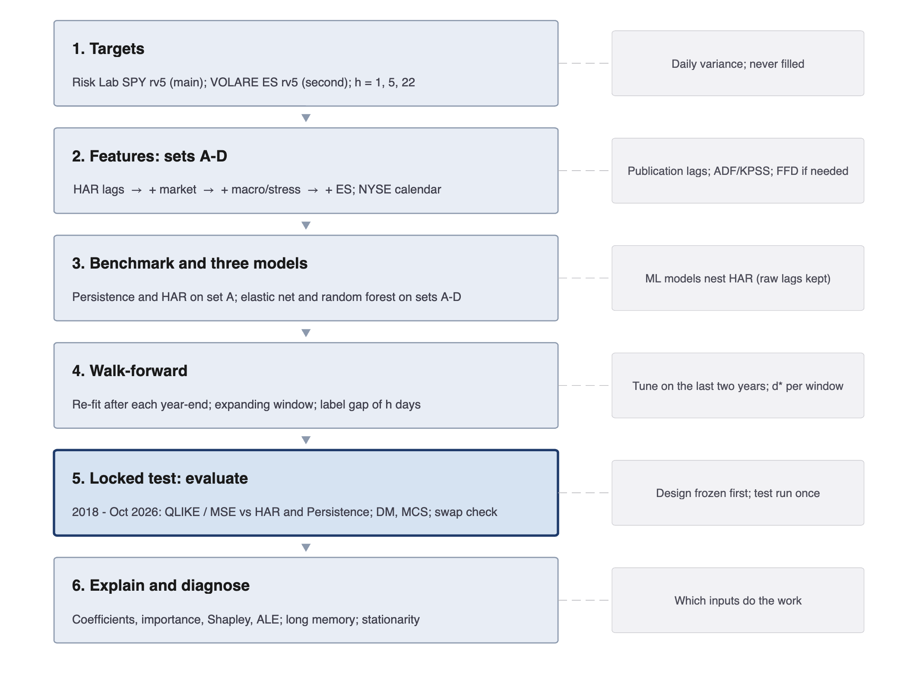
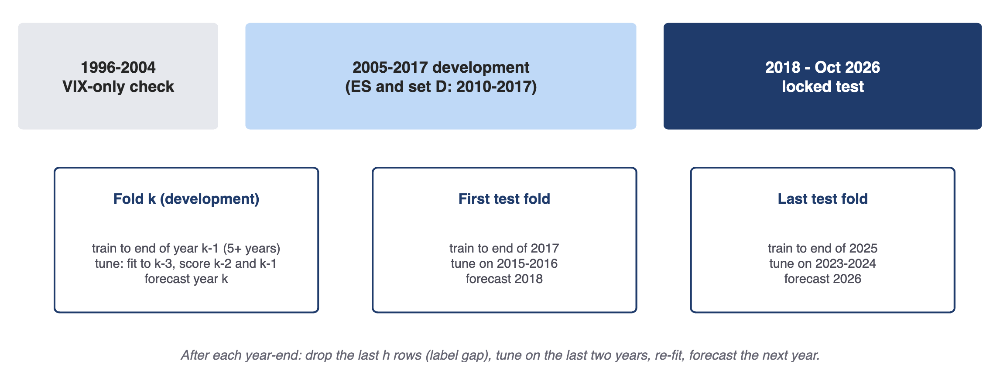
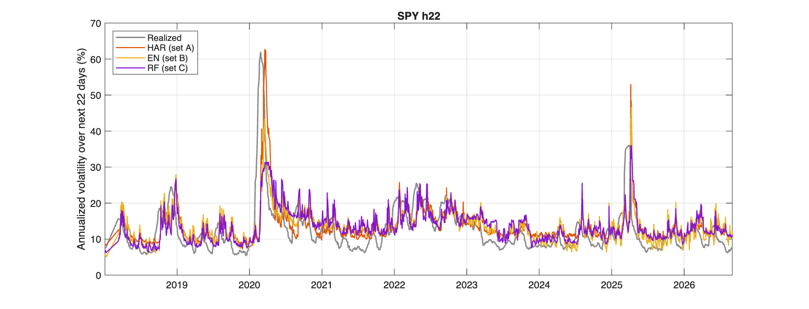
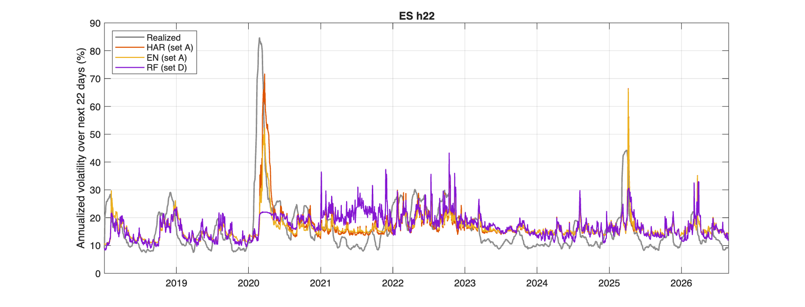
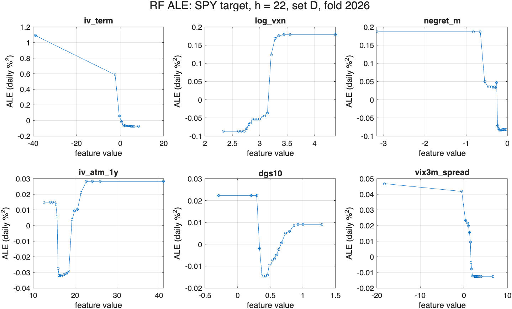

::: {custom-style="Block Text"}
**Status (21 October 2026; implements proposal v5.4).** Everything in the proposal is implemented in one MATLAB pipeline and runs end to end. That covers data alignment and publication lags, the stationarity and long-memory diagnostics, fractional differencing chosen inside each training window, the Persistence benchmark, all three models on all four feature sets at every horizon for both targets, the walk-forward engine, the full evaluation suite and every robustness check. As proposal Section 5 prescribes, every setting was frozen on the development results (git tag `design-freeze`) before the 2018 – October 2026 test was run, once. Section 7 summarizes the development period that fixed the design. Section 8 reports the locked test, which is the basis for every conclusion.
:::

# 1. Introduction and Motivation

Volatility sets the price of every option, the size of risk limits and how much a fund can safely invest. It is not observed directly. It can be measured after the fact by summing squared intraday returns, which gives **realized variance (RV)** (Andersen, Bollerslev, Diebold & Labys, 2003). For day $t$, with $M$ intraday returns $r_{t,i}$:

$$\mathrm{RV}_t=\sum_{i=1}^{M} r_{t,i}^{2}$$

EQNUM(1)

Five-minute sampling is the standard compromise between information and microstructure noise, and it is the frequency used by all three reference papers.

Forecasting S&P 500 realized volatility is **crucial for volatility trading with S&P 500 options, including variance swaps**. A one-month variance-swap strike is approximately $\mathrm{VIX}^2$. Anyone who forecasts realized variance better than that price knows when volatility looks cheap or expensive. The same forecasts drive volatility-targeting funds, value-at-risk limits and margin models.

Two structural facts motivate a machine-learning comparison:

- **HAR is a strong but linear baseline.** Corsi's (2009) model predicts future RV from its daily, weekly and monthly averages. Three regressors are enough to approximate the long memory of volatility (Section 4.3). The reference papers disagree on whether ML beats it:
  - Kılıç (2026) finds that ML sometimes improves on HAR but does not systematically beat a broader econometric set.
  - Christensen, Siggaard & Veliyev (2023) find that ML does beat the HAR family, especially at longer horizons.
  - Rahimikia & Poon (2026) find that ML wins on most days, but HAR does better on extreme-volatility days.
- **Richer information is available, but only some of it is RV history.** Option-implied volatility, rates, macro and financial-stress indices can all enter as features. So can VOLARE E-mini futures decompositions (jumps, semivariances, quarticity), available from late 2009. Linear models struggle with many correlated inputs; trees can capture interactions and regimes. Many of these inputs are close to unit-root processes, which is why the design tests them and, where needed, fractionally differentiates them.

Our contribution is deliberately narrow:

- **Three models:** HAR, the elastic net and the random forest, all on the same horizons and walk-forward design.
- **A naive Persistence benchmark** ("tomorrow looks like today") that every forecast must beat.
- **HAR as the fixed benchmark** on its own lags (set A).
- **Four nested feature sets for the two ML models.** This lets us ask whether they beat HAR, and also whether the non-linear model extracts more than the linear one from the implied-vol, macro/stress and ES features.

**How to read this report.**

- Sections 2–6 follow the proposal's structure and give every definition and formula needed to reproduce the work.
- Section 7 summarizes the development-period results on which the design was frozen.
- Section 8 reports the locked 2018–2026 test.
- Section 9 relates the results to the reference papers.
- Sections 10–12 cover applications, risks and limitations, and the implementation.
- The appendices give a feature dictionary, a line-by-line compliance check against proposal v5.4, the output files and a glossary.

# 2. Research Questions and Hypotheses

| Research question | Hypothesis | How it is tested |
|--------------------------------|--------------------------------|--------------------------------|
| **RQ1.** With volatility history alone (set A), do the elastic net or random forest beat HAR (and the naive Persistence benchmark) out of sample? | At $h=1$ gains are small; they grow at $h=5$ and $h=22$, consistent with Christensen et al. (2023). | Pairwise DM tests and the MCS on set A (Persistence, HAR, EN, RF), by horizon. |
| **RQ2.** Does the random forest get more improvement from implied-vol, macro/stress and ES features than the elastic net? | The forest's non-linearity and interactions let it extract more from sets B–D, so its loss reduction from set A exceeds the elastic net's. | Per horizon and target, the change in QLIKE/MSE from A→B, A→C and A→D for RF vs EN. A DM test on the difference-in-differences of losses (eq. 15), plus the MCS. |
| **RQ3.** Does the full-session ES target change the economic conclusion relative to SPY intraday RV? | ES captures about 95% of close-to-close variance (SPY RV about 56%), so ES-target forecasts should align better with a variance-swap payoff. | The pipeline is repeated on VOLARE ES (2010–2026), and the variance-swap comparison is run on both targets. |

The three questions are separable: a null finding on any one of them is still useful. In particular, we do not assume that implied volatility helps:

- the set A → B comparison tests whether implied-vol features add forecasting power;
- the set-B coefficients and importances (Section 8.7) show which part of the block does the work.

**Success criterion** (proposal Section 6). On the locked test, the design counts as successful if both of the following hold:

1. the elastic net or random forest has statistically lower QLIKE than HAR at one horizon or more, and the MCS includes the winner;
2. the variance-swap check is directionally consistent.

For RQ2 the question is answered either way, by the sign and significance of the RF-minus-EN gain. A well-documented failure to beat HAR is also a legitimate outcome (Kılıç, 2026). **Persistence is the floor:** a forecast that does not beat it is reported as uninformative at that horizon. The pipeline computes all of this automatically (Section 8.10).

# 3. Data

The team's cleaned inputs are read unchanged from the project's data folder; every column is described in the companion *Data Description*. No file is simply "five-minute data". Each delivers daily measures built from a stated intraday sampling frequency, or daily and weekly macro series.

| File (source) | Sampling and measure | Coverage | Role in the project |
|--------------------------|----------------------------------|------------------|----------------------|
| Risk Lab SPY (Dacheng Xiu) | Daily annualized SPY volatility from intraday trades, regular session: rv5 (5-min subsampled), rv15, QMLE | 2 Jan 1996 – 5 Oct 2026; 7,707 days | **Main target** (rv5); set-A lags; rv15 and QMLE as robustness |
| VOLARE ES | Daily variances from 1-second ES mid-quotes over the Globex session (18:00–17:00 ET): RV, bipower, ± semivariances, quarticity at 1-min and 5-min; realized kernel | 30 Sep 2009 – 30 Sep 2026; 4,397 rows | **Second target** (rv5); set D; rv1 and kernel as robustness |
| Oxford-Man Realized Library (archived) | Daily S&P 500 index rv5, bipower, negative semivariance, cash session | 3 Jan 2000 – 25 Feb 2022 | Cross-check of the SPY target (correlation 0.968 over 4,293 common days, reproduced by `data_audit.m`); pre-2010 jump robustness |
| Bloomberg IV surface | Daily SPX implied vol, 7 moneyness levels × 6 tenors (1–24 months) | 3 Jan 2005 – 1 Oct 2026; 5,471 days | Set B: ATM level, skew, term slope; fixes the 2005 sample start |
| Cboe indices | Daily VIX, VIX9D, VIX3M, VIX6M, VIX1Y, SKEW | VIX from 1990; VIX3M from Sep 2009; VIX9D from Jan 2011 | Set B (log VIX, VRP, term structure); VIX² is the variance-swap strike |
| `features_daily.csv`: market | Daily S&P 500 OHLC and returns; Hang Seng; VVIX, VXN, VXD, RVX | 1990 – 6 Oct 2026; VVIX from Mar 2006 | Set B; Hang Seng in set C |
| `features_daily.csv`: rates | Daily 10Y−3M spread and 10Y yield (FRED) | 1990 – Oct 2026 | Set B |
| `features_daily.csv`: macro and stress | EPU, CISS, real-time ADS, news sentiment, classic GPR (daily; the monthly AI-GPR is not used, which proposal §5 allows); NFCI, STLFSI4 (weekly) | 1990 – Oct 2026; real-time ADS from Dec 2008 | Set C |
| `features_daily.csv`: Fama–French | Daily factor returns, published about a month late | to Aug 2026 | Not used (not available in real time) |
| NYSE calendar | NYSE sessions and early closes | 1990 – 6 Oct 2026 (9,258 sessions) | Master calendar for alignment and FFD; early-close flag in set C |

**About the calendar.** We take the NYSE calendar from the dates of `features_daily.csv`; the data team verified these sessions are identical to the NYSE calendar (special closures excluded). Proposal v5.4 names a separate calendar file (`nyse_trading_calendar_1990_2026.csv`, 9,318 sessions to end-2026) that is not in the data folder. It would only add sessions after 6 October 2026, which no forecast uses.

## 3.1 Sample design

| Sample | Dates | Size |
|---|---|---|
| Main sample | January 2005 – 5 October 2026 (starts when the implied-vol surface begins) | 5,440 Risk Lab days |
| **Development** | **2005–2017** | 3,272 days |
| **Locked test** | **2 January 2018 – 5 October 2026** | 2,201 sessions; 2,168 with a Risk Lab value |
| ES models and set D: development | 2010–2017 | 2,013 NYSE days |
| ES models and set D: locked test | Same test, through 30 September 2026 | — |

Pre-2005 Risk Lab data enter only a VIX-only robustness check.

## 3.2 Missing data, holidays and staggered starts

- **Calendar.** Every series is aligned to the NYSE trading-day calendar, and FFD (Section 4.3) is computed over NYSE sessions. Weekends and exchange holidays are therefore not missing observations. Weekly NFCI and STLFSI4 are placed on their release date and held until the next release.
- **Late starts.** Some series begin after the sample start:
  - VVIX (Mar 2006);
  - real-time ADS (Dec 2008; before that, the revised vintage lagged 5 days is used in training rows, Section 5);
  - VIX3M (Sep 2009);
  - the ES/set-D measures (Sep 2009);
  - VIX9D (Jan 2011).

  The raw data and the model inputs are treated differently:
  - **Raw data.** A late-starting series has no observed values before its first date, and its FFD transform has none before its first date plus the FFD window $\ell_\tau$.
  - **Entry into a fold.** In each walk-forward fold, a feature is used only once it has at least three years (3 × 252 rows) of non-missing values in that fold's training window. Until then it is left out of the fold.
  - **Median fill.** Once a feature is in a fold, every missing row, in the training window and in the forecast year, is set to the training-window median. This includes all rows before the series began. The median uses training rows only, so no test information enters (`walk_forward.m`).
  - **Consequence for SPY sets B and C.** These models train from 2005, so the VIX3M − VIX and VIX9D − VIX spreads hold one constant value from January 2005 to their start dates, including the whole 2008 crisis. That is 36% and 46% of training rows at the first test re-fit (end of 2017), falling to 23% and 29% at the last (end of 2025). Models trained from 2010 (all ES models and set D) have at most one year filled. Section 8.7 shows how this bears on the feature-importance results. This is part of the frozen design and is not changed after the test.

  Comparisons across sets use common days only.
- **Missing trading days.** We reproduced the proposal's counts exactly from the raw files (`data_audit.m`):
  - Risk Lab SPY lacks 33 of the 5,473 NYSE sessions from 3 Jan 2005 to 5 Oct 2026, all in the test period (5–9 Feb 2018 and 28 isolated days). Development has none, and ES has no missing NYSE session.
  - Within their coverage, some inputs also lack values on NYSE days: Hang Seng 251 (Hong Kong holidays), T10Y3M and DGS10 39 (bond-market holidays), VVIX 61 (59 in 2006), RVX 7, VXD 3.
  - **How missing target days are handled.** We never fill a missing target day with another source (ES or Oxford-Man) or with a model forecast.
    - A 1-day target on a missing day is dropped.
    - A multi-day target is the average of the observed days in its window ($\mathrm{RV}_{t+1:t+h}$ in eq. 2 is computed over those days only). This implicitly treats the missing days as equal to that average, so it is a mild form of imputation, not none.
    - A multi-day target is dropped if more than 20% of its window is missing (rule 1 below).
    - Every model is scored on the same origins.

    The 20% rule was fixed before the test. Section 8.12 reports the results with and without it (partial versus complete windows) as a sensitivity analysis (`build_design.m`, lines 39–52).

| Horizon | Test origins | Target window has a missing day | More than 20% of target window missing | 22-day lag window has a missing day |
|----------|----------|----------|----------|----------|
| $h=1$ | 2,200 | 33 | 33 | 531 |
| $h=5$ | 2,196 | 143 | 12 | 527 |
| $h=22$ | 2,179 | 532 | 19 | 510 |

*Affected Risk Lab SPY test origins (reproduced from the raw files; matches proposal v5.4, Section 3.2).*

- **Treatment, frozen before the test.** Proposal v5.4 left the treatment of missing days to be decided once the counts were measured. The team froze four rules, all switches in `rv_config.m` / `build_design.m`:
  1. a multi-day target is dropped if more than 20% of its window is missing;
  2. weekly and monthly RV lags are built from the observed days if at least 80% of the window is present;
     - The one exception is `overnight_w`, the 5-day average of overnight variance in set D, which is built if at least 60% of the window (3 of 5 days) is present; it was coded this way before the design freeze and is left unchanged so the locked test results match the code.
  3. an origin whose own $\mathrm{RV}_t$ is missing is dropped, for every model alike;
  4. on a day when a daily input has no value (e.g. a bond holiday), its last published value is used for at most 5 sessions (10 for weekly series), which uses no future information. This departs from proposal §3.2, which says daily series "are not forward-filled". The rule was fixed before the test and is listed in Appendix B.

  None of these affects the development results, because development has no missing Risk Lab days. A **strict** alternative is run as a robustness check (scenario `strict`): any origin whose target or 22-day lag window touches a missing day is dropped. On the test this removes about a quarter of the SPY 22-day origins (2,160 → 1,647).
- **ES holiday sessions.** VOLARE has 121 rows on non-NYSE dates (abbreviated Globex holiday sessions). Their variance is rolled into the next NYSE day, so each target spans one close-to-close interval; dropping them is a robustness check (scenario `holdrop`). Proposal §3.2 left this treatment "pending the professor's confirmation". The instructor considered the treatment reasonable when the team reviewed it with him on 7 November 2026. Dropping the rows leaves the ES conclusions unchanged (Section 8.9).

## 3.3 Limitations

- **VOLARE coverage.** VOLARE has no SPY or index series; ES is its only S&P 500 instrument. It is refreshed monthly, and ES ends 30 September 2026.
- **ES session timing.** The ES day is inferred as 18:00–17:00 ET, and roll dates are not flagged. Because the day-$t$ ES measures are complete only at 17:00 ET, the forecast origin is 17:00 ET (Section 5).
- **Missing feature types.** We lack limit-order-book and news-text features (central to Rahimikia & Poon) and the firm-level implied vol used by Christensen et al.
- **Overnight move.** SPY intraday RV omits the overnight move, so it covers only about 56% of close-to-close variance. ES captures about 95%, which is why it is the preferred target for the variance-swap check.

# 4. Methodology

Forecasts are issued at 17:00 ET on each NYSE day $t$, once the day's ES session has closed (Section 5), for horizons $h\in\{1,5,22\}$ trading days. Figure 1 summarizes the pipeline.

{width=74%}

## 4.1 Targets

For SPY, Risk Lab reports an annualized volatility $\sigma^{\mathrm{rv5}}_t$. We convert it to a daily variance, held in %² (i.e. decimal × $10^4$), and form horizon averages:

$$\mathrm{RV}^{\mathrm{SPY}}_t=\frac{(\sigma^{\mathrm{rv5}}_t)^2}{252},\qquad \mathrm{RV}_{t+1:t+h}=\frac{1}{h}\sum_{k=1}^{h}\mathrm{RV}_{t+k}$$

EQNUM(2)

For ES, VOLARE rv5 is already a daily variance of 5-minute mid-quote returns over the Globex session. Any linear forecast below the training-window minimum of daily RV is floored at that minimum (Christensen et al., 2023).

## 4.2 Nested feature sets

| Set | Contents (exact features: Appendix A) | First date |
|--------------|-----------------------------------------------------------|------------------|
| **A: HAR lags** | Daily, weekly (5-day) and monthly (22-day) averages of the target's own RV | Jan 2005 (SPY), Jan 2010 (ES) |
| **B: + market** | A + negative-return averages (d/w/m), Parkinson range (d/w), log VIX, VRP $=\mathrm{VIX}^2/252-\mathrm{RV}^{(m)}$, IV surface (ATM 1M/3M/1Y, 1M skew, 1Y−1M term slope), 10Y yield and 10Y−3M spread, VVIX, SKEW, VIX9D−VIX, VIX3M−VIX, log VXN, log RVX | Jan 2005; VVIX, VIX3M, VIX9D from their start + $\ell_\tau$ |
| **C: + macro/stress** | B + real-time ADS, log EPU, news sentiment, log GPR, CISS, NFCI, STLFSI4, squared Hang Seng return, calendar flags | Jan 2005; real-time ADS from Dec 2008 |
| **D: + ES measures** | C + ES continuous/jump averages (d/w/m), ± semivariances (d/w), $\sqrt{\mathrm{RQ}}\times\mathrm{RV}$, realized kernel, overnight variance $\max(\mathrm{ES}-\mathrm{SPY},0)$ (d/w) | Jan 2010 |

How the sets are used:

- **HAR** is estimated on set A only.
- **The elastic net on set A** is a regularized HAR.
- **On sets B–D,** both ML models receive the HAR lags plus the extras, so they nest HAR.
- **Jump, semivariance and quarticity measures** enter **as features**, not as separate HAR-J / SHAR / HARQ models.

From the VOLARE bipower variation $\mathrm{BV}_t$ and signed semivariances, the set-D inputs are:

$$J_t=\max(\mathrm{RV}_t-\mathrm{BV}_t,\,0),\quad C_t=\mathrm{RV}_t-J_t,\quad \mathrm{RS}^{+}_t=\sum_{i} r^{2}_{t,i}\mathbf{1}\{r_{t,i}>0\},\quad \mathrm{RS}^{-}_t=\sum_{i} r^{2}_{t,i}\mathbf{1}\{r_{t,i}<0\}$$

EQNUM(3)

## 4.3 Stationarity and long memory

**Why it matters.** Both ML models learn a mapping on the training window and apply it to later years, so their inputs must behave similarly in both. Two kinds of input cause trouble:

- VIX, rate and stress levels are close to unit-root processes;
- RV is highly persistent, with slowly decaying autocorrelations (long memory).

When an input drifts, its test values can fall outside the training range. A random forest cannot extrapolate beyond the leaf values it has seen. Elastic-net coefficients fitted to trending, correlated levels change from one re-estimation to the next.

**The fix.** Integer differencing restores stationarity but removes the memory that HAR exploits. **Fractional differencing** (López de Prado, 2018, ch. 5) is the middle ground. With the lag operator $L$ ($L^kX_t=X_{t-k}$) and order $d\ge0$:

$$(1-L)^dX_t=\sum_{k=0}^{\infty}w_kX_{t-k},\qquad w_0=1,\quad w_k=-w_{k-1}\frac{d-k+1}{k}\ (k\ge1)$$

EQNUM(4)

For $d=1$ the weights are $\{1,-1,0,\dots\}$ (ordinary differences). For $0<d<1$ they decay slowly, so part of the memory survives. The fixed-width-window version (FFD) truncates the weights once they fall below a threshold $\tau$, so every observation is built from the same window. The order $d$ is set to the smallest grid value that passes the ADF test at 95%:

$$\widetilde X_t(d)=\sum_{k=0}^{\ell_\tau}w_kX_{t-k},\qquad \ell_\tau=\max\{k:|w_k|\ge\tau\},\qquad d^*=\min\{d\in\mathcal G:\mathrm{ADF}(\widetilde X(d))<c_{0.95}\}$$

EQNUM(5)

**Implementation.**

- **Grid and threshold.** $\mathcal G=\{0,0.05,\dots,1\}$ and $\tau=10^{-3}$, fixed in advance. This gives windows of at most about 70 sessions.
- **The tests.** ADF uses a constant, the Schwert lag length and the MacKinnon 5% critical value. KPSS tests level stationarity with a Bartlett long-run variance and the 5% critical value 0.463. Both are coded directly, because MATLAB's `adftest` and `kpsstest` belong to the Econometrics Toolbox, which is not installed.
- **Which inputs.** Every input except the raw HAR lags and the two calendar flags is a candidate. Each candidate's $d^*$ is chosen on the training window's data only, and re-chosen at every walk-forward re-fit.
- **What stays raw.** The target is never transformed, and the same raw HAR lags enter both ML models, so they still nest HAR.
- **Robustness.** An FFD variant in which the ML lag block is replaced by FFD log RV is a robustness check.

**Diagnosis on the development sample** (2005–2017; 2010–2017 for ES and set D; `stationarity.m`). ADF and KPSS were run on both targets and every input, in levels and, for positive series, in logs: 74 tests in all.

| Verdict | Count | Series |
|----------------------|------|------------------------------------------------------------|
| ADF rejects a unit root **and** KPSS rejects stationarity ("persistent / long memory") | 65 | Both targets and the HAR lags; returns, ranges, VIX, VRP, skew, term slope, VVIX, SKEW, VIX9D and VIX3M spreads, cross-market IV; ADS, EPU, news, GPR, NFCI, STLFSI4; every ES measure |
| ADF cannot reject a unit root | 8 | ATM 3M and 1Y implied vol, 10Y−3M spread, 10Y yield, CISS (level) |
| Stationary on both tests | 1 | $\sqrt{\mathrm{RQ}}\times\mathrm{RV}$ |

The dominant pattern, where ADF rejects but KPSS still rejects, is exactly what Bhatti (2026) describes for long-memory series. ADF declares stationarity while KPSS keeps rejecting under strong persistence, and neither identifies the minimal $d$.

Under eq. 5, only the unit-root inputs are transformed. Their $d^*$ and retained correlation $\rho=\mathrm{corr}(\widetilde X(d^*),X)$ are:

| Input | $d^*$ (full development sample) | $\rho$ (memory retained) | Inside the walk-forward (set-D folds): $d^*$ range, share of folds differenced |
|------------------|------|------|------------------------------------------|
| ATM 3M implied vol | 0.10 | 0.992 | 0–0.10, 66% |
| ATM 1Y implied vol | 0.20 | 0.969 | 0.10–0.15, 100% |
| 10Y−3M spread | 0.25 | 0.968 | 0.15–0.25, 100% |
| 10Y yield | 0.30 | 0.960 | 0.15–0.25, 100% |
| CISS | 0.10 | 0.995 | 0–0.15, 33% |
| ATM 1M IV, log RVX, STLFSI4 | 0 | 1 | 0–0.10 in some folds, 33% |

Fractional differencing therefore changes very little here. The orders are small, and the transformed inputs keep 96–99.5% correlation with the originals. What it removes is the slow drift in rates and long-dated implied vol.

**Memory of RV.** We estimate $d$ in two ways:

- **Local Whittle** (Robinson, 1995), which minimizes over the first $m$ Fourier frequencies $\lambda_j$, with periodogram $I(\lambda_j)$:

$$\hat d=\arg\min_{d}\Bigl[\ln\Bigl(\tfrac{1}{m}\sum_{j=1}^{m}\lambda_j^{2d}I(\lambda_j)\Bigr)-\tfrac{2d}{m}\sum_{j=1}^{m}\ln\lambda_j\Bigr],\qquad \mathrm{se}(\hat d)=\tfrac{1}{2\sqrt m}$$

EQNUM(6)

- **Bhatti's detectability-boundary estimator $d_{\mathrm{LTM}}$,** as a cross-check. For each $d$ on a grid the series is fractionally differenced, and $\ln|\hat\rho(k)|$ is regressed on $\ln k$ over lags 20 to $K_2\le200$. $d_{\mathrm{LTM}}$ is the $d$ with the largest regression RMSE. In his Monte Carlo the boundary sits below the true order by about $d_0(T)=5.81\,T^{-0.367}$, and short windows bias it downward.

| Series (development data) | $T$ | Local Whittle $\hat d$, $m=T^{0.5}$ | Local Whittle $\hat d$, $m=T^{0.65}$ | $d_{\mathrm{LTM}}$ | $d_0(T)$ |
|--------------------|------|----------|----------|------|------|
| SPY RV 1996–2017, level | 5,539 | 0.37 (0.06) | 0.53 (0.03) | 0.50 | 0.25 |
| SPY RV 1996–2017, log | 5,539 | 0.61 (0.06) | 0.60 (0.03) | 0.92 | 0.25 |
| SPY RV 2005–2017, level | 3,272 | 0.52 (0.07) | 0.63 (0.04) | 0.44 | 0.30 |
| SPY RV 2005–2017, log | 3,272 | 0.61 (0.07) | 0.56 (0.04) | 0.40 | 0.30 |
| ES RV 2010–2017, level | 2,013 | 0.47 (0.08) | 0.40 (0.04) | 0.08 | 0.36 |
| ES RV 2010–2017, log | 2,013 | 0.56 (0.08) | 0.57 (0.04) | 0.42 | 0.36 |

What the estimates say:

- **Local Whittle:** $d$ is between 0.37 and 0.63 for every series. That is classic long memory, many standard errors from zero.
- **$d_{\mathrm{LTM}}$ is erratic:**
  - 0.40–0.44 on the 2005–2017 SPY window (about 0.7 after adding Bhatti's offset);
  - 0.92 for log RV over 1996–2017;
  - 0.08 for ES levels on 2,013 observations, close to his 2,000-observation minimum.

  As the proposal anticipates, it is reported as a cross-check and not used to choose $d$.
- **Implication:** volatility memory decays over months. That is why HAR works, and why every ML set keeps the raw HAR lags.

{width=100%}

## 4.4 Benchmarks and comparison grid

Two simple benchmarks sit beside the three models; neither is estimated.

- **Persistence** is the naive benchmark: the coming $h$-day average equals the latest $h$-day average of realized variance. For $h=1$, tomorrow's forecast is today's variance:

$$\widehat{\mathrm{RV}}^{\mathrm P}_{t+1:t+h}=\frac{1}{h}\sum_{j=0}^{h-1}\mathrm{RV}_{t-j},\qquad \widehat{\mathrm{RV}}^{\mathrm P}_{t+1}=\mathrm{RV}_t$$

EQNUM(7)

  It is the floor every forecast must clear, including HAR.
- **The VIX-implied strike $\mathrm{VIX}^2$** is the market benchmark, used only in the variance-swap check.

| Forecast | Type | Inputs | Estimation | Owner | Code |
|----------|----------|----------|------------------|------|----------|
| Persistence | Naive benchmark | Latest RV only | None | James | `fit_persistence.m` |
| HAR | Model 1 | Set A | OLS per horizon | James | `fit_har.m` |
| Elastic net | Model 2 | Sets A–D | Penalized regression, tuned | Aryan | `fit_en.m` |
| Random forest | Model 3 | Sets A–D | Bagged trees, tuned | Aryan | `fit_rf.m` |
| VIX² strike | Market benchmark | VIX | None; variance-swap check only | All | `evaluate_phase.m` |

## 4.5 Model 1: HAR

There is one ordinary-least-squares specification per horizon, on the variance scale (Corsi, 2009):

$$\begin{aligned}\mathrm{RV}_{t+1:t+h}&=\beta_0+\beta_d\,\mathrm{RV}_t+\beta_w\,\mathrm{RV}^{(w)}_t+\beta_m\,\mathrm{RV}^{(m)}_t+\varepsilon_{t+h},\\ \mathrm{RV}^{(w)}_t&=\frac{1}{5}\sum_{j=0}^{4}\mathrm{RV}_{t-j},\qquad \mathrm{RV}^{(m)}_t=\frac{1}{22}\sum_{j=0}^{21}\mathrm{RV}_{t-j}\end{aligned}$$

EQNUM(8)

It has four parameters, estimates in milliseconds, and is the literature's standard benchmark.

## 4.6 Model 2: Elastic net

The elastic net is a penalized linear regression on the active feature set $\mathbf{x}_t$, with target $y_{t+h}=\mathrm{RV}_{t+1:t+h}$:

$$\min_{\beta_0,\boldsymbol\beta}\;\frac{1}{2N}\sum_{t=1}^{N}\bigl(y_{t+h}-\beta_0-\mathbf{x}_t^{\top}\boldsymbol\beta\bigr)^2+\lambda\Bigl[\alpha\lVert\boldsymbol\beta\rVert_1+\frac{1-\alpha}{2}\lVert\boldsymbol\beta\rVert_2^2\Bigr]$$

EQNUM(9)

- **The mixing parameter $\alpha$** blends ridge ($\alpha=0$) and lasso ($\alpha=1$).
- **Tuning.** Both $\alpha\in\{0,0.1,0.25,0.5,0.75,0.9,1\}$ and a 50-point $\lambda$ path are tuned on validation QLIKE, so ridge and lasso are special cases rather than separate models.
- **Implementation.** MATLAB's `lasso` handles $\alpha>0$; the ridge case is solved in closed form in the same scaling. Predictors are standardized with training-window statistics only.
- **Reporting.** Following Kılıç (2026), the selected coefficients are reported as a result (Section 8.7).

## 4.7 Model 3: Random forest

The random forest averages many regression trees. Each tree is grown on a bootstrap sample, with a random subset of predictors tried at every split (MATLAB `TreeBagger`). Trees capture interactions and regimes, need little tuning and supply impurity-based importance. With $B$ trees $T_b$:

$$\widehat{\mathrm{RV}}_{t+1:t+h}=\frac{1}{B}\sum_{b=1}^{B}T_b(\mathbf{x}_t)$$

EQNUM(10)

- **Tuning.** Bayesian optimization (`bayesopt`, 12 evaluations of 100-tree forests on validation QLIKE) chooses the minimum leaf size (1–200) and the number of predictors per split (1 to $p$).
- **Final forest:** 300 trees.
- **A key limitation.** A forest predicts averages of training targets, so its forecasts are always positive. It also cannot forecast outside the range of volatility it has seen.

## 4.8 What we do not estimate

The following are out of scope:

- LogHAR, LevHAR, HAR-X, HAR-J/CJ, SHAR and HARQ;
- $\mathrm{VIX}^2/252$ as a forecasting model;
- neural nets and LSTMs (gradient boosting appears only in the post-freeze exploratory run of Section 7.4);
- forecast combinations (a HAR + forest combination built from the saved forecasts is reported as exploratory in Section 8.13).

$\mathrm{VIX}^2$ remains the **market strike** in the variance-swap test, not a competing forecast. An exploratory gradient-boosting comparison was run after the design freeze, on the development period only (Section 7.4); it is not part of the frozen design and, on the professor's advice, was not run on the locked test.

# 5. Validation Design

Days are never shuffled, and every date below is an NYSE session.

- **Boundaries.**
  - SPY: development origins 3 Jan 2005 – 29 Dec 2017. Locked-test origins run from 2 Jan 2018 to the last session whose $h$-day target ends by 5 Oct 2026.
  - ES and set D: development from 4 Jan 2010; test targets end by 30 Sep 2026.
- **Re-estimation dates.** After the close of the last session of year $Y$ (date $T_Y$), every model is re-fitted on all data through $T_Y$. The window expands from 2005 for SPY and from 2010 for ES and set D. The re-fitted model is used unchanged for every origin in year $Y+1$, so the locked test has nine re-fits, at the last sessions of 2017 through 2025. **Development pseudo-out-of-sample years use the same rule once the window holds five years: SPY 2010–2017, ES and set D 2015–2017.**
- **Tuning.** Hyperparameters are chosen by fitting on the window minus its last two years and validating on those two years. The model is then re-fitted on the whole window. $d^*$ and standardization use the training window only.
- **Label gap.** A row with origin $s$ is used in the re-fit at $T_Y$ only if its target has been observed. The last $h$ origins of each window are therefore dropped, and the same gap separates the inner fit from the two tuning years:

$$\mathcal D_Y(h)=\bigl\{(\mathbf x_s,\ \mathrm{RV}_{s+1:s+h}):\ s+h\le T_Y\bigr\}$$

EQNUM(11)

- **Rolling window.** A rolling 10-year window (8-year for ES) is a robustness check.
- **Availability timing.** The forecast origin is **17:00 ET on NYSE day $t$**. An input dated $t$ enters only if it is published by then; later releases are shifted:

| Input | Value for day $t$ is known | Shift (sessions) |
|----------------------------------------|------------------------------|----------------|
| Risk Lab SPY RV; S&P 500 OHLC; Cboe VIX family, VVIX, VXN, VXD, RVX; Bloomberg IV surface | Close of day $t$ (by 16:15 ET) | 0 |
| VOLARE ES measures | 17:00 ET on $t$ (Globex close), the forecast origin | 0 |
| Hang Seng | 04:00 ET on $t$, before the NYSE open | 0 |
| Treasury T10Y3M, DGS10 | Late afternoon of $t$ | 0 |
| EPU | Morning of $t+1$ | 1 |
| ECB CISS | About one business day later | 2 |
| SF Fed news sentiment; classic daily GPR | Weekly updates | 5 |
| ADS | Real-time vintage released before $t$ (current vintage lagged 5 days before Dec 2008, training rows only) | Built in |
| NFCI, STLFSI4 | Weekly; placed on release date | Built in |
| Fama–French factors | About one month later | Not used |

- **Why 17:00 ET.** Earlier versions of this report placed the origin at the NYSE close (16:00 ET). The models, however, use the day-$t$ ES measures with no lag:
  - as set-D features (ES continuous, jump, semivariance, quarticity and kernel measures, and overnight variance);
  - as the ES target's own history (its HAR lags, the Persistence forecast and the VRP);
  - through the ES holiday sessions rolled into the next NYSE day.

  Those measures are complete only when the Globex session closes at 17:00 ET, so a 16:00 forecast could not have used them. Following the instructor's comments (1 November 2026), we state the origin as 17:00 ET. No input, forecast or loss changes: the convention makes the stated timing match the data the models used. Both targets start after the origin: SPY RV for $t+1$ at the 09:30 open, and the ES session for $t+1$ at 18:00 on day $t$.
- **The other convention.** Keeping a 16:00 origin would require lagging every ES-derived input by one session. That variant was run after the test as a robustness check (scenario `eslag1`, Section 8.9).
- **Consequence for the economic checks.**
  - The volatility-targeting utility is unaffected, because the position is set before the next session starts.
  - The variance-swap check (Section 6) is stylized: it uses the day-$t$ VIX close (16:15 ET) as the strike and the close-to-close payoff from day $t$, both of which come before a 17:00 forecast. A tradeable version would enter one session later. This is disclosed here rather than re-computed.

{width=100%}

The test period is examined once; anything changed afterwards is labelled exploratory.

# 6. Evaluation

All scores are strictly out of sample and computed on the same origins for every forecast. They are reported for the development pseudo-out-of-sample period (Section 7) and for the locked test (Section 8).

| Area | Metrics |
|--------------------|------------------------------------------------------------------|
| Statistical accuracy | MSE and QLIKE on the variance scale (QLIKE primary; Patton, 2011); MAE (descriptive only); out-of-sample $R^2$ against the HAR training-window mean |
| Significance | Diebold–Mariano tests with Newey–West variance and HLN correction, against HAR and against Persistence; Model Confidence Set at 10% over Persistence, HAR, EN and RF (Hansen, Lunde & Nason, 2011) |
| Attribution | Loss ratios vs HAR and vs Persistence by feature set and horizon; RF-minus-EN change in loss from set A to B, C and D (RQ2); calm vs high-RV regimes; normal vs extreme days; stress episodes |
| Economic value | Realized utility of a volatility-targeting rule (Bollerslev et al., 2018); stylized variance-swap P&L vs VIX² |
| Robustness | Rolling window; Risk Lab 15-min and QMLE; ES rv1 / kernel / holiday-drop; Oxford-Man pre-2010 jump features; 1996 VIX-only start; FFD-lag variant; untuned forest; 16:00 origin with ES inputs lagged (added after the test) |

**Losses.** With forecast $\hat y_t$ of realized variance $y_t$ over $T$ days, the two losses are (Patton, 2011):

$$\mathrm{MSE}=\frac{1}{T}\sum_{t=1}^{T}(y_t-\hat y_t)^2,\qquad \mathrm{QLIKE}=\frac{1}{T}\sum_{t=1}^{T}\Bigl(\frac{y_t}{\hat y_t}-\ln\frac{y_t}{\hat y_t}-1\Bigr)$$

EQNUM(12)

**Why these losses** (Patton, 2011):

- **Both MSE and QLIKE are robust.** Realized variance measures the true variance with noise. With a conditionally unbiased proxy such as 5-minute RV, both losses rank two forecasts the same way the unobserved true variance would. They are the only such losses among the common choices.
- **QLIKE is primary for three reasons:**
  - it depends only on the ratio $y_t/\hat y_t$, so a few crisis days weigh less than under MSE;
  - it needs weaker moment conditions than MSE;
  - Diebold–Mariano tests based on it have more power (Patton & Sheppard, 2009).

  It also penalizes under-prediction more than over-prediction.
- **MAE is reported for description only.** It is not robust: its optimal forecast is the conditional median, which lies below the conditional variance. It is therefore not used to rank forecasts.
- **Out-of-sample $R^2$** is a monotone transformation of MSE, so it ranks forecasts as MSE does.

**Diebold–Mariano.** For a loss differential $d_t$ (benchmark loss minus model loss):

$$\mathrm{DM}=\sqrt{\frac{T+1-2h+h(h-1)/T}{T}}\;\frac{\bar d}{\sqrt{\widehat{\mathrm{LRV}}(d)/T}}$$

EQNUM(13)

- The long-run variance is Bartlett, with bandwidth $\max(\lceil1.5h\rceil,4(T/100)^{2/9})$ to cover the overlap of multi-day targets.
- The square-root factor in front is the Harvey–Leybourne–Newbold small-sample correction.
- p-values come from Student $t_{T-1}$.

**MCS.** The $T_{\max}$ statistic at 10%, with a moving-block bootstrap (block length $\max(h,\lfloor\sqrt T\rfloor)$, 5,000 draws).

**Regimes.**

- *High-RV:* the monthly RV lag exceeds its 2005–2017 80th percentile.
- *Extreme days:* the realized target exceeds Q3 + 1.5·IQR (Rahimikia & Poon, 2026).
- *Stress episodes:* August 2015; the euro crisis (Kılıç, 2026); and the proposal's test episodes (Feb 2018, 2020, 2022, Apr 2025).

**Economic value: vol-targeting utility.**

$$U=\frac{\mathrm{SR}^2}{\gamma}\Bigl(\sqrt{\frac{\mathrm{RV}}{F}}-\frac{\mathrm{RV}}{2F}\Bigr)$$

EQNUM(14)

with $\mathrm{SR}=0.4$ and $\gamma=2$, so the maximum is 4% per year, reached at $F=\mathrm{RV}$.

**RQ2.** With $L^{m}_{s,t}$ the daily loss of model $m$ on set $s\in\{B,C,D\}$, the DM test is applied to

$$d_{s,t}=\bigl(L^{\mathrm{RF}}_{A,t}-L^{\mathrm{RF}}_{s,t}\bigr)-\bigl(L^{\mathrm{EN}}_{A,t}-L^{\mathrm{EN}}_{s,t}\bigr),\qquad \bar d_s>0\ \Rightarrow\ \text{the forest gains more}$$

EQNUM(15)

**Variance swap.** A one-month forecast is compared with the strike $K_t\approx(\mathrm{VIX}_t/100)^2$, which we report in vol-points² as $\mathrm{VIX}_t^2$. Selling one unit of variance pays

$$\Pi_t=K_t-252\cdot\mathrm{RV}_{t+1:t+22}$$

EQNUM(16)

- **Timing rule:** sell variance when the annualized forecast is below $K_t$; buy otherwise.
- **SPY adjustment:** SPY RV omits the overnight move, so SPY forecasts are rescaled by the training ratio of mean squared close-to-close return to mean RV.
- **Payoffs:** the actual close-to-close payoff is reported alongside.
- **Timing:** the strike and payoff start at the day-$t$ close, before the 17:00 ET origin (Section 5).

# 7. Results: Development Period (2005–2017)

The development period is where the design was tuned and frozen; its numbers are pseudo-out-of-sample. All ten forecasts (Persistence, HAR, and EN/RF on sets A–D) share **2 January 2015 – 29 December 2017 ($n=755$)** for both targets; SPY sets A–C also share a longer sample, **2010–2017 ($n=2{,}013$)**.

Ratios are model QLIKE ÷ HAR QLIKE, so values below 1 beat HAR. Table notation, used throughout Sections 7 and 8:

- **bold** = significantly lower QLIKE than HAR (one-sided DM, $p<0.05$);
- ✓ = in the 10% MCS;
- † = significantly lower QLIKE than Persistence.

## 7.1 Forecast accuracy

| Target | $h$ | HAR QLIKE | Persist. | EN A | RF A | EN B | RF B | EN C | RF C | EN D | RF D |
|------|----|------|------|------|------|------|------|------|------|------|------|
| SPY | 1 | 0.254 | 0.952 | 1.000 | **0.815**† | 1.675 | **0.745**† | 1.596 | **0.705** ✓† | 0.978 | **0.714** ✓† |
| SPY | 5 | 0.263 ✓ | 1.078 ✓ | 1.000 ✓ | 1.036 ✓ | 1.335 ✓ | 0.995 ✓ | 1.625 | 0.967 ✓ | 0.935 ✓ | **0.914** ✓ |
| SPY | 22 | 0.317 ✓ | 0.884 ✓ | 1.000 ✓ | 0.922 ✓ | **0.838** ✓ | 0.933 ✓ | 0.955 ✓ | 1.197 ✓ | 1.061 ✓ | 1.058 ✓ |
| ES | 1 | 0.217 | 0.943 | 1.021 | **0.874**† | **0.777** | **0.615** ✓† | **0.802** | **0.625** ✓† | **0.753** | **0.614** ✓† |
| ES | 5 | 0.292 | 0.895 ✓ | 1.018 | **0.887** ✓ | **0.646** ✓† | **0.844** ✓ | **0.740** ✓ | **0.754** ✓ | **0.709** ✓ | **0.819** ✓ |
| ES | 22 | 0.325 ✓ | 0.942 ✓ | 1.185 ✓ | 0.967 ✓ | 0.944 ✓ | 1.035 ✓ | 1.114 ✓ | 1.028 ✓ | 1.152 ✓ | 0.976 ✓ |

**Longer SPY sample, sets A–C (2010–2017, $n=2{,}013$):**

| $h$ | Persistence | EN A | RF A | EN B | RF B | EN C | RF C |
|----|------|------|------|------|------|------|------|
| 1 | 1.060 | 1.000 | **0.887**† | 2.925 | **0.797**† | 2.626 | **0.777** ✓† |
| 5 | 1.092 ✓ | 1.002 ✓ | 0.988 ✓ | 2.656 | 0.947 ✓† | 3.157 | **0.916** ✓† |
| 22 | 1.104 ✓ | 1.010 ✓ | 0.971 ✓ | 1.943 | 0.971 ✓ | 3.981 | 1.144 ✓ |

## 7.2 What the development period showed

- **1 day.** The random forest on any set beats HAR, by 18–30% for SPY and 13–39% for ES, and it is the only forecast that also significantly beats Persistence.
- **5 and 22 days.** Several models beat HAR, but apart from the ES elastic net on set B at 5 days, none significantly beats Persistence. HAR does not significantly beat Persistence on 2015–2017 either, a calm window in which "tomorrow looks like today" is hard to beat.
- **RQ1 (set A).** The elastic net on set A reproduces HAR (validation picks almost no shrinkage). The set-A forest beats HAR at 1 day for both targets (ratios 0.89 and 0.87) and at 5 days for ES.
- **RQ2.** The significant positive differences-in-differences come from the elastic net breaking down on SPY sets B and C, where it hits the forecast floor on 8–12% of days. Where neither model breaks down (set D for SPY, every ES set), the forest never gains significantly more.
- **RQ3.** At 22 days, ES-target forecasts line up better with the variance-swap payoff than SPY-target ones: every estimated ES model has a signal–payoff correlation of 0.23–0.41, against −0.11 to 0.38 for SPY.
- **Robustness.** Every robustness scenario reproduces the 1-day result (best forest 0.61–0.84 against HAR, significant against both benchmarks). The strict missing-day rule gives results identical to the main design, because development has no missing Risk Lab day.

## 7.3 What was frozen

The design entering the test was the proposal's specification, unchanged, with the following choices fixed on the development data:

- the four missing-day rules of Section 3.2 and the rolled-forward ES holiday rows;
- the elastic net as specified in the proposal, **without** a guard against its breakdown on sets B and C (the team decided to report the breakdown as a finding rather than change the specification);
- the forest's tuning budget (12 `bayesopt` evaluations, one seed) and every other setting in `rv_config.m`;
- the feature sets of Section 4.2, including the VIX3M − VIX term-structure spread that proposal Section 4.2 lists for set B.

The frozen code is git tag `design-freeze`. The test was then run once for the main design and every robustness scenario.

**Team review of the freeze (31 October 2026, confirmed in writing 4–5 November).**

- **Timeline.** The design was frozen and the test run on the same evening, 21 October 2026: the `design-freeze` tag was created at 21:43 and the test results committed at 23:51. The pull request that merged them had no recorded review.
- **The review.** The team discussed the four decisions above at its meeting on 31 October 2026, without completing an item-by-item sign-off there. Robin and Aryan confirmed them in writing on 4–5 November 2026, when they approved this note (pull request #9), which James proposed. The team reports the decisions as they ran. This is a review made **after** the test, not approval given before it.
- **A check made afterwards.** The 60% window for `overnight_w` (Section 3.2) was left open at the meeting and later confirmed to be already in the frozen code (`build_design.m`, line 136, at tag `design-freeze`).

## 7.4 Exploratory gradient boosting (post-freeze)

After the design freeze, we ran an **exploratory** gradient-boosting comparison against the random forest on the same nested feature sets A–D. This run is outside the frozen design: it uses the development period only (`cfg.gb.allowTest = false`), writes to its own `boost` scenario folder, and leaves the locked 2018–2026 test untouched. The proposal's optional "boosting on the winning set" was not the design used here; the comparison is set-by-set against the forest.

The feature sets are the nested sets of Section 4.2, each adding to the one before:

- **Set A (HAR lags):** daily, weekly (5-day) and monthly (22-day) averages of the target's own realized variance.
- **Set B (+ market):** A plus negative-return averages, Parkinson range, log VIX, the variance risk premium, the SPX implied-vol surface (ATM level, skew, term slope), rates (10Y yield, 10Y-3M spread), VVIX, SKEW, VIX term-structure spreads, log VXN and log RVX.
- **Set C (+ macro/stress):** B plus real-time ADS, log EPU, news sentiment, log GPR, CISS, NFCI, STLFSI4, the squared Hang Seng return and calendar flags.
- **Set D (+ ES measures):** C plus ES continuous and jump averages, signed semivariances, quarticity-adjusted RV, the realized kernel and overnight variance (from January 2010).

**Method.** Gradient boosting is least-squares boosting of regression trees (MATLAB `fitrensemble`, `Method=LSBoost`), implemented in `fit_gb.m` with the same walk-forward interface as the forest: FFD inputs, train-only median imputation, chronological sub / validation masks (fit on targets ending by year $Y-3$, score origins in $Y-2$–$Y-1$), and the training-window floor on forecasts. A restrained grid of 36 settings —

- maximum splits $\{3,7,15,31\}$,
- learning rate $\{0.01,0.05,0.1\}$,
- minimum leaf size $\{5,20,50\}$ —

is searched on validation QLIKE. For each setting an ensemble of up to 1{,}000 trees is grown on the sub-window, and the number of trees is chosen by staged validation QLIKE (checkpoints every 20 trees). There is no `OptimizeHyperparameters` and no $k$-fold CV. The winning (splits, rate, leaf, trees) is refit on all training rows. Scenario `boost` estimates only GB; Persistence, HAR, elastic net and the forest are copied from the saved `main` forecasts so the comparison uses identical paths for those four models.

**Scope of the numbers below.** All figures are development-period, all-model common days ($n=755$), QLIKE ÷ HAR QLIKE (lower is better), with the same bold / ✓ / † notation as Section 7.1. They are **not** locked-test results.

### Best GB versus best RF (QLIKE ratio vs HAR)

| Target | $h$ | Best GB | Best RF | GB beats RF on that cell? |
|------|----|------|------|------|
| SPY | 1 | **0.719** ✓† (B) | **0.705** ✓† (C) | no (but GB B **0.719** beats RF B **0.745**) |
| SPY | 5 | 1.102 ✓ (A) | **0.914** ✓ (D) | no |
| SPY | 22 | 1.341 ✓ (A) | 0.922 ✓ (A) | no |
| ES | 1 | **0.790** ✓ (C) | **0.614** ✓† (D) | no |
| ES | 5 | 1.054 ✓ (A) | **0.754** ✓ (C) | no |
| ES | 22 | 1.391 ✓ (A) | 0.967 ✓ (A) | no |

GB is the best ML model in **none** of the six target–horizon cells (`success_criterion.csv`: winners remain RF C / RF D / EN B / RF D / EN B / EN B). Across all 24 matched GB-vs-RF cells (2 targets × 3 horizons × 4 sets), GB has the lower QLIKE ratio in **only one** cell: SPY, 1 day, set B (0.719 vs 0.745).

### Full GB grid (QLIKE ratio vs HAR)

| Target | $h$ | GB A | GB B | GB C | GB D |
|------|----|------|------|------|------|
| SPY | 1 | **0.843**† | **0.719** ✓† | **0.733** ✓† | 0.874 |
| SPY | 5 | 1.102 ✓ | 1.203 ✓ | 1.312 ✓ | 1.640 ✓ |
| SPY | 22 | 1.341 ✓ | 1.416 ✓ | 1.367 ✓ | 2.186 |
| ES | 1 | 0.991 ✓ | 0.859 ✓ | **0.790** ✓ | 0.880 ✓ |
| ES | 5 | 1.054 ✓ | 1.178 | 1.358 | 1.378 |
| ES | 22 | 1.391 ✓ | 2.018 | 2.627 | 2.389 |

(MCS dropouts among GB: SPY 1-day A and D; SPY 22-day D; ES 5-day B, C, D; ES 22-day B, C, D. Several of the multi-day dropouts are also significantly worse than HAR on the Diebold–Mariano $p$-values in `loss_ratios_vs_HAR.csv`.)

### What the boosting run showed

- **Competitive only at 1 day.** On SPY, GB sets B and C beat HAR by about 27–28% and stay in the MCS (and significantly beat Persistence). On ES, set C beats HAR (ratio 0.790, $p\approx0.04$) and stays in the MCS, but the forest on sets B–D is far ahead (best RF 0.614).
- **Breaks down at 5 and 22 days.** Every GB QLIKE ratio is above 1 against HAR at those horizons. Losses generally worsen as the feature set gets richer (A → D), which is the opposite of the forest's usual pattern and looks like overfitting under sequential residual fitting.
- **MCS.** At 5 and 22 days for ES, sets B–D drop out of the 10% MCS; SPY set D drops at 22 days. At SPY 5 days every GB cell remains in the MCS despite ratios above 1 — none of those cells is close to the forest.
- **MSE vs QLIKE.** In 7 of the 24 matched cells GB has a lower MSE ratio than the forest even when its QLIKE is worse (notably SPY 1-day B and C, and SPY 22-day B). QLIKE remains the primary loss; the MSE gap does not overturn the ranking.
- **Interpretation.** Bagging averages noisy trees; boosting fits residuals step by step. On this noisy realized-variance target the forest's averaging is the more stable nonlinear model. That is a useful negative result for the report: under the same features, walk-forward and validation rule, restrained LSBoost does not displace the random forest.
- **Locked test skipped.** On the professor's advice (7 November 2026), boosting was not run on the locked test, given its weak development results and long runtime; it could be explored if the project continues. `cfg.gb.allowTest` stays `false`.

### Multiple testing (Holm)

Adding the 24 GB-vs-HAR tests enlarges the family of one-sided QLIKE tests of each ML model against HAR from 48 (EN and RF) to 72. With the Holm (1979) step-down correction at the 5% level over all 72 tests:

- **The best ML model in each cell is unchanged.** SPY 1-day RF C, ES 1-day RF D and ES 5-day EN B remain significant; SPY 5-day RF D, SPY 22-day EN B and ES 22-day EN B remain not significant.
- **Three EN/RF results lose significance:** SPY 1-day RF D (adjusted $p$ from 0.032 to 0.050), SPY 1-day RF A (0.037 to 0.058) and ES 1-day EN D (0.048 to 0.075). The other ten EN/RF wins hold.
- **GB:** only SPY 1-day sets A, B and C beat HAR after the correction; ES 1-day set C does not. No GB model beats HAR at 5 or 22 days.
- No model beats HAR on MSE after the correction.

The RQ2 set-step tests (A to B, C and D, in families of three per target and horizon) do not involve GB and are unchanged.

# 8. Results: Locked Test (2018 – October 2026)

Every number in this section comes from the single run of the frozen design. Re-fits happen at the last session of 2017 through 2025, so the test has nine re-fits. All ten forecasts share their sample from the first test day: $n=2{,}109$–$2{,}135$ for SPY (origins with a missing Risk Lab day or a target more than 20% missing drop out) and $n=2{,}176$–$2{,}197$ for ES.

## 8.1 Forecast accuracy

| Target | $h$ | HAR QLIKE | Persist. | EN A | RF A | EN B | RF B | EN C | RF C | EN D | RF D |
|------|----|------|------|------|------|------|------|------|------|------|------|
| SPY | 1 | 0.235 ✓ | 1.308 | 1.001 ✓† | 0.982 ✓† | 1.346 ✓ | **0.857** ✓† | 1.332 ✓ | **0.846** ✓† | 2.109 | 0.922 ✓† |
| SPY | 5 | 0.215 ✓ | 1.366 | 0.999 ✓† | 1.051 ✓† | 0.959 ✓† | **0.883** ✓† | 1.973 ✓ | 0.930 ✓† | 2.878 | 1.149 ✓ |
| SPY | 22 | 0.333 ✓ | 1.508 ✓ | 1.023 ✓† | 1.085 ✓† | 0.971 ✓ | 1.055 ✓† | 0.987 ✓ | 1.043 ✓ | 1.291 ✓ | 1.270 ✓ |
| ES | 1 | 0.193 ✓ | 1.211 ✓ | 1.001 ✓† | 1.133 ✓ | 1.557 | 1.051 ✓ | 1.489 ✓ | 1.006 ✓† | 1.071 ✓† | 0.968 ✓† |
| ES | 5 | 0.216 ✓ | 1.304 ✓ | 1.001 ✓† | 1.344 ✓ | 2.061 ✓ | 1.321 ✓ | 2.368 | 1.432 ✓ | 0.984 ✓† | 1.057 ✓† |
| ES | 22 | 0.387 ✓ | 1.559 ✓ | 1.000 ✓† | 1.229 ✓† | 1.206 ✓ | 1.348 ✓ | 1.270 ✓ | 1.399 ✓ | 1.255 ✓ | 1.213 ✓ |

- **SPY, 1 and 5 days: the forest on market features wins.** RF C (0.846) and RF B (0.857) at 1 day, and RF B (0.883) at 5 days, have significantly lower QLIKE than HAR ($p<0.01$), stay in the MCS and beat Persistence. That is a 12–15% loss reduction over nine years that include four stress episodes.
- **SPY, 22 days: nothing beats HAR.** The best forecast is EN B (0.971, $p=0.33$).
- **ES: nothing beats HAR at any horizon.** The best ratios are 0.968 (RF D, 1 day) and 0.984 (EN D, 5 days), neither significant. The ES forests on sets A–C are 23–43% *worse* than HAR at 5 and 22 days.
- **HAR beats Persistence everywhere.** Persistence is 21–56% worse than HAR, and HAR's advantage is significant at every horizon for both targets ($p\le0.04$; Section 8.2). This reverses the development window, where calm 2015–2017 flattered Persistence.
- **The MCS rarely discriminates.** HAR is in the 10% MCS in every case. The MCS removes the worst forecasts (Persistence at short SPY horizons, the elastic net on SPY set D) but cannot separate HAR from the winning forests.
- **MSE: much weaker evidence.** This report quotes a two-sided DM p-value for MSE but a one-sided one for QLIKE, so the two are not directly comparable.
  - *Two-sided:* no improvement over HAR is significant anywhere. The best SPY 1-day ratio is RF C at 0.69 ($p=0.08$).
  - *One-sided* (the test used for QLIKE): RF C at 1 day is nominally significant ($p=0.04$), the only such case among the 48 ML forecasts. It does not survive the Holm correction of Section 8.10 (adjusted $p=1.00$; `holm_ml_vs_har.csv`).
  - Every forecast stays in the MSE MCS.
  - *Why the two losses disagree:* MSE squares the errors, so a few spike days (March 2020 above all) dominate it, whereas QLIKE scores each error relative to the level of volatility. The success criterion is defined on QLIKE, the proposal's primary loss, and is a QLIKE result only.
- **The elastic net still breaks down on some sets.** On SPY set D it is 2.1–2.9 times worse than HAR at 1 and 5 days, and on ES sets B and C 1.5–2.4 times worse; floors bind on up to 3% of days.
- **Out-of-sample $R^2$** (MSE-based, against the HAR training mean):

| | $h=1$ | $h=5$ | $h=22$ |
|---|---|---|---|
| SPY: HAR | 0.53 | 0.48 | 0.09 |
| SPY: best model | 0.67 (RF C) | 0.52 (RF B) | 0.25 (RF A) |
| ES: HAR | 0.63 | 0.52 | 0.17 |
| ES: best model | 0.63 (EN A) | 0.52 (EN A) | 0.17 (HAR) |

{width=100%}

{width=100%}

## 8.2 RQ1: volatility history only (set A)

The table gives QLIKE ratios between the set-A forecasts, with the one-sided DM p-value for "first beats second" in parentheses.

| Comparison | SPY $h=1$ | SPY $h=5$ | SPY $h=22$ | ES $h=1$ | ES $h=5$ | ES $h=22$ |
|------------------|----------|----------|----------|----------|----------|----------|
| HAR vs Persistence | **0.765** (<0.001) | **0.732** (<0.001) | **0.663** (0.038) | **0.826** (<0.001) | **0.767** (<0.001) | **0.641** (0.021) |
| EN A vs HAR | 1.000 (0.95) | 0.999 (0.22) | 1.023 (0.90) | 1.000 (0.61) | 1.000 (0.62) | 1.000 (0.50) |
| RF A vs HAR | 0.982 (0.20) | 1.051 (0.93) | 1.085 (0.96) | 1.133 (0.94) | 1.344 (0.95) | 1.229 (0.96) |
| RF A vs Persistence | **0.751** (<0.001) | **0.769** (<0.001) | **0.720** (0.048) | 0.936 (0.20) | 1.031 (0.57) | **0.788** (0.045) |

**Answer.** With volatility history alone, **neither machine-learning model beats HAR** at any horizon, for either target.

- The elastic net on set A is HAR: validation chooses almost no shrinkage.
- The set-A forest's 1-day advantage on the development period (0.87–0.89) does not survive the test. It is roughly level with HAR for SPY at 1 day and worse elsewhere.
- **The horizon hypothesis is rejected.** Gains do not grow at 5 and 22 days; if anything, the forest falls further behind HAR as the horizon lengthens.
- HAR, in turn, is informative: it beats the Persistence floor at every horizon.

## 8.3 RQ2: does the random forest gain more from richer features?

The table gives the QLIKE gain from set A to set $s$, as a % of each model's set-A loss, the difference-in-differences (eq. 15) and its one-sided p-value for "RF gains more".

| Target | $h$ | Step | EN gain | RF gain | DiD | $p_1$ |
|------|----|----------|----------|----------|----------|----------|
| SPY | 1 | A→B / A→C / A→D | −35% / −33% / −111% | +13% / +14% / +6% | +0.11 / +0.11 / +0.28 | 0.001 / 0.001 / < 0.001 |
| SPY | 5 | A→B / A→C / A→D | +4% / −98% / −188% | +16% / +12% / −9% | +0.03 / +0.24 / +0.38 | 0.003 / < 0.001 / < 0.001 |
| SPY | 22 | A→B / A→C / A→D | +5% / +4% / −26% | +3% / +4% / −17% | −0.01 / +0.00 / +0.03 | 0.64 / 0.46 / 0.33 |
| ES | 1 | A→B / A→C / A→D | −56% / −49% / −7% | +7% / +11% / +15% | +0.12 / +0.12 / +0.05 | < 0.001 / < 0.001 / < 0.001 |
| ES | 5 | A→B / A→C / A→D | −106% / −137% / +2% | +2% / −7% / +21% | +0.23 / +0.28 / +0.06 | < 0.001 / < 0.001 / 0.098 |
| ES | 22 | A→B / A→C / A→D | −21% / −27% / −26% | −10% / −14% / +1% | +0.03 / +0.04 / +0.11 | 0.29 / 0.29 / 0.064 |

**Answer.** On the test, **the forest gains significantly more than the elastic net from richer features at 1 and 5 days, for both targets.** The hypothesis is supported at short horizons and not at 22 days.

- **Two mechanisms, and the DiD reflects both.** The DiD adds the forest's change in loss to the elastic net's, so the two have to be read separately. Of the 11 significant cells:
  - the forest's own loss falls in 9, by 2–16% of its set-A loss;
  - the elastic net's loss rises in 10;
  - both improve in 1 (SPY 5 days, A→B);
  - in 2 the forest's loss also rises (SPY 5 days A→D; ES 5 days A→C), so those results come entirely from the elastic net's deterioration.

  For example, at SPY 1 day A→B the forest's QLIKE falls by 0.03 (13%) and the elastic net's rises by 0.08 (35%), which gives the DiD of 0.11. The forest therefore does improve, but where the elastic net breaks down, most of the size of the DiD comes from that breakdown. The DiD cannot by itself say how much extra information the forest extracts.
- **Clean cases.** Two comparisons do not rely on an elastic-net breakdown. For SPY at 5 days, A→B, both models gain, the forest +16% and the elastic net +4% ($p=0.003$). For ES at 1 day, A→D, the forest gains +15% while the elastic net loses 7% ($p<0.001$), so the forest uses the ES jump and semivariance block better.
- **22 days.** Richer features help neither model, and the DiD is not significant.

**What each feature block does to the forest.** The DiD compares the forest with the elastic net. The table below looks at the forest alone: the change in its test QLIKE as each block is added, on the all-model common days of Section 8.1 (positive = lower loss).

| Target | $h$ | A → B (market) | B → C (macro, stress) | C → D (ES measures) | Best forest set |
|---|---|---|---|---|---|
| SPY | 1 | +13% | +1% | −9% | C (0.846) |
| SPY | 5 | +16% | −5% | −23% | B (0.883) |
| SPY | 22 | +3% | +1% | −22% | C (1.043) |
| ES | 1 | +7% | +4% | +4% | D (0.968) |
| ES | 5 | +2% | −8% | +26% | D (1.057) |
| ES | 22 | −10% | −4% | +13% | D (1.213) |

*Last column: the forest's best set and its QLIKE ratio vs HAR. Source: `loss_*.csv`; importance shares below from `explain_*.csv`, averaged over the nine test re-fits.*

- **The market block does almost all the work.** Adding it cuts the SPY forest's loss by 13% at 1 day and 16% at 5 days, the step that turns the forest from level with HAR into a significant winner. It also holds 79–83% of the importance in every set-C forest at 1 and 5 days, mostly through the implied-vol term slope (Section 8.7).
- **Macro and stress indices add little.** The B → C step moves the loss by −8% to +4%. These features take 2–6% of the importance at 1 and 5 days. At 22 days the SPY forest gives them 21% of its importance, yet they improve the loss by only 1%.
- **The ES block helps the ES target but hurts SPY.** For ES, every set trains from 2010, so C → D is a clean feature effect: +4%, +26% and +13% at 1, 5 and 22 days. For SPY the same step also shortens the training window from 2005 to 2010, dropping the 2008 crisis. The loss then rises by 9–23%, and the March 2020 failure of the set-D forests follows (Section 8.5). The two effects cannot be separated within the frozen design.
- **Richer is not always better for the forest.** Its best set is C, B and C for SPY and D at every ES horizon. Even with the ES block added, the market block keeps 52–62% of the importance, against 29–32% for the ES measures.

## 8.4 RQ3: ES target and the variance-swap check ($h=22$)

The table gives the mean P&L per 22-day variance-swap trade (vol-points², actual close-to-close payoff) with its $t$-statistic, and $\rho$, the correlation between the forecast signal $K-F$ and the realized payoff $K-\text{realized}$.

| Strategy | SPY-target forecasts | ES-target forecasts |
|--------------------|------------------------------------|------------------------------------|
| Always sell variance | +70.7 ($t=1.1$) | +68.1 ($t=1.0$) |
| Persistence | +37.5 ($t=0.6$), $\rho=-0.11$ | +24.8 ($t=0.4$), $\rho=-0.13$ |
| HAR | +52.4 ($t=1.2$), $\rho=0.10$ | +45.6 ($t=0.8$), $\rho=0.05$ |
| EN A | +46.1 ($t=1.1$), $\rho=0.10$ | +53.7 ($t=0.8$), $\rho=0.10$ |
| RF A | **+85.2 ($t=2.3$), $\rho=0.28$** | +44.6 ($t=0.7$), $\rho=0.08$ |
| EN B | +45.9 ($t=0.7$), $\rho=0.13$ | +51.6 ($t=0.8$), $\rho=0.10$ |
| RF B | +61.4 ($t=1.6$), $\rho=0.16$ | +21.1 ($t=0.3$), $\rho=0.08$ |
| EN C | +33.1 ($t=0.5$), $\rho=0.10$ | +57.3 ($t=0.9$), $\rho=0.09$ |
| RF C | +27.8 ($t=0.4$), $\rho=0.12$ | +19.7 ($t=0.3$), $\rho=0.08$ |
| EN D | +52.7 ($t=0.8$), $\rho=0.12$ | +44.5 ($t=0.7$), $\rho=0.08$ |
| RF D | +30.4 ($t=0.5$), $\rho=0.09$ | +17.9 ($t=0.3$), $\rho=0.08$ |

- **Short variance paid, but noisily.** Selling variance every day earned about +70 vol-points² per trade, but the 2018, 2020 and 2025 spikes make it insignificant ($t\approx1$).
- **Every estimated forecast times the swap in the right direction** (positive $\rho$), and Persistence does not ($\rho<0$). The success criterion's "directionally consistent" condition is therefore met for both targets.
- **Only one timing rule is significant:** the set-A forest on the SPY target (+85.2, $t=2.3$, $\rho=0.28$), the only timing rule that beats always selling variance. With 20 timing rules tested (10 per target), it would not survive a Holm correction (one-sided $p=0.012$, adjusted $p=0.24$; `holm_varswap.csv`).
- **What the check can and cannot show.**
  - *It tests the 22-day forecasts only.* The forests that pass the success criterion are 1- and 5-day forecasts, so the swap check does not test them. At 22 days, the forecast set of the 1-day winner (RF C) earns +27.8 for SPY ($t=0.4$).
  - *The pass condition is weak.* "Directionally consistent" requires only $\rho>0$. Apart from SPY RF A, $\rho$ is 0.05–0.16, so the signal explains under 3% of the payoff's variance.
  - *Timing adds little to always selling.* The estimated forecasts sell variance on 72–90% of days. Apart from SPY RF A, every timing rule earns less per trade than always selling.
  - *It is stylized.* $\mathrm{VIX}^2$ only approximates the swap strike. There are no costs or margin. A one-unit trade opens every day, so about 22 positions overlap at any time. The $t$-statistics allow for this overlap: they use the DM routine's Newey–West variance with $h=22$.
- **RQ3 answer: not supported.** ES-target forecasts do **not** line up better with the swap payoff. Their signal–payoff correlations (0.05–0.10) are lower than the SPY-target ones (0.09–0.28). The development-period hint (Section 7.2) does not survive the test, mainly because the ES models, trained without a crisis in their history, under-forecast the 2020 spike (Figure 5).

## 8.5 Regimes, extreme days and stress episodes

QLIKE ratio vs HAR on the test; the best one or two forecasts per cell, plus Persistence.

| Sample | SPY $h=1$ | SPY $h=22$ | ES $h=1$ | ES $h=22$ |
|---------------------------------|------------------|------------------|------------------|------------------|
| Calm (monthly RV ≤ 80th pct) | RF C 0.87, RF B 0.89; Persist. 1.36 | EN C 0.98; Persist. 1.54 | RF D 0.94; Persist. 1.24 | EN A 0.96; Persist. 1.66 |
| High RV (510 SPY / 738 ES days) | RF B 0.76, RF C 0.77; Persist. 1.15 | EN B 0.93; Persist. 1.37 | EN D 0.88; RF A 1.38 | every ML ≥ 1.13; Persist. 1.24 |
| Extreme days (target > Q3 + 1.5·IQR) | RF C 0.51, EN B 0.53 | EN B 0.84; Persist. 1.57 | EN D 0.79, EN B 0.82; RF A 1.36 | EN B 0.97; Persist. 1.36 |
| Feb 2018 Volmageddon | EN B/C 0.71; RF A 1.64 | every ML ≥ 1.55; Persist. 0.87 | EN B 0.58, EN C 0.64 | EN B 0.76, RF D 0.85 |
| COVID 2020 (70 days) | RF C 0.72, EN B 0.74; **RF D 2.25** | EN B 0.81, RF A 0.85; Persist. 2.03 | **RF A–D 2.6–4.5**; Persist. 0.79 | every ML 1.19–1.72 |
| 2022 bear market | RF C 0.66, EN B/C 0.66 | EN B 0.72 | RF B 0.68, RF C 0.70 | RF C 0.83, RF D 0.86 |
| April 2025 tariffs | RF D 0.41, RF C 0.42 | EN D 0.52, RF D 0.58 | RF D 0.53, RF B 0.56 | EN B/C 0.82 |

**Caveat on the SPY Feb 2018 row.** Risk Lab SPY data are missing for 5–9 February 2018, which includes the spike week itself. Under the missing-data rules (Section 3.2), forecasts whose targets or lag windows fall in the gap are dropped. The SPY episode results therefore use only 17 days at 1 day and 14 at 22 days, out of the 43 sessions in the window, and none from the spike week, so they do not fully represent the episode. The ES results are not affected (43 days at both horizons).

- **At 1 day, ML beats HAR on extreme days and in stress episodes.** For SPY, the best forests halve HAR's loss on extreme days (0.51) and in April 2025 (0.41–0.42), and cut it by a third in 2022. This is the opposite of Rahimikia & Poon's single-stock finding.
- **The COVID failure is a training-history failure.** Every model whose training window starts in 2010 (all ES models and SPY set D) never saw a crisis of 2008's size. In March 2020 these forests were 2.3–4.5 times worse than HAR. The SPY forests on sets B and C, trained from 2005 and so through the 2008 crisis, beat HAR in the same episode (0.72–0.80). A forest cannot forecast outside the range of volatility it was trained on (Section 9).
- **Persistence is now poor everywhere except the first days of a spike,** where it reacts fastest (ES COVID 0.79; SPY Feb 2018 at 22 days 0.87, on 14 days only).
- **At 22 days, extreme days remain hard for everyone.** Only the elastic net on set B does slightly better than HAR (0.84 SPY, 0.97 ES).

## 8.6 Economic value: volatility-targeting utility

Realized utility (eq. 14) in % per year; the maximum is 4.00. The two test columns give the one-sided DM $p$-value on the daily utility difference and, for the best model, the gain over HAR in basis points a year with its Holm-adjusted $p$ over the 48 ML forecasts.

| Target | $h$ | Persistence | HAR | HAR beats Persistence ($p$) | Best model | Best vs HAR: bp a year ($p$; Holm) |
|-------|----|------|------|------|------------|------------------|
| SPY | 1 | 3.31 | 3.54 | < 0.001 | 3.62 (RF C) | +8.0 (< 0.001; < 0.001) |
| SPY | 5 | 3.32 | 3.55 | < 0.001 | 3.61 (RF B) | +6.1 (0.010; 0.47) |
| SPY | 22 | 2.70 | 3.21 | 0.046 | 3.25 (EN B) | +4.5 (0.25; 1.00) |
| ES | 1 | 3.48 | 3.61 | < 0.001 | 3.62 (RF D) | +1.3 (0.33; 1.00) |
| ES | 5 | 3.35 | 3.53 | < 0.001 | 3.54 (EN D) | +0.8 (0.43; 1.00) |
| ES | 22 | 2.40 | 3.04 | 0.025 | 3.05 (EN A) | +0.4 (0.45; 1.00) |

- **HAR is worth 0.1–0.6 percentage points a year more than Persistence,** most at 22 days, where Persistence's spike errors are costliest. The gain is significant at every horizon for both targets.
- **The best ML model adds about 0.06–0.08 points (6–8 basis points) a year over HAR for SPY at 1 and 5 days,** and almost nothing elsewhere.
- **Only the 1-day SPY gain is significant.** The 1-day forests (RF C +8.0 bp, RF B +7.5 bp) beat HAR in utility and survive the Holm correction. The 5-day forest (RF B, +6.1 bp) is significant before correction ($p=0.010$) but not after it. No other forecast beats HAR in utility. This matches the QLIKE results (Section 8.10).
- **For scale,** Bollerslev et al. (2018) find that their best model is worth 48 basis points a year over a static risk model, but only 8 over a 21-day realized-volatility average. Moving from that average to their HExp model adds 6. They call gains of several basis points "noticeable" and tens of basis points "large". Our 6–8 bp ML gain over HAR is of the same size as their gain between two dynamic models. As in their results, model choice matters less than having a model at all.
- *Method (added after the test).* `evaluation/utility_test.m` computes each day's realized utility from the saved forecasts and applies the DM routine of Section 6 (Newey–West with the HLN correction) to the daily difference from HAR. It re-estimates nothing, and its mean utilities reproduce `utility_*.csv` exactly.

## 8.7 What drives the forecasts

Figure 6 shows the inputs the winning SPY 1-day forests rely on. Impurity importance measures how the forest's splits are spread during training. It is not a causal effect, and it does not measure a feature's contribution to forecast accuracy.

{width=100%}

Averaged over the nine test re-fits (impurity importance for the forests, coefficients for the elastic net):

- **The winning SPY forests (sets B and C, 1 and 5 days) are driven by the implied-vol term slope** `iv_term`, ATM IV(1Y) − IV(1M). It carries 37% (set B) and 39% (set C) of importance at 1 day, and 33% and 31% at 5 days. Next come:
  - today's RV (13–14% at 1 day);
  - the weekly negative-return average (11–14% at 1 day);
  - Nasdaq implied vol, log VXN (7–8% at 1 day, 12–14% at 5 days).

  The VIX9D − VIX and VIX3M − VIX spreads carry under 1% in these forests.
- **Forests trained from 2010 rank the short-dated spread first instead.** At 1 day the VIX9D − VIX spread leads the SPY set-D forest (27%) and the ES forests on sets B, C and D (26–27%). In the set-D forests it is followed by the weekly negative-return average (10–12%), ES continuous variation (8–9%) and the ES negative semivariance (8–9%). None of these forests significantly beats HAR (Section 8.1).
- **Why the spread matters in one group and not the other.** The two groups differ in training history:
  - VIX9D starts in January 2011, and under the late-start rule (Section 3.2) its spread is set to the training median for every earlier row.
  - For models trained from 2010 that is one year.
  - For SPY sets B and C it is six years (2005–2010, including the 2008 crisis), 46% of training rows at the first test re-fit.

  A constant value through the 2008 crisis gives the forest little reason to split on the spread, so the SPY B/C forests take their term-structure information from the IV term slope, which is observed from 2005. The importance shares therefore reflect data coverage as well as economic content. The two cannot be separated without changing the frozen design.
- **Random forest, 22 days (set D):** the implied-vol term slope leads (9–10%), followed by cross-market implied vol (log VXN) and negative-return averages.
- **Elastic net, set D:**
  - 1 day: the Parkinson range, the weekly negative-return average (negative), the VIX9D spread, the ES negative semivariance and the VRP, all selected in every re-fit.
  - 22 days: the VIX3M − VIX spread has the largest coefficient (negative), followed by the 1-month IV skew and the weekly ES jump average.
- **Conclusion on implied volatility:** as on development data, implied volatility helps mainly through the **shape** of the term structure and the skew, not through its level. For the winning SPY forests that shape enters through the IV term slope. For forests trained from 2010 it enters through the short-dated VIX9D spread, and for the elastic net through the VIX3M spread. Macro, stress and calendar features again rank at the bottom.
- **HAR coefficients** are stable across re-fits (persistence $\beta_d+\beta_w+\beta_m$ = 0.88–0.92 at 1 day). After 2020 the weight moves from the monthly lag (0.19 → 0.05) to the weekly lag (0.47 → 0.56).
- **Fractional differencing in the test re-fits:** the 10Y yield and the 10Y − 3M spread are differenced in every re-fit ($d^*$ 0.10–0.40, retained correlation 0.96–0.97), and ATM 1Y implied vol in a third of them. Every other input passes ADF undifferenced.

- **Shapley values** for the last test re-fit (forest on set D, $h=22$, forecasting 2026) agree with the impurity ranking. The IV term slope leads for both targets, followed by log VXN and the monthly negative-return average. For ES, the VIX3M − VIX spread and ATM 1M implied vol are next.
- **ALE curves** (Figure 7) are steep at low values and flat beyond the training range: the forest cannot extrapolate.

{width=80%}

**Spike days: what moves the winning forest (added after the test).** The averages above do not say what drives a forecast on a given day. We therefore computed day-level Shapley values for the winning forest (SPY, $h=1$, set C) before, at and after the three largest test episodes.

- **Method.** `evaluation/explain_spikes.m` rebuilds each fold's forest as `walk_forward.m` built it: same training rows, features, FFD orders, median fill, tuned hyperparameters and random seed.
  - The rebuilt 2020, 2022 and 2025 forests reproduce their saved forecasts exactly (largest difference 0), so the values explain the forecasts that were scored. No forecast changes.
  - Shapley values are interventional kernel SHAP, with 100 training rows as the background.
  - A feature's share below is its Shapley value divided by the push from the baseline (the average forecast on the background, about 12–14% vol) to that day's forecast.

| Origin | Forest | HAR | Realized next day | Largest contributions (share of the push) |
|---|---|---|---|---|
| 26 Feb 2020 | 33% | 20% | 43% | weekly negative returns 28%, today's RV 17%, IV term slope 12% |
| 27 Feb 2020 | 44% | 30% | 62% | IV term slope 22%, weekly negative returns 20%, today's RV 16% |
| 11 Mar 2020 | 57% | 38% | 98% | IV term slope 38%, weekly negative returns 19%, today's RV 7% |
| 16 Mar 2020 | 80% | 68% | 76% | IV term slope 23%, log VXN 15%, weekly negative returns 12% |
| 15 Apr 2020 | 31% | 30% | 22% | IV term slope 19%, log VXN 14%, today's RV 10% |
| 15 May 2020 | 23% | 20% | 12% | log VXN 24%, ADS 12%, today's RV 11% |
| 3 Apr 2025 | 25% | 17% | 45% | IV term slope 21%, today's RV 19%, ATM 1M IV 19% |
| 4 Apr 2025 | 50% | 31% | 102% | IV term slope 48%, today's RV 27%, weekly negative returns 12% |
| 8 Apr 2025 | 64% | 49% | 72% | IV term slope 60%, weekly negative returns 17%, today's RV 11% |

*Volatility in annualized %. Calm days with a very small push (21 Feb 2020, 12 Sep 2022, 25 Apr 2025, 15 May 2025) are in the output file but left out here, because their shares are unstable.*

- **Going up.** An inverted implied-vol term structure leads the push, followed by recent negative returns and today's realized variance. At the 16 March 2020 peak, 1-month IV stood 39 vol points above 1-year IV, against a training median of 3.6 points the other way.
- **Ahead of HAR.** These inputs move before realized variance, so at the start of each episode the forest forecast 25–50% when HAR said 17–31% (26–27 Feb 2020, 3–4 Apr 2025). It still under-forecast the largest days (98% on 11 March 2020, 102% on 4 April 2025).
- **Coming down.** The term slope and negative returns fade first. In 2025 most of the push was gone within about two and a half weeks (64% on 8 April, 16% on 25 April); in 2020 it took longer (80% on 16 March, still 31% on 15 April). In 2020, Nasdaq implied vol (log VXN) and weak business conditions (ADS) kept the forecast above realized volatility into May.
- **Caveats.** Kernel SHAP is an approximation, and correlated inputs (the term slope and ATM 1-month IV) can share credit between them.

**A data error found by this analysis.** On 20 September 2022 the forest forecast 48% against HAR's 16%. 95% of that push came from the IV term slope, at −22.5 against a training median of 3.6.

- **The cause is a one-day error in the raw Bloomberg surface** (`iv_surface.mat`). The 1-month ATM IV is 47.3, against 24.2 the day before and 26.7 the day after. Only the 1-month tenor moves: the 2-month to 2-year tenors stay near 25, and VIX closed at 27.2.
- **It happened to help the forest.** The next day brought a 75 bp FOMC hike and realized volatility of 41%. That day, HAR's QLIKE was 3.72 and the forest's 0.04.
- **Effect on the results** (`evaluation/iv_glitch_check.m`):
  - Dropping the origin moves the headline SPY 1-day RF C ratio only from 0.846 to 0.852 ($p$ from $6\times10^{-7}$ to $1\times10^{-6}$).
  - It moves the 2022 bear-market ratios in Section 8.5 from 0.66–0.68 to 0.73–0.76; they stay significant.
- **It is disclosed, not corrected.** The error is in the frozen input data, so the frozen results keep it.

## 8.8 Memory in forecast errors

The table gives the local Whittle $\hat d$ of the 1-day forecast errors over the test at two bandwidths (s.e. 0.07 and 0.04) and the Ljung–Box $Q(10)$ test.

| Target | Forecast | $\hat d$, $m=T^{0.5}$ | $\hat d$, $m=T^{0.65}$ | Ljung–Box $p$ |
|------|----------------------|------------------|------------------|------------------|
| SPY | Persistence / HAR | −0.49 / −0.37 | −0.49 / −0.08 | < 0.001 |
| SPY | EN B–D / RF A–D | −0.13 to 0.12 | 0.06 to 0.43 | < 0.001 |
| ES | Persistence / HAR | −0.49 / −0.17 | −0.48 / 0.15 | < 0.001 |
| ES | EN B–D / RF A–D | 0.03 to 0.14 | 0.40 to 0.46 | < 0.001 |

- **On development data no forecast left long memory in its errors** (every $\hat d\le0.10$; Section 4.3).
- **On the test, the ML errors carry low-frequency persistence.** At the wider bandwidth their $\hat d$ is 0.06–0.46, against −0.08 (SPY) and 0.15 (ES) for HAR. The ML models' errors stay on one side for long stretches, most visibly the ES and set-D forests after the 2020 shift in the volatility level. Short-range dependence (Ljung–Box) is present for every forecast.
- **Interpretation.** A level shift such as 2020 creates spurious long memory in a short sample, so these estimates are a symptom of the regime problem in Section 8.5 rather than evidence of unmodelled fractional integration. HAR, whose weights adapt smoothly, absorbs the shift best on this measure. Bhatti's $d_{\mathrm{LTM}}$ was unstable on these error series and is not reported.

## 8.9 Robustness on the test

Each check reruns the frozen walk-forward on the test with one change. The table gives the best one or two QLIKE ratios against that scenario's own HAR, plus Persistence (same notation as Section 8.1).

| Check (scenario) | $h=1$ | $h=5$ | $h=22$ |
|-------------------------------|----------------------|----------------------|----------------------|
| Main design, SPY | RF C **0.85** ✓†, RF B **0.86** ✓† | RF B **0.88** ✓†; Persist. 1.37 | EN B 0.97 ✓; Persist. 1.51 |
| Main design, ES | RF D 0.97 ✓† | EN D 0.98 ✓† | EN A 1.00 ✓†; Persist. 1.56 |
| Rolling window, SPY (10 years) | RF C 0.93 ✓†, RF D 0.95 ✓† | EN D 0.90 ✓† | EN A 0.99 ✓ |
| Rolling window, ES (8 years) | RF D 0.95 ✓†, RF C 0.95 ✓† | EN A 1.00 ✓† | EN A 1.03 ✓† |
| SPY target = Risk Lab 15-min RV | RF C **0.84** ✓†, RF D **0.90** ✓† | RF C **0.89** ✓† | EN C 0.98 ✓ |
| SPY target = Risk Lab QMLE | RF C **0.85** ✓†, RF A **0.92** ✓† | RF C 0.99 ✓† | EN C 0.99 ✓ |
| Strict missing-day rule, SPY ($n$ = 1,650 / 1,580 / 1,318) | RF C **0.83** ✓†, EN D **0.91** ✓† | RF C **0.90** ✓† | EN C 0.97 ✓ |
| ES target = 1-min RV | RF D 1.00 ✓† | EN A 1.01 ✓† | EN A 0.99 ✓† |
| ES target = realized kernel | RF D 0.96 ✓†, RF C 0.97 ✓† | EN A 1.00 ✓† | EN A 1.00 ✓† |
| ES holiday rows dropped | RF D 0.96 ✓† | EN A 1.00 ✓† | EN A 1.00 ✓† |
| Random forest with untuned defaults | SPY RF C **0.87** ✓†; ES RF D **0.91** ✓† | SPY RF C 0.94 ✓†; ES ≥ 1.14 | SPY ≥ 1.08; ES ≥ 1.14 |
| FFD-lag variant (ML lag block = FFD log RV) | SPY RF CL **0.84** ✓†; ES RF CL 0.97 ✓† | SPY RF BL **0.88** ✓†, RF CL **0.89** ✓† | SPY EN BL 0.97 ✓; ES ≥ 1.13 |
| Oxford-Man jump features, SPY 2018–2021 ($n\approx970$) | RF C+OM **0.87** ✓† vs RF C **0.92** ✓† | RF C 0.97 ✓† | EN C 0.99 ✓ |
| 1996 start, HAR lags + log VIX | RF A+VIX **0.89** ✓†, RF A **0.93**† | RF A+VIX **0.90** ✓† | EN A+VIX 1.00 ✓ |
| 16:00 origin, ES inputs lagged one session, SPY (sets A, D; added after the test) | RF D 0.96 ✓† | every set-D forecast ≥ 1.11 | EN D 1.25 ✓ |
| 16:00 origin, ES inputs lagged one session, ES (added after the test) | RF B **0.73** ✓†, RF D **0.74** ✓†, RF C **0.76** ✓† | RF C 0.90 ✓† | EN A 0.99 ✓† |

What the checks show:

- **The SPY short-horizon result is robust where the training history includes 2008.** The 1-day forest gain over HAR (0.83–0.89) survives the alternative SPY targets (15-min RV, QMLE), the strict missing-day rule, untuned forests, FFD lags and the 1996 start. At 5 days it survives 15-min RV, the strict rule, FFD lags and the 1996 start.
- **It weakens with a rolling window.** A 10-year rolling window drops 2008 from SPY training after the 2018 re-fit, and the 1-day forest gain shrinks to 0.93, no longer significant. This is the same training-history effect as the COVID failure (Section 8.5).
- **ES at the 17:00 origin: no check produces a significant gain over HAR, with one exception.** The untuned forest on set D (0.91 at 1 day) does, which suggests that the tuned ES forests were over-fitted to calm validation years. The alternative ES targets, the holiday-row treatment and the rolling window change nothing material. The 16:00 variant is a different comparison and is covered next.
- **The ES forecast-time convention matters for ES at 1 day.** This check was added after the test, following the instructor's comments; Section 5 explains the two conventions. With a 16:00 origin, every ES-derived input is lagged one session (scenario `eslag1`).
  - **ES HAR is hit hardest.** It can then use only the previous day's ES session, and its 1-day QLIKE rises by 39% (0.193 to 0.268).
  - **The forests are hit less.** On sets B–D they still see the day's market close (returns, range, implied volatility), so they now beat this weaker HAR significantly at 1 day (0.73–0.76, $p\le0.0005$).
  - **In absolute terms nothing improves.** The best 16:00 forecast (RF B, QLIKE 0.195) is no more accurate than HAR at the 17:00 origin (0.193).
  - **At 5 and 22 days no ES forecast beats HAR** under either convention.
  - **SPY is unaffected** apart from set D, whose forecasts still do not beat HAR (1 day 0.96, $p=0.27$). The winning SPY forests use sets B and C, which contain no ES input.
- **22 days: no check produces a forecast that beats HAR.** Persistence is 1.3–1.7 times worse than HAR in every scenario.
- **The strict missing-day rule** removes about a quarter of SPY origins but leaves the conclusions unchanged, so the frozen 80%/20% rules are not driving the results.
- **FFD lags:** the forest is again indifferent to raw or FFD lags, while the elastic net on FFD log RV alone is 1.1–2.0 times worse than HAR. Keeping the raw HAR lags matters for the linear model.

## 8.10 Success-criterion scorecard

| Target | $h$ | Best ML | Ratio vs HAR | $p$ vs HAR | In MCS | Beats HAR | Ratio vs Persist. | Beats Persist. | Swap timing (P&L, $\rho$) |
|----|----|------|------|------|----|----|------|----|----------------|
| SPY | 1 | RF C | 0.846 | < 0.001 | yes | **yes** | 0.646 | **yes** | — |
| SPY | 5 | RF B | 0.883 | 0.006 | yes | **yes** | 0.646 | **yes** | — |
| SPY | 22 | EN B | 0.971 | 0.33 | yes | no | 0.644 | no | +45.9, $\rho=0.13$ (consistent) |
| ES | 1 | RF D | 0.968 | 0.30 | yes | no | 0.800 | **yes** | — |
| ES | 5 | EN D | 0.984 | 0.41 | yes | no | 0.755 | **yes** | — |
| ES | 22 | EN A | 1.000 | 0.50 | yes | no | 0.641 | **yes** | +53.7, $\rho=0.10$ (consistent) |

- **The success criterion is met.** The random forest has statistically lower QLIKE than HAR at two horizons (SPY 1 and 5 days), the MCS includes it, and the variance-swap check is directionally consistent for both targets.
- **Multiple testing.** After a Holm correction across all 48 ML-versus-HAR tests, the 1-day gain stays significant and the 5-day gain does not. The criterion is therefore met robustly at 1 day and only marginally at 5 days (table below).
- **The verdict holds for QLIKE only.** Under MSE, no forecast beats HAR after the Holm correction, and the MSE MCS keeps every forecast (Section 8.1).
- **The swap condition is a low bar.** "Directionally consistent" asks only for a positive signal–payoff correlation. The scorecard's 22-day entries (EN B for SPY, EN A for ES) have $\rho$ of 0.13 and 0.10. They earn less per trade than always selling variance, with $t$ below 1. The check also uses 22-day forecasts, not the 1- and 5-day forests that pass the accuracy test (Section 8.4).
- **The success is narrow.** It holds for the main SPY target at short horizons and on market-feature sets only. It fails for ES and at 22 days, where HAR remains the forecast to beat, consistent with Kılıç (2026).
- **Informative forecasts.** Against the Persistence floor, HAR and the set-A elastic net are informative at every horizon for both targets. The forecasts that fail to beat Persistence are models on the richer sets B–D, above all at 22 days, and the ES set-A forest at 1 and 5 days.

**Multiple testing (Holm).** The scorecard reads each p-value on its own, but the locked test reports 48 DM tests of a machine-learning forecast against HAR (EN and RF × four sets × three horizons × two targets). We applied the Holm (1979) step-down correction to the one-sided QLIKE p-values in `loss_*.csv`: sort the $m$ p-values, multiply the $i$-th smallest by $m-i+1$, and keep the running maximum. The correction was added after the test. `evaluation/multiple_testing.m` reads the saved tables and writes `holm_ml_vs_har.csv`, `holm_scorecard.csv` and `holm_varswap.csv`; it re-estimates nothing and changes no forecast.

| Forecast | Raw $p$ | Holm: all 48 tests | Holm: 6 scorecard rows | Holm: 8 ML forecasts in the same cell |
|----------|------|------|------|------|
| SPY $h=1$, RF C | < 0.001 | < 0.001 | < 0.001 | < 0.001 |
| SPY $h=1$, RF B | < 0.001 | < 0.001 | — | < 0.001 |
| SPY $h=5$, RF B | 0.006 | **0.254** | 0.028 | 0.044 |
| SPY $h=5$, RF C | 0.071 | 1.000 | — | 0.496 |

- The 1-day forest gain survives every grouping.
- The 5-day gain survives only when the family is the six scorecard rows or the eight forecasts at that horizon. Across all 48 tests it does not.
- Choosing the best model in each cell before testing it favours that model, so the 48-test family is the conservative reading.

## 8.11 Development versus test

| Finding | Development (2015–2017) | Locked test (2018–2026) |
|---|---|---|
| 1-day ML gain over HAR | Large for both targets (forest 0.61–0.81) | SPY only (forest 0.85); ES none |
| Set-A forest vs HAR | Beats HAR at 1 day | Does not beat HAR |
| HAR vs Persistence | Not significantly better | Significantly better at every horizon |
| RQ2 (forest gains more) | Only where the elastic net breaks | Yes at 1 and 5 days, through both forest improvement and elastic-net deterioration |
| RQ3 (ES aligns better with swaps) | Directionally yes | No |
| Gains grow with the horizon | No | No |

The pattern is consistent with a calm development window that flattered both the forests (which interpolate well inside a familiar range) and Persistence (which is excellent when nothing moves). Nine test years with four stress episodes reward HAR's smooth weighting of the past and punish models trained on too narrow a range of volatility.

## 8.12 Complete-window versus partial-window targets (added after the test)

The main design scores a 5- or 22-day target that averages the observed days of its window, if at least 80% of them are observed (Section 3.2). Here the same saved forecasts are re-scored on two samples:

- **partial window**: every origin the main design scores (Sections 8.1–8.10);
- **complete window**: only origins whose whole target window has a Risk Lab value.

`evaluation/window_check.m` re-runs the loss, DM, MCS and Holm steps on each sample; it re-estimates nothing. On the partial-window sample it reproduces `loss_*.csv` exactly.

**How many windows are partial** (SPY, locked test, origins in the main results):

| Horizon | Origins scored | All days observed | 1 day missing | 2 days missing | 3–4 days missing |
|---|---|---|---|---|---|
| $h=1$ | 2,118 | 2,118 | — | — | — |
| $h=5$ | 2,135 | 2,012 | 123 (4 of 5) | — | — |
| $h=22$ | 2,109 | 1,626 | 400 (21 of 22) | 81 (20 of 22) | 2 |

ES has no missing NYSE session, and development has no missing Risk Lab day, so for ES and for development the two samples are identical. At $h=1$ they are also identical, because a 1-day target is either observed or dropped.

**Results** (SPY, locked test; QLIKE ratio vs HAR, one-sided DM $p$, and Holm-adjusted $p$ over the 48 ML forecasts of that sample):

| Forecast | Partial window (main) | Complete window |
|---|---|---|
| $h=1$, RF C | 0.846 ($p<0.001$; Holm $<0.001$) | identical |
| $h=1$, RF B | 0.857 ($p<0.001$; Holm $<0.001$) | identical |
| $h=5$, RF B | 0.883 ($p=0.006$; Holm 0.254) | 0.876 ($p=0.004$; Holm 0.202) |
| $h=5$, RF C | 0.930 ($p=0.071$) | 0.923 ($p=0.056$) |
| $h=22$, EN B (scorecard) | 0.971 ($p=0.33$) | 0.958 ($p=0.29$) |
| $h=22$, EN C | 0.987 ($p=0.42$) | 0.966 ($p=0.32$) |
| $h=22$, Persistence | 1.508 | 1.552 |

- **The conclusions do not depend on the completeness rule.** Dropping the partial windows moves the ratio of every forecast within 10% of HAR by about 0.02 or less. Larger moves occur only for forecasts far from HAR (the broken elastic nets and Persistence), whose verdicts do not change. The 5-day forest gain stays significant before correction and still fails the 48-test Holm correction. Nothing beats HAR at 22 days in either sample.
- **The MCS changes in one cell:** at $h=5$ the set-C elastic net (ratio 1.93) leaves the 10% MCS on the complete-window sample.
- **Neither sample shows performance against the full-window outcome that was never observed.** Patton's (2011) robustness result needs a conditionally unbiased volatility proxy. An average over the observed days is unbiased only if the missing days are unrelated to volatility, and they are not always: 5–9 February 2018 was the spike week (Section 8.5). The complete-window sample avoids that average but drops the windows around the gap, so it is not a random subsample either.

Outputs: `window_check.csv` and `window_counts.csv` in `Output/tables/<phase>/main/`.

## 8.13 HAR + random forest combination (exploratory, added after the test)

Following the instructor's suggestion, we combined each forest with HAR:

$$\widehat{\mathrm{RV}}^{\mathrm{ENS}}_{s}=w\,\widehat{\mathrm{RV}}^{\mathrm{RF}}_{s}+(1-w)\,\widehat{\mathrm{RV}}^{\mathrm{HAR}}$$

EQNUM(17)

- **What it uses.** The saved walk-forward forecasts only (`evaluation/ensemble_check.m`). Nothing is re-estimated, and the ten main forecasts reproduce `loss_*.csv` exactly.
- **Weights.** The main rule is $w=0.5$ everywhere. As a second rule, $w\in\{0.25,0.5,0.75\}$ is chosen per target, horizon and set on the development common days (2015–2017) and then applied unchanged to the test.
- **Scoring.** As in Section 8.1, on the same common days: QLIKE and MSE ratios, one-sided DM tests against HAR and against the forest alone, and the 10% MCS with the four combinations added. Holm is taken over the 24 combinations of each rule.
- **Status.** The idea came after the test results were known, so every test number here is **exploratory**. None of it changes the frozen results or the success criterion.

**Test results, equal weights** (QLIKE ratio vs HAR; **bold** = beats HAR after the Holm correction over the 24 combinations; the forest alone in parentheses):

| Target | $h$ | HAR + RF A | HAR + RF B | HAR + RF C | HAR + RF D |
|---|---|---|---|---|---|
| SPY | 1 | **0.959** (0.982) | **0.879** (0.857) | **0.874** (0.846) | **0.890** (0.922) |
| SPY | 5 | 0.990 (1.051) | **0.894** (0.883) | **0.909** (0.930) | 0.949 (1.149) |
| SPY | 22 | 1.012 (1.085) | 0.993 (1.055) | 0.988 (1.043) | 1.046 (1.270) |
| ES | 1 | 0.990 (1.133) | **0.913** (1.051) | **0.914** (1.006) | **0.908** (0.968) |
| ES | 5 | 1.003 (1.344) | 0.954 (1.321) | 0.993 (1.432) | 0.941 (1.057) |
| ES | 22 | 1.028 (1.229) | 1.111 (1.348) | 1.139 (1.399) | 1.042 (1.213) |

- **The combination is safer than the forest.** Its QLIKE is below the forest's in 21 of the 24 cells, by up to 31%. The exceptions are SPY 1-day sets B and C and SPY 5-day set B, where the forest alone is already the best forecast. Against the forest alone, 14 of the 24 gains are significant at 5% before correction and 2 after Holm (SPY 5-day set A, ES 5-day set D).
- **It beats HAR in more places.** Nine of the 24 combinations beat HAR after Holm: every SPY 1-day set, SPY 5-day sets B and C, and ES 1-day sets B, C and D. With the forest alone, only the SPY 1-day forests on sets B and C survive Holm (Section 8.10; that family has 48 tests, this one 24). The most notable new cases are ES at 1 day, where no forest beats HAR (Section 8.1), and SPY 1-day set D. At 22 days no combination beats HAR.
- **Headline cell (SPY, 1 day, set C).** The combination scores 0.874 against HAR ($p<0.001$; Holm $<0.001$), 3% worse than the forest alone (0.846). Under MSE it scores 0.799 (one-sided $p=0.026$), but that does not survive Holm (0.64).
- **Why: it removes the COVID failure.** In March–May 2020 the 1-day forests trained from 2010 were 2.6–4.5 times worse than HAR for ES and 2.25 times for SPY set D (Section 8.5). Their combinations with HAR score 1.06–1.28 for ES and 0.95 for SPY set D. On ES extreme days the 1-day ratio falls from 0.89–1.36 (forests) to 0.74–0.96. Averaging with HAR caps how far the forest can miss when volatility leaves its training range.
- **Limits.**
  - Under MSE the ES combinations are still 1.13–1.30 times worse than HAR at 1 and 5 days, because the March 2020 misses still dominate a squared loss.
  - The MCS keeps every combination, every forest and HAR on the test, so it does not separate them.
- **Development-chosen weights do worse.** The calm development years favour the forest, so the development rule picks $w=0.75$ in 18 of the 24 cells. On the test this rule has only 5 combinations that beat HAR after Holm, against 9 for equal weights. At ES 1 day the COVID ratios rise to 1.41–1.93. On development data itself the forest alone beats the equal-weight combination at 1 day (by 4–16%).
- **Reading.** A fixed 50/50 combination keeps most of the forest's gain where the forest works (SPY, 1 and 5 days) and protects against the training-history failure where it does not (ES, set D). It does not help at 22 days. Because the weights and the idea came after the test, this is evidence for future work, not a test of the frozen design.

Outputs: `ensemble.csv` (both phases and both weight rules) and `ensemble_weights.csv` (development QLIKE for each weight) in `Output/tables/test/main/`.

# 9. Discussion and Relation to the Literature

The project folder holds the three reference papers and the long-memory working paper cited in Section 4.3.

| Study | Data and design | Headline finding | What this project takes from it |
|----------------|------------------------------|------------------------------|------------------------------|
| Christensen, Siggaard & Veliyev (2023), *JFEC* (arXiv:2601.13014) | 29 DJIA stocks, 5-min RV, 2001–2017; averaged targets at 1, 5, 22 days; HAR family vs EN, RF, boosting, neural nets; MSE, DM, MCS 90% | With HAR lags only ML ≈ HAR; with covariates RF MSE 0.90 / 0.80 / 0.60 of HAR; gains grow with the horizon | Floor rule; train-only standardization; trailing validation (no shuffling); RF-defaults check; ALE |
| Kılıç (2026), FEDS 2025-061r1 | S&P 500 RV 1996–2025 and 40 stocks; HAR, ARFIMA, regime-switching HAR vs XGBoost, MLP, LSTM; QLIKE, DM–HLN, MCS | ML improves on HAR by about 1% at most at 1 day and loses by 22 days; extended predictors do not help | Label-availability rule; HLN-corrected DM; MCS block length $\lfloor\sqrt T\rfloor$; euro-crisis window; utility check; EN coefficients as a result |
| Rahimikia & Poon (2026), SSRN 3707796 | 23 NASDAQ stocks with order-book and news data, 2007–2022, 1 day; HAR family (CHAR) vs LSTM | ML loses overall, wins on normal days, loses badly on extreme days (RV > Q3 + 1.5·IQR) | Extreme-day split; floor-frequency reporting |
| Bhatti (2026), Fordham working paper | Long memory in S&P 500 constituent log prices; finite-sample detectability boundary | $d_0(T)=5.81T^{-0.367}$; ADF passes after one difference while KPSS keeps rejecting under long memory | ADF and KPSS read together; $d_{\mathrm{LTM}}$ cross-check with its caveats (Section 4.3) |

**With Christensen et al. on set A.** As they find, with volatility history alone the machine-learning models do no better than HAR. Unlike them, we find no gains that grow with the horizon. Under MSE our 22-day SPY ratios with covariates (0.86–0.92) are in their range but not significant over nine years of a single index; they forecast 29 stocks and refit daily.

**Closest to Kılıç.** Our test results match his conclusion on the S&P 500: ML gains are concentrated at short horizons, they are modest, and extended macro predictors add nothing. Our 1-day SPY gain (12–15% QLIKE) is larger than his (about 1%), which we attribute to the implied-vol term-structure features he does not use. The 1-year minus 1-month IV slope is the winning forests' most important input (31–39% of importance).

**Against Rahimikia & Poon.** At 1 day our forests do much *better* than HAR on extreme days (0.51 for SPY). Index RV is smoother than single-stock RV, and our models see the implied-vol term structure, which moves before realized volatility. At 22 days extreme days stay hard for every model.

**Why the forests failed in 2020, and why that matters.** A tree forecasts the average of the training targets in a leaf, so its forecasts are bounded by the training range. The ES models and SPY set D can only be trained from 2010, when the ES data begin, so through 2019 they had never seen volatility like March 2020. Their 1-day QLIKE in COVID was 2.3–4.5 times HAR's. The SPY forests trained from 2005 had the 2008 crisis in their history and did well. A practical lesson for anyone deploying tree-based volatility models: the training window must contain at least one crisis, or the forecasts must be blended with a model that can extrapolate.

**Why the elastic net breaks down on some sets.**

1. Validation sometimes picks an almost-zero penalty.
2. The near-OLS fit then puts large, offsetting coefficients on the collinear implied-vol block (VIX, ATM 1M/3M/1Y IV, VRP).
3. These inputs mostly pass the ADF test, so FFD leaves them unchanged.
4. When they move one to two standard deviations outside their training range, the linear forecast falls below zero and is floored, or overshoots.

The team kept the proposal's specification rather than add a guard after seeing the development results. Possible remedies (a floor on $\lambda$, an unpenalized HAR block as in Kılıç, or trimming the implied-vol block) are left for exploratory work.

**Why Persistence looked strong in development and weak in the test.** In a persistently calm regime the latest realized variance is an excellent forecast. Over 2018–2026, with frequent spikes and fast mean reversion, its errors on the days after a spike dominate, and it loses to HAR by 21–56%.

# 10. Applications

- **Volatility and variance trading.** A forecast of realized variance against $\mathrm{VIX}^2$ indicates when implied volatility is rich or cheap. On the test, the timing signal is directionally right for every estimated model, but significantly profitable only for the SPY-target set-A forest; the evidence for systematic swap timing is weak.
- **Volatility targeting and risk budgeting.** A fund that scales exposure by $1/\hat\sigma$ gains 0.1–0.6 percentage points a year from using HAR instead of Persistence, and a further 0.06–0.08 points from the 1- and 5-day SPY forests. Only the 1-day gain is statistically significant after the Holm correction (Section 8.6).
- **Risk limits and margining.** One-day forecasts feed value-at-risk limits and initial-margin models. That is the horizon where the ML gains are largest, and the forests' advantage on extreme days is what such systems need. The COVID failure shows the forests should be trained on a window that includes a crisis, or combined with HAR.
- **A reusable evaluation harness.** Any new volatility model can be dropped into `models/walk_forward.m` and judged against HAR and Persistence under the same rules: label gap, train-only stationarity transforms, tuning protocol, DM and MCS tests, regimes and economic checks.

# 11. Risks, Limitations and Decisions

| Risk (proposal Section 7) | Mitigation in the implementation | Status |
|--------------------------|------------------------------------------|----------|
| Look-ahead bias | Publication-lag table; real-time ADS; label gap; train-only standardization, imputation, floors and $d^*$; locked test | In place |
| Overfitting a flexible model | Nested sets; DM and MCS; design frozen at tag `design-freeze` before the test; later ideas labelled exploratory | In place |
| ES session and sample | SPY remains the main target; Oxford-Man pre-2010 check; holiday-row robustness | In place; the short ES history proved the main weakness (Section 8.5) |
| Over-differencing or look-ahead in choosing $d$ | Smallest $d$ passing ADF, re-chosen inside each training window; retained correlation reported (0.96–0.999); raw HAR lags kept; FFD-lag variant as robustness | In place |
| Missing SPY days in test | No target filled from another source or a model; multi-day targets average the observed days (dropped if more than 20% missing); rules frozen before the test; strict-rule and complete-window checks; ES models scored on those days | Done |
| Overnight mismatch | ES secondary target for the swap payoff; SPY forecasts rescaled in that check only | In place |
| Scope for one semester | Three models plus two unestimated benchmarks | In place |

**Decisions taken before the test** (Section 7.3): the four missing-day rules; ES holiday rows rolled into the next session; the elastic net left as specified; the forest's tuning budget unchanged; VIX3M added to set B as the proposal lists. No setting was changed after the test was run.

**Limitations.**

1. **One test, one index.** Nine years of one index give limited power: many ratios of 0.90–0.97 are not significant, and the MCS rarely excludes HAR.
2. **Levels-scale modelling** causes both the forest's extrapolation problem and the elastic net's floor and overshoot problems.
3. **A narrow benchmark set.** The benchmarks are plain HAR and Persistence. Richer econometric models (ARFIMA, CHAR, regime-switching HAR) might erase the remaining ML gains, so our conclusions are "relative to HAR and Persistence".
4. **Short ES history.** ES and set D start in 2010, so their training windows contain no crisis before 2020.
5. **Tuning noise.** Twelve Bayesian-optimization steps with one seed make the forest's hyperparameters noisy across years.
6. **Data gaps.** There are no limit-order-book or news-text data; ES session times are inferred; pre-December-2008 ADS is the revised vintage (training rows only).
7. **A stylized variance-swap check.** VIX² only approximates the strike, and there are no costs. A trade opens every day, so positions overlap (the $t$-statistics allow for this). The check uses the 22-day forecasts only, and passing it requires only a positive correlation, not a profit (Section 8.4). Its strike and payoff start at the day-$t$ close, before the 17:00 ET forecast origin; that convention was stated after the instructor's comments of 1 November 2026 (Section 5).
8. **Many tests.** Two Holm–Bonferroni checks were added after the test. Both read the saved outputs only.
   - *ML versus HAR* (`Code/evaluation/multiple_testing.m`): across the 48 one-sided QLIKE tests, the 1-day SPY forest gains stay significant but the 5-day one does not (Section 8.10).
   - *RQ2* (`Code/evaluation/holm_rq2_check.m`): with the three set steps per target and horizon as the family, every 5% result is unchanged. All 1- and 5-day differences-in-differences stay significant (adjusted p ≤ 0.004) except ES 5-day A→D (0.098, not significant before adjustment either), and no 22-day one is significant (adjusted p ≥ 0.19).

   Read individual p-values together with these corrections and the MCS.
9. **Hand-coded tests.** ADF and KPSS are coded directly rather than taken from the Econometrics Toolbox. They reproduce the textbook behaviour on simulated white noise and random walks.
10. **An earlier look at two benchmarks.** Before the team adopted a single pipeline, a standalone HAR script also scored HAR and Persistence on 2018–2026 (20 October 2026). Neither benchmark has tuning parameters, and no design choice used those numbers.

**Exploratory next steps** (outside the frozen design): an elastic net with an unpenalized HAR block or a $\lambda$ floor; forests on log RV; HAR + forest combinations with weights fixed in advance (a first exploratory look is in Section 8.13); a training window that adds pre-2010 Oxford-Man jump measures to the ES models. An LSTM, which the professor noted would significantly expand the project, is left to future work; both Rahimikia & Poon (2026) and Kılıç (2026) use LSTMs, so it is the natural next ML benchmark.

# 12. Implementation and Code

Work proceeded in thin slices, so that each phase left a runnable pipeline:

1. Persistence and HAR on set A, end to end;
2. the elastic net and random forest;
3. richer feature sets;
4. the development evaluation, the design freeze and the locked test.

All code is one MATLAB pipeline in `Code/` (MATLAB R2026a with the Statistics and Machine Learning Toolbox; neither the Parallel Computing nor the Econometrics Toolbox is needed). Its folders follow the stages of Figure 1, and every target, feature, model and table comes from the same code path.

| Stage (proposal Section 8 task) | Implementation |
|--------------------------|--------------------------------------------------------------|
| Data: targets, alignment and publication lags | `data/load_panel.m` (NYSE-calendar alignment), `data/build_design.m` (targets, feature sets, publication lags, sources), `data/export_design.m` (modelling dataset and feature dictionary), `data/data_audit.m` (missing-day counts, target cross-check) |
| Stationarity and FFD | `stationarity/adf_test.m`, `kpss_test.m`, `ffd.m`, `ffd_choose.m` (coded directly); `stationarity.m` (diagnostics); `long_memory.m`; $d^*$ per fold in `models/walk_forward.m` |
| Persistence and HAR | `models/fit_persistence.m`, `models/fit_har.m` |
| Elastic net | `models/fit_en.m` (`lasso` with Alpha, plus closed-form ridge) |
| Random forest | `models/fit_rf.m` (`TreeBagger`, `bayesopt`) |
| Gradient boosting (exploratory, §7.4) | `models/fit_gb.m` (`fitrensemble`, LSBoost) |
| Walk-forward and scenarios | `models/walk_forward.m`, `run_job.m`, `data/make_spec.m` (main and robustness scenarios), `rv_config.m` (every setting and the test lock) |
| Evaluation and explanation | `evaluation/evaluate_phase.m`, `qlike.m`, `dm_test.m`, `mcs.m`; `evaluation/multiple_testing.m`, `holm_rq2_check.m`, `holm_adjust.m` (Holm corrections from the saved tables); `evaluation/window_check.m`, `utility_test.m`, `load_forecasts.m` (complete-window check; utility tests); `evaluation/explain_rf.m` (Shapley, ALE); `evaluation/explain_spikes.m` (day-level Shapley on spike days), `iv_glitch_check.m` (20 Sep 2022 IV error); `evaluation/ensemble_check.m` (HAR + forest combination, §8.13) |
| Drivers and report | `run_parallel.sh`, `main.m`; `evaluation/report_figures.m`, `Report/build_report.py` |

**How to run.**

- `Code/run_parallel.sh dev all` regenerates every development result: the main design and the eleven robustness scenarios (about 35 minutes on a 14-core Mac).
- `Code/run_parallel.sh test all` runs the locked test with `cfg.runLockedTest = true` (about 45 minutes).
- `python3 Report/build_report.py` rebuilds this document as `.docx` and `.pdf`.

**Implementation choices the proposal leaves open** (all in `rv_config.m`, `data/build_design.m` or `models/walk_forward.m`):

| Choice | Setting |
|---|---|
| Units | Variances in daily %² |
| Tuning criterion | Validation QLIKE |
| FFD grid and threshold | $\{0,0.05,\dots,1\}$; $\tau=10^{-3}$ |
| ADF specification | Constant; Schwert lag length |
| Late-starting inputs | Enter a fold once they have three years of non-missing training data; from then on every missing row, including rows before the series starts, gets the training-window median (§3.2) |
| Calendar flags | Next-session early close; days to the next session |
| DM bandwidth | $\max(\lceil1.5h\rceil,4(T/100)^{2/9})$ |
| MCS bootstrap | Block length $\max(h,\lfloor\sqrt T\rfloor)$; 5,000 draws |
| High-RV threshold | 80th percentile of the monthly RV lag over 2005–2017 |
| SPY rescaling in the swap check | Training ratio of close-to-close variance to RV |

| Team member | Lead responsibility | Pipeline stage |
|------------|--------------------------------------------------------|----------|
| Robin | Risk Lab and VOLARE ES targets, feature alignment and publication lags, data dictionary, QC | `Code/data/` |
| James | Persistence and HAR; walk-forward engine; DM tests and Model Confidence Set | `Code/models/` (benchmarks, walk-forward), `Code/evaluation/` |
| Aryan | Elastic net and random forest, tuning, coefficients and feature importance | `Code/models/` (EN, RF), `Code/evaluation/explain_rf.m` |
| All | Stationarity, volatility-timing utility, variance-swap comparison, report and presentation | `Code/stationarity/`, `Report/` |

**Calendar.**

| Milestone | Status |
|---|---|
| Data lock (mid-October) | Done |
| Persistence, HAR and first ML baseline (end-October) | Done |
| Full sets A–D and ES runs (mid-November) | Done (ahead of schedule, by 21 October 2026) |
| Design freeze and locked test (late November) | Done on 21 October 2026, about a month earlier than planned and before the instructor's comments of 1 November; the freeze and the test ran the same evening (Section 7.3) |
| Economic checks, final report and slides (through early December) | Report done; slides to follow |

# References

::: {custom-style="Bibliography"}
Andersen, T. G., Bollerslev, T., Diebold, F. X., & Labys, P. (2003). Modeling and forecasting realized volatility. *Econometrica*, 71(2), 579–625.

Apley, D. W., & Zhu, J. (2020). Visualizing the effects of predictor variables in black box supervised learning models. *Journal of the Royal Statistical Society B*, 82(4), 1059–1086.

Aruoba, S. B., Diebold, F. X., & Scotti, C. (2009). Real-time measurement of business conditions. *Journal of Business & Economic Statistics*, 27(4), 417–427.

Baker, S. R., Bloom, N., & Davis, S. J. (2016). Measuring economic policy uncertainty. *Quarterly Journal of Economics*, 131(4), 1593–1636.

Bhatti, A. S. (2026). Finite-sample long-memory estimation via detectability boundaries. Working paper, Fordham University, February 2026.

Bollerslev, T., Hood, B., Huss, J., & Pedersen, L. H. (2018). Risk everywhere: Modeling and managing volatility. *Review of Financial Studies*, 31(7), 2730–2773.

Bollerslev, T., Patton, A. J., & Quaedvlieg, R. (2016). Exploiting the errors: A simple approach for improved volatility forecasting. *Journal of Econometrics*, 192(1), 1–18.

Breiman, L. (2001). Random forests. *Machine Learning*, 45(1), 5–32.

Carr, P., & Wu, L. (2009). Variance risk premiums. *Review of Financial Studies*, 22(3), 1311–1341.

Christensen, K., Siggaard, M., & Veliyev, B. (2023). A machine learning approach to volatility forecasting. *Journal of Financial Econometrics*, 21(5), 1680–1727. arXiv:2601.13014.

Cipollini, F., Cruciani, G., Gallo, G. M., Insana, A., Otranto, E., & Spagnolo, F. (2026). VOLatility Archive for Realized Estimates (VOLARE). arXiv:2602.19732.

Corsi, F. (2009). A simple approximate long-memory model of realized volatility. *Journal of Financial Econometrics*, 7(2), 174–196.

Dickey, D. A., & Fuller, W. A. (1979). Distribution of the estimators for autoregressive time series with a unit root. *Journal of the American Statistical Association*, 74(366), 427–431.

Diebold, F. X., & Mariano, R. S. (1995). Comparing predictive accuracy. *Journal of Business & Economic Statistics*, 13(3), 253–263.

Hansen, P. R., Lunde, A., & Nason, J. M. (2011). The model confidence set. *Econometrica*, 79(2), 453–497.

Harvey, D., Leybourne, S., & Newbold, P. (1997). Testing the equality of prediction mean squared errors. *International Journal of Forecasting*, 13(2), 281–291.

Holm, S. (1979). A simple sequentially rejective multiple test procedure. *Scandinavian Journal of Statistics*, 6(2), 65–70.

Kılıç, R. (2026). Linear and nonlinear econometric models against machine learning models: Realized volatility prediction. Finance and Economics Discussion Series 2025-061r1, Board of Governors of the Federal Reserve System.

Kwiatkowski, D., Phillips, P. C. B., Schmidt, P., & Shin, Y. (1992). Testing the null hypothesis of stationarity against the alternative of a unit root. *Journal of Econometrics*, 54(1–3), 159–178.

López de Prado, M. (2018). *Advances in Financial Machine Learning*. Hoboken, NJ: Wiley (Chapter 5: Fractionally Differentiated Features).

Lundberg, S. M., & Lee, S.-I. (2017). A unified approach to interpreting model predictions. *Advances in Neural Information Processing Systems*, 30.

MacKinnon, J. G. (2010). Critical values for cointegration tests. Queen's Economics Department Working Paper 1227.

Patton, A. J. (2011). Volatility forecast comparison using imperfect volatility proxies. *Journal of Econometrics*, 160(1), 246–256.

Patton, A. J., & Sheppard, K. (2009). Evaluating volatility and correlation forecasts. In T. G. Andersen, R. A. Davis, J.-P. Kreiss, & T. Mikosch (Eds.), *Handbook of Financial Time Series* (pp. 801–838). Springer.

Patton, A. J., & Sheppard, K. (2015). Good volatility, bad volatility: Signed jumps and the persistence of volatility. *Review of Economics and Statistics*, 97(3), 683–697.

Rahimikia, E., & Poon, S.-H. (2026). Machine learning for realised volatility forecasting. SSRN Working Paper 3707796 (revised 22 January 2026).

Robinson, P. M. (1995). Gaussian semiparametric estimation of long range dependence. *Annals of Statistics*, 23(5), 1630–1661.

Zou, H., & Hastie, T. (2005). Regularization and variable selection via the elastic net. *Journal of the Royal Statistical Society B*, 67(2), 301–320.

Data sources: Dacheng Xiu, Risk Lab (research use); VOLARE (volare.unime.it), ES measures downloaded 4 October 2026 (research use); Oxford-Man Institute Realized Library (archived mirror); Cboe; FRED; Federal Reserve Bank of Philadelphia (ADS); ECB (CISS); SF Fed news sentiment; Caldara–Iacoviello GPR; Yahoo Finance; Bloomberg.
:::

# Appendix A. Feature Dictionary

All variances are in daily %². The full list with first dates and missing counts is written by `data/export_design.m` to `Output/data/feature_dictionary.csv`. "Lag" is the publication shift in trading days. "FFD" says whether the input is a fractional-differencing candidate; every input is one except the raw HAR lags and the calendar flags. On development data, only the unit-root inputs marked † are actually differenced in most folds.

| Feature | Set | Definition | Source | Lag | FFD |
|------------------|----|----------------------------------------|----------------|------|------|
| `rv_d`, `rv_w`, `rv_m` | A | Target RV today; 5-day and 22-day averages (≥80% observed) | Risk Lab `rv5_trade_vol`²/252 (SPY) or VOLARE `rv5` (ES) | 0 | never (raw) |
| `negret_d`, `negret_w`, `negret_m` | B | $\min(r_t,0)$ of the S&P 500 close-to-close % return; 5- and 22-day averages | `spx_logret_cc_pct` | 0 | candidate |
| `parkinson_d`, `parkinson_w` | B | Parkinson range variance; 5-day average | `spx_parkinson_var_daily` | 0 | candidate |
| `log_vix`, `vrp` | B | $\ln\mathrm{VIX}$; $\mathrm{VIX}^2/252-\mathrm{RV}^{(m)}$ | Cboe | 0 | candidate |
| `iv_atm_1m`, `iv_atm_3m`, `iv_atm_1y` | B | At-the-money implied vol, vol points | Bloomberg | 0 | 3M†, 1Y† |
| `iv_skew_1m`, `iv_term` | B | IV(90%) − IV(110%) at 1 month; ATM IV(1Y) − IV(1M) | Bloomberg | 0 | candidate |
| `t10y3m`, `dgs10` | B | 10Y − 3M Treasury spread; 10Y yield | FRED | 0 | both† |
| `vvix`, `skew`, `vix9d_spread`, `vix3m_spread` | B | VVIX; Cboe SKEW; VIX9D − VIX; VIX3M − VIX | Cboe | 0 | candidate |
| `log_vxn`, `log_rvx` | B | Log Nasdaq-100 and Russell 2000 implied vol | Cboe / FRED | 0 | candidate |
| `ads` | C | ADS business conditions, real-time vintage | Philadelphia Fed | built in | candidate |
| `log_epu` | C | Log daily Economic Policy Uncertainty | Baker–Bloom–Davis | 1 | candidate |
| `ciss` | C | ECB New CISS for the US | ECB | 2 | † (some folds) |
| `news_sent` | C | SF Fed daily news sentiment | SF Fed | 5 | candidate |
| `log_gpr` | C | Log classic daily geopolitical risk | Caldara–Iacoviello | 5 | candidate |
| `nfci`, `stlfsi4` | C | Chicago Fed NFCI; St. Louis Fed stress index | FRED | built in | candidate |
| `hsi_sq` | C | Squared Hang Seng return (0 when HKEX is closed) | Yahoo | 0 | candidate |
| `early_close_next`, `gap_days_next` | C | Next NYSE session is an early close; calendar days to the next session | NYSE calendar | 0 | never |
| `es_C_d/w/m`, `es_J_d/w/m` | D | ES continuous and jump components (eq. 3); 5- and 22-day averages | VOLARE `rv5`, `bv5` | 0 | candidate |
| `es_rsp_d/w`, `es_rsn_d/w` | D | ES positive and negative semivariance; 5-day averages | VOLARE `rsp5`, `rsn5` | 0 | candidate |
| `es_sqrtrq_rv` | D | $\sqrt{\mathrm{RQ}}\times\mathrm{RV}$ (Bollerslev, Patton & Quaedvlieg, 2016) | VOLARE `rq5`, `rv5` | 0 | candidate |
| `es_rk_d` | D | ES realized kernel | VOLARE `rk` | 0 | candidate |
| `overnight_d`, `overnight_w` | D | $\max(\mathrm{ES\ rv5}-\mathrm{SPY\ RV},0)$; 5-day average | VOLARE, Risk Lab | 0 | candidate |
| `log_rv` | L | Log RV of the target (FFD-lag robustness variant only) | as set A | 0 | candidate |

```{=openxml}
<w:p><w:r><w:br w:type="page"/></w:r></w:p>
```

# Appendix B. Compliance with Proposal v5.4

Status key:

- **Done:** implemented and run on the development period and the locked test.
- **Optional:** allowed by the proposal, not done.

| Proposal item (section) | Status | Where |
|----------------------------------------------|----------|------------------------------|
| Three models plus Persistence and VIX² benchmarks (Abstract, §1, §4.4) | Done | `fit_persistence.m`, `fit_har.m`, `fit_en.m`, `fit_rf.m`, `evaluate_phase.m` |
| Four nested sets; HAR and Persistence on A; ML on A–D (§4.2, §4.4) | Done (set B includes VIX3M) | `data/build_design.m`, `data/set_columns.m`, `run_job.m` |
| Horizons 1, 5, 22; target = average RV over $t{+}1{:}t{+}h$ (§4.1) | Done | `build_design.m` |
| Main target SPY rv5 from 2005; ES second target and set D from 2010 (§3.1) | Done; Risk Lab vs Oxford-Man correlation 0.968 reproduced | `data/sample_start.m`, `data/data_audit.m` |
| NYSE calendar alignment; weekly series held to next release (§3.2) | Done (calendar from `features_daily.csv`; the named calendar file is not in the data folder) | `data/load_panel.m` |
| Daily series "not forward-filled" (§3.2) | **Changed:** a missing daily input carries its last published value for at most 5 sessions (10 for weekly series), frozen before the test (report §3.2, rule 4) | `data/build_design.m` (`ffill_limit`) |
| Late starts from first date + $\ell_\tau$; common days only (§3.2) | Done for raw and FFD values. Model inputs differ: once a feature enters a fold, its rows before the start date get the training median (report §3.2) | `ffd.m`, `walk_forward.m`, `evaluate_phase.m` |
| Missing-day counts measured (§3.2) | Done (reproduced exactly) | `data_audit.m` |
| Missing-day treatment (§3.2: "will be decided") | Done (rules frozen before the test; no target filled from another source; multi-day targets average the observed days; strict-rule robustness; complete-window check added after the test, Section 8.12) | `rv_config.m`, `data/build_design.m`; scenario `strict`; `evaluation/window_check.m` |
| ES holiday rows rolled forward; dropping as robustness (§3.2) | Done; the instructor considered it reasonable (7 November 2026; report §3.2) | `data/load_panel.m`; scenario `holdrop` |
| Linear forecasts floored at the training-window minimum RV (§4.1) | Done | `fit_har.m`, `fit_en.m` |
| ADF and KPSS on every target and input, levels and logs, development sample only (§4.3) | Done (coded directly; Econometrics Toolbox not installed) | `adf_test.m`, `kpss_test.m`, `stationarity.m` |
| Local Whittle and Bhatti's detectability-boundary estimator for RV memory (§4.3) | Done | `long_memory.m` |
| FFD with the smallest $d$ passing ADF, chosen inside each training window; $\tau$ and grid fixed in advance; $d^*$ and retained correlation reported (§4.3) | Done | `ffd.m`, `ffd_choose.m`, `walk_forward.m`, `ffd_*.csv` |
| Target never transformed; raw HAR lags kept in both ML models (§4.3) | Done | `walk_forward.m` |
| FFD variant replacing the ML lag block with FFD log RV (§4.3) | Done | scenario `ffdlags` |
| Forecast-time convention for ES inputs (instructor's comments, 1 Nov 2026) | Done after the test: origin stated as 17:00 ET (§5); 16:00 variant as robustness | scenario `eslag1` |
| Elastic net: $\alpha$ and $\lambda$ tuned; ridge and lasso special cases; coefficients reported (§4.6) | Done | `fit_en.m`, `explain_*.csv` |
| Random forest; impurity importance (§4.7) | Done | `fit_rf.m` |
| Excluded models not estimated (§4.8) | Done | — |
| Optional exploratory boosting run (§4.8) | Done after the freeze, development only; test run skipped on the professor's advice (§7.4) | `fit_gb.m`, scenario `boost` |
| Boundaries; re-fit after each year-end; development years once the window holds five years (§5) | Done | `walk_forward.m`, `rv_config.m` |
| Tuning on the last two years; label gap (eq. 10) (§5) | Done | `walk_forward.m` |
| Availability timing and publication shifts (§5) | Done | `build_design.m` |
| Rolling 10-year (8-year ES) robustness (§5) | Done | scenario `rolling` |
| Locked 2018–2026 test examined once (§5) | Done, after the `design-freeze` tag, on 21 October 2026 rather than in late November as §8 planned (early benchmark look disclosed, Section 11) | `cfg.runLockedTest`; Section 8 |
| MSE, QLIKE, MAE, OOS $R^2$ on the same origins (§6) | Done | `loss_*.csv` |
| DM (Newey–West + HLN) against HAR and Persistence; MCS at 10% over Persistence, HAR, EN, RF (§6) | Done | `dm_test.m`, `mcs.m`, `loss_*.csv`, `rq1_*.csv` |
| Loss ratios vs HAR and vs Persistence; RQ2 difference-in-differences (§6) | Done | `loss_ratios_vs_HAR.csv`, `rq2_*.csv` |
| Calm vs high-RV regimes; stress episodes (§6) | Done (Feb 2018, 2020, 2022, Apr 2025) | `regimes_*.csv` |
| Vol-targeting utility; variance-swap P&L vs VIX² (§6) | Done | `utility_*.csv`, `varswap_*_h22.csv` |
| Robustness: rolling; Risk Lab 15-min and QMLE; ES rv1, kernel, holiday drop; Oxford-Man; 1996 VIX-only (§6) | Done | scenarios `rolling`, `rv15`, `qmle`, `rv1`, `rk`, `holdrop`, `oxford`, `vix1996` |
| Success criterion, with Persistence as the floor (§6) | Done (met; Section 8.10) | `success_criterion.csv` |
| Shapley and ALE (§8) | Done | `explain_rf.m` |
| Code regenerates every table from the cleaned inputs (§8) | Done | `run_parallel.sh` |
| Final report (§8) | Done | this report |
| Slides (§8) | Required deliverable; in preparation after the report, for the early-December write-up deadline | — |
| Additions from the research papers | Done | Extreme-day split (Rahimikia & Poon); RF-defaults robustness and floor reporting (Christensen et al.); MCS block length and euro-crisis window (Kılıç) |

# Appendix C. Output Files

`<phase>` is `dev` (development) or `test` (locked test); `<scenario>` is `main` or a robustness scenario.

| Location | Contents |
|--------------------------------|------------------------------------------------------------|
| `Output/panel.mat` | The aligned daily panel (all inputs on the NYSE calendar) |
| `Output/data/design_SPY.csv`, `design_ES.csv`, `feature_dictionary.csv` | The modelling dataset (targets and features A–D per origin) and the feature dictionary |
| `Output/forecasts/<phase>/<scenario>/<target>_h<h>.mat` | Every forecast, with per-fold hyperparameters, kept features, coefficients, importances and FFD orders |
| `Output/tables/<phase>/<scenario>/summary.md` | All tables for a scenario in one readable file |
| `Output/forecasts/<phase>/eslag1/`, `Output/tables/<phase>/eslag1/` | The 16:00-origin check with ES inputs lagged one session (added after the test; Section 8.9) |
| `.../loss_*.csv`, `loss_noD_*.csv` | Accuracy, DM against HAR and Persistence, MCS; sets A–C on the longer SPY development sample |
| `.../rq1_*.csv`, `rq2_*.csv` | RQ1 pairwise tests (Persistence, HAR, EN, RF); RQ2 difference-in-differences |
| `.../regimes_*.csv`, `utility_*.csv`, `varswap_*_h22.csv` | Regimes and episodes; vol-targeting utility; variance swap |
| `.../explain_*.csv`, `har_coefficients_*.csv`, `ffd_*.csv` | EN coefficients and RF importance; HAR coefficients per re-fit; FFD orders per input |
| `.../shap_*.csv`, `ale_*.png` | Shapley values and ALE plots for the last-fold forest |
| `.../stationarity.csv`, `long_memory_*.csv`, `long_memory_acf.png` | ADF/KPSS diagnostics with development $d^*$; long-memory estimates and memory in forecast errors |
| `.../success_criterion.csv`, `loss_ratios_vs_HAR.csv` | Success scorecard (with Persistence floor); every loss ratio in one table |
| `.../holm_ml_vs_har.csv`, `holm_scorecard.csv`, `holm_varswap.csv` | Holm-adjusted p-values: every ML forecast vs HAR (QLIKE and one-sided MSE), the scorecard rows, the variance-swap timing rules |
| `Output/tables/test/main/spike_shap_SPY_h1_C.csv` | Day-level Shapley values of the winning forest on spike days, with each feature's share of the push and its value (Section 8.7) |
| `Output/tables/test/main/iv_glitch_check.csv` | Headline and 2022 bear-market ratios with and without 20 Sep 2022 (Section 8.7) |
| `Output/tables/test/main/ensemble.csv`, `ensemble_weights.csv` | HAR + forest combinations: scores against HAR and against the forest, MCS and Holm, for both phases and weight rules; development QLIKE for each weight (Section 8.13) |
| `.../window_check.csv`, `window_counts.csv` | Complete-window vs partial-window scores (Section 8.12) and the observed days in each retained target window |
| `.../utility_tests.csv` | Daily-utility DM tests against HAR, with gains in basis points and Holm-adjusted $p$ (Section 8.6) |
| `Output/tables/audit_*.csv` | Missing-data counts, the test-origin table of proposal 3.2 and the Risk Lab vs Oxford-Man cross-check |
| `Output/logs/` | One log per MATLAB job |

# Appendix D. Glossary

| Term | Meaning |
|----------------|----------------------------------------------------------------------|
| RV | Realized variance: the sum of squared intraday returns (eq. 1) |
| Persistence | Naive benchmark: the latest $h$-day average of RV is the forecast (eq. 7) |
| HAR | Heterogeneous autoregressive model: regression of future RV on daily, weekly and monthly RV averages (eq. 8) |
| ADF / KPSS | Unit-root test (null: unit root) / stationarity test (null: stationary) |
| FFD, $d^*$ | Fixed-width fractional differencing (eq. 5); $d^*$ is the smallest order that makes an input pass ADF |
| Long memory, $d$ | Very slow (hyperbolic) decay of autocorrelation; $d$ is the fractional-integration order |
| Local Whittle; $d_{\mathrm{LTM}}$ | Semiparametric estimator of $d$ (eq. 6); Bhatti's detectability-boundary estimator |
| QLIKE | Quasi-likelihood loss (eq. 12). Like MSE, it is robust to noise in the volatility proxy (Patton, 2011); it is primary because it depends only on the ratio of realized to forecast variance |
| DM test | Diebold–Mariano test of equal forecast accuracy, with the HLN correction (eq. 13) |
| MCS | Model Confidence Set: the models that cannot be distinguished from the best |
| DiD | Difference-in-differences of losses for RQ2 (eq. 15) |
| Uninformative | A forecast that does not significantly beat Persistence at that horizon |
| VRP | Variance risk premium: implied minus expected realized variance |
| Label gap | A training row is used only once its whole target window has been observed (eq. 11) |
| Missing target day | A test day with no Risk Lab SPY value. It is never filled from another source; a multi-day target averages the observed days of its window (implicitly setting the missing days to that average) and is dropped if more than 20% of the window is missing |
| Complete / partial window | A multi-day target window with every day observed / with up to 20% of its days missing (Section 8.12) |
| Walk-forward | Re-estimate after each year-end on past data only; forecast the next year |
| Floor | Linear forecasts below the training minimum of daily RV are set to that minimum |
| ALE / Shapley | Model-agnostic explanations of how features move forecasts |
